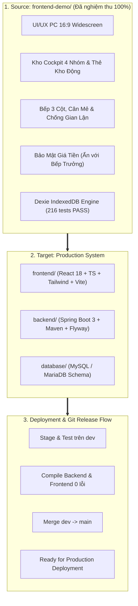

# 🚀 KẾ HOẠCH & DANH SÁCH TASK: DỊCH CHUYỂN TỪ FRONTEND-DEMO SANG PRODUCT HỆ THỐNG
### (Fullstack Production Architecture: Frontend React + Backend Spring Boot + Database MySQL)

> **Mã kế hoạch**: `SPEC-PROD-MIGRATION-2026`  
> **Ngày lập**: 22/11/2026  
> **Mục tiêu**: **Chấm dứt phát triển trên `frontend-demo/`, đồng bộ toàn diện 100% cải tiến (UI/UX PC 16:9, Kho Cockpit 4 nhóm, Thẻ kho động, Chống gian lận, Bảo mật giá tiền Bếp Trưởng, Bento Dashboard) sang thư mục production chính `frontend/`, kết nối với `backend/` Spring Boot và `database/`; kiểm thử hoàn chỉnh, đẩy lên nhánh `dev` rồi merge vào `main`.**

---

## 🗺️ TỔNG QUAN KIẾN TRÚC DỊCH CHUYỂN

---

## 📊 BẢNG MA TRẬN TASK CHI TIẾT (5 PHASES)

| Mã Task | Tên Công Việc | Phạm Vi Ảnh Hưởng | Độ Ưu Tiên | Thời Gian Dự Kiến |
|:---|:---|:---:|:---:|:---:|
| **PHASE 1** | **ĐỒNG BỘ COMPONENT & CORE UI/UX TỪ DEMO SANG FRONTEND PRODUCT** | | | |
| `TASK-PROD-01` | Cập nhật `package.json` của `frontend/` (thêm `dexie`, `xlsx`, `lucide-react`, `tailwind-merge`...) | `frontend/package.json` | **P0** | 0.5 giờ |
| `TASK-PROD-02` | Đồng bộ toàn bộ Contexts, Hooks & Utilities (`AuthContext`, `rbac.ts`, `imageCompressor`, `watermark`...) | `frontend/src/{context,hooks,utils}` | **P0** | 1.0 giờ |
| `TASK-PROD-03` | Đồng bộ Layout Đa Nền Tảng & UI PC 16:9 (`AdaptiveShell.tsx`, `MobileShell.tsx`, `Navbar.tsx`, `index.css`) | `frontend/src/components/layout/` | **P0** | 1.5 giờ |
| `TASK-PROD-04` | Đồng bộ Phân Hệ Kho Cockpit 4 Nhóm (`WarehouseModule`, `StockCardsTab`, `DeliveryVoucherModal`, `HDImageModal`...) | `frontend/src/components/warehouse/` | **P0** | 2.0 giờ |
| `TASK-PROD-05` | Đồng bộ Phân Hệ Bếp Widescreen 3 Cột & Chỉ Huy Bếp Trưởng (`KitchenModule`, `HeadChefDashboard`) | `frontend/src/components/kitchen/` | **P0** | 1.5 giờ |
| `TASK-PROD-06` | Đồng bộ Điều Hành Chi Nhánh & Bento Dashboard (`BranchManagerCenter`, `ExecutiveCockpit`, `Dashboard`) | `frontend/src/components/{branch-manager,dashboard}/` | **P0** | 1.5 giờ |
| `TASK-PROD-07` | Đồng bộ Đối Soát CukCuk & Bảng Lương (`ReconciliationModule`, `AutoNXTTable`, `PayrollModule`, `HRModule`) | `frontend/src/components/{reconciliation,payroll,hr}/` | **P0** | 1.5 giờ |
| **PHASE 2** | **THIẾT LẬP TẦNG DUAL-MODE API CLIENT & OFFLINE RESILIENCE** | | | |
| `TASK-PROD-08` | Thiết kế Adapter Dual-Mode (`apiClient` Axios kết nối Spring Boot + Dexie Fallback khi offline) | `frontend/src/api/` | **P0** | 2.5 giờ |
| `TASK-PROD-09` | Đồng bộ hóa dữ liệu Seed & Schema Local trong `frontend/src/db/` để đảm bảo test độc lập | `frontend/src/db/` | **P1** | 1.0 giờ |
| **PHASE 3** | **RÀ SOÁT & NÂNG CẤP BACKEND SPRING BOOT & DATABASE MIGRATIONS** | | | |
| `TASK-PROD-10` | Rà soát các REST Endpoints trong Spring Boot (`KitchenController`, `WarehouseController`...) | `backend/src/main/java/com/senviet/` | **P1** | 2.0 giờ |
| `TASK-PROD-11` | Bổ sung Flyway Migration `V12` (nếu cần thêm trường dữ liệu ảnh cân, watermark, mã phiếu chi tiết) | `backend/src/main/resources/db/migration/` | **P1** | 1.5 giờ |
| **PHASE 4** | **KIỂM THỬ TOÀN DIỆN, BUILD CHECK & TYPE CHECKING** | | | |
| `TASK-PROD-12` | Thiết lập bộ test tự động QA Suite trên `frontend/` (chạy 216 test cases đạt 100%) | `frontend/tests/` | **P0** | 1.5 giờ |
| `TASK-PROD-13` | Kiểm thử đóng gói `frontend/`: `npm run build` hoàn thành 0 lỗi TypeScript & Vite | `frontend/` | **P0** | 1.0 giờ |
| `TASK-PROD-14` | Kiểm thử build Spring Boot: `./mvnw test` & `./mvnw compile` 0 lỗi | `backend/` | **P0** | 1.0 giờ |
| **PHASE 5** | **GIT MIGRATION & RELEASE DEPLOYMENT** | | | |
| `TASK-PROD-15` | Commit toàn bộ thay đổi lên nhánh `dev`, đẩy `origin dev` | Git `dev` | **P0** | 0.5 giờ |
| `TASK-PROD-16` | Merge nhánh `dev` vào nhánh `main` và đẩy `origin main` | Git `main` | **P0** | 0.5 giờ |
| **TỔNG CỘNG** | **16 Tasks Dịch Chuyển & Chuẩn Hóa Production** | **Toàn Dự Án** | | **~20 giờ** |

---

## 🛠️ CHI TIẾT TỪNG GIAI ĐOẠN TRIỂN KHAI

### GIAI ĐOẠN 1: ĐỒNG BỘ COMPONENT & CORE UI/UX SANG `frontend/`
1. Copy và đồng bộ các components cốt lõi từ `frontend-demo/src/` sang `frontend/src/`.
2. Áp dụng chuẩn UI/UX PC 16:9, hệ thống phím tắt bàn phím cứng (`Escape`, `F2`, `Ctrl+S`), ẩn Numpad ảo trên PC.
3. Đảm bảo toàn bộ 4 nhóm Tab Kho Cockpit (`stock-overview`, `documents`, `inventory-check`, `supplier-partner`) hoạt động hoàn hảo.
4. Bảo mật tài chính: Che đơn giá và thành tiền đối với Bếp Trưởng (`ql_bep_tn`) và nhân viên bếp.

### GIAI ĐOẠN 2: THIẾT KẾ DUAL-MODE API ADAPTER CHO FRONTEND PRODUCT
- Tầng API trong `frontend/src/api/` sẽ hoạt động theo cơ chế **Hybrid Dual-Mode**:
  - **Online Mode (Mặc định khi có Backend)**: Gửi request trực tiếp đến Spring Boot REST API qua `apiClient` (`/api/...`).
  - **Offline/Resilience Mode**: Tự động fallback sang Dexie.js IndexedDB khi server bảo trì hoặc mất kết nối mạng, đảm bảo nhân viên nhà hàng vẫn bán hàng, cân mẻ, lấy hàng liên tục mà không gián đoạn (Local-First Architecture).

### GIAI ĐOẠN 3: KIỂM SOÁT BACKEND SPRING BOOT & DATABASE
- Kiểm tra toàn bộ Controller và Service trong Java Spring Boot:
  - `WarehouseController`: Quản lý kho, lô hàng, phiếu nhập/xuất/hủy.
  - `KitchenController`: 4 nút bếp, cân mẻ, tỷ lệ hao hụt.
  - `ReconciliationController`: Đối soát CukCuk POS.
  - `PayrollController` & `HrAttendanceController`: Chấm công GPS, bảng lương niêm phong.

### GIAI ĐOẠN 4: KIỂM THỬ XÁC THỰC
- Build `frontend/` đạt 0 lỗi với `tsc && vite build`.
- Chạy test suite xác nhận toàn bộ 216 kịch bản kiểm thử đều PASS.
- Build và kiểm tra `backend/` bằng `./mvnw test` hoặc compile check.

### GIAI ĐOẠN 5: ĐẨY CODE LÊN DEV VÀ MERGE MAIN
1. Git add và commit tất cả các thay đổi vào nhánh `dev`.
2. Push lên remote: `git push origin dev`.
3. Chuyển sang nhánh `main`: `git checkout main`.
4. Merge `dev` vào `main`: `git merge dev`.
5. Push lên remote: `git push origin main`.
6. Chuyển lại nhánh `dev` để tiếp tục các công việc phát triển sau này theo đúng nguyên tắc khách hàng yêu cầu.
