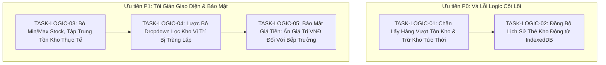

# 📋 KẾ HOẠCH & DANH SÁCH TASK: HOÀN THIỆN LOGIC KHO & TỐI GIẢN TRẢI NGHIỆM VẬN HÀNH THỰC TẾ
### (Hệ thống Nhà hàng Buffet Sen Việt — Dựa trên Feedback Trực tiếp của Khách Hàng)

> **Mã kế hoạch**: `SPEC-LOGIC-WAREHOUSE-REFINED-2026`  
> **Ngày lập**: 21/11/2026  
> **Nguồn phát sinh**: Phản hồi thực nghiệm trực tiếp từ Ban Điều Hành / Chủ Đầu Tư Sen Việt Buffet  
> **Đối tượng thực hiện**: Đội ngũ lập trình viên Frontend, Backend & Database

---

## 🌟 I. GHI NHẬN CẢM NHẬN TÍCH CỰC & LỜI KHEN TỪ KHÁCH HÀNG

Trước khi đi vào các điểm lỗi logic cần khắc phục, Ban Điều Hành đánh giá rất cao sự tiến bộ vượt bậc của sản phẩm:

> 💬 *"Phải nói là **UI/UX hiện tại rất tốt**!"*  
> 💬 *"Cột **Thẻ kho khá hay, ấn vào là xem được xuất ra dùng và nhập hàng về luôn**!"*  
> 💬 *"Chỗ **tìm kiếm rất ấn tượng vì không phải xổ xuống chọn hàng** (Search-as-you-type gõ đến đâu ra đến đó rất nhanh và tiện)!"*

Đây là 3 điểm sáng then chốt chứng minh hướng đi kiến trúc và trải nghiệm giao diện đang rất đúng đắn. Việc cần làm ngay bây giờ là **"vá" triệt để các lỗi logic nghiệp vụ ngầm bên dưới** để hệ thống hoạt động chuẩn xác 100% như vận hành thực tế.

---

## ⚠️ II. 4 LỖI LOGIC & ĐIỂM BẤT CẬP NGHIỆP VỤ CẦN HOÀN THIỆN GẤP

1. **Lỗi logic Nút 1 (Lấy hàng ra bếp)**:
   - *Hiện tượng*: Kho thực tế chỉ có 21 kg cá hồi nhưng nhập lấy 200 kg hệ thống vẫn cho lấy thành công; sau đó mở Kho ra thì số lượng tồn kho vẫn giữ nguyên không hề bị trừ!
   - *Nguyên nhân kỹ thuật*: Form lấy hàng thiếu bước đối chiếu số lượng tồn khả dụng trước khi submit; hàm `recordTakeOut` chưa ràng buộc `validateStock` và giao dịch thẻ kho trong modal Thẻ kho đang đọc dữ liệu tĩnh/mock mà chưa nối động với `db.takeOutLogs`.
2. **Chỉ số lý thuyết rườm rà, không thực tế**:
   - Các cột `Min Stock`, `Max Stock`, và các cảnh báo `Overstock` mang tính lý thuyết quản trị nhà máy, trong nhà hàng buffet không có ý nghĩa vận hành thực tế và làm rối mắt người dùng.
3. **Trùng lặp thanh công cụ lọc vị trí kho**:
   - Bên cạnh thanh lọc nhóm thực phẩm (Bán thành phẩm, Hải sản, Rau củ, Bar...) lại có thêm 1 dropdown chọn vị trí kho (Kho đông lạnh, Kho mát, Kho khô...). Khách hàng thấy thừa thãi và gây rườm rà.
4. **Hở sườn bảo mật tài chính — Bếp Trưởng xem được giá tiền**:
   - Hiện tại Bếp Trưởng (`ql_bep_tn`) vẫn nhìn thấy đơn giá và tổng giá trị tồn kho (VNĐ). Khách hàng yêu cầu: **Bếp Trưởng chỉ quản lý SỐ LƯỢNG (Kg, Con, Túi...) và chất lượng/hao hụt, tuyệt đối không được xem giá tiền** (giống hệt nhân viên bếp). Chỉ Kế toán và Chủ chuỗi mới có quyền xem tiền.

---

## 🗺️ TỔNG QUAN 5 TASK HOÀN THIỆN LOGIC CHO DEV



---

## 🛠️ CHI TIẾT TỪNG TASK KỸ THUẬT CHO DEV

---

### 📌 TASK-LOGIC-01: Chặn Lấy Hàng Vượt Tồn Kho & Khấu Trừ Tồn Kho Tức Thời
- **Mã task**: `TASK-LOGIC-01`
- **Mức độ ưu tiên**: **P0 (Lỗi nghiêm trọng nhất khách vừa test)**
- **Thời gian ước lượng**: 2.5 giờ
- **Vị trí code cần sửa**:
  - `frontend-demo/src/components/kitchen/KitchenModule.tsx`
  - `frontend-demo/src/api/kitchen.ts`
- **Mô tả công việc**:
  1. **Hiển thị Tồn Kho Khả Dụng ngay trên Form Lấy Hàng (Nút 1)**:
     - Khi Bếp chọn một món ăn (ví dụ: *Cá hồi phi lê Nauy*), ngay dưới ô chọn món hoặc bên cạnh ô số lượng phải hiện nhãn trực quan:  
       👉 `Tồn kho khả dụng hiện tại: 21.50 kg` (hoặc con, gói).
  2. **Validation Chặn Cứng (Strict Validation)**:
     - Nếu người dùng nhập `Số lượng lấy > Tồn kho khả dụng`:
       - Ô số lượng viền đỏ cảnh báo.
       - Nút *"Xác nhận xuất kho"* bị disable.
       - Bấm Enter hoặc submit $\rightarrow$ Bắn thông báo lỗi đỏ: `⚠️ Số lượng yêu cầu (200 kg) vượt quá tồn kho hiện tại (21.50 kg). Vui lòng kiểm tra lại!`.
  3. **Khấu Trừ Tồn Kho Thực Tế 100% trong IndexedDB**:
     - Trong hàm `recordTakeOut`: Khấu trừ chính xác `currentStock` trong bảng `inventoryLots` của chi nhánh hiện tại.
     - Sau khi lấy hàng thành công, số lượng tồn kho của mặt hàng đó trong toàn bộ hệ thống (Kho, Thẻ kho, Bảng NXT) phải giảm đúng số kg đã lấy ngay lập tức.
- **Tiêu chí nghiệm thu (DoD)**:
  - Chọn Cá hồi (tồn 21kg) $\rightarrow$ Gõ 200kg $\rightarrow$ Bị chặn đỏ ngay lập tức, không thể bấm lưu.
  - Gõ 5kg $\rightarrow$ Bấm lưu thành công $\rightarrow$ Quay lại phân hệ Kho kiểm tra thấy Cá hồi còn đúng 16kg (21 - 5).

---

### 📌 TASK-LOGIC-02: Đồng Bộ Lịch Sử Thẻ Kho Động Từ IndexedDB (Xóa Mock Data)
- **Mã task**: `TASK-LOGIC-02`
- **Mức độ ưu tiên**: **P0**
- **Thời gian ước lượng**: 2.5 giờ
- **Vị trí code cần sửa**:
  - `frontend-demo/src/components/warehouse/StockCardsTab.tsx`
  - `frontend-demo/src/api/warehouse.ts`
- **Hiện trạng**: Popup Thẻ kho hiện tại đang chứa một số dòng giao dịch tĩnh (`tx-1`, `tx-2`, `tx-3`) làm số liệu tồn hiển thị 21kg cố định, không phản ánh các lần xuất nhập mới.
- **Mô tả công việc**:
  1. Xóa bỏ toàn bộ các bản ghi hardcoded trong `generateTransactions()`.
  2. Nối động 100% lịch sử giao dịch từ 2 nguồn trong IndexedDB:
     - Các phiếu Nhập kho / Xuất hủy từ bảng `warehouseDocuments`.
     - Các lần Bếp lấy hàng chế biến từ bảng `takeOutLogs`.
  3. Hiển thị dòng thời gian chuẩn mực:
     - Cột: *Ngày giờ | Mã phiếu/Mã xuất | Loại giao dịch (Nhập / Xuất bếp / Xuất hủy) | SL Nhập (+) | SL Xuất (-) | Tồn lũy kế | Người thực hiện | Ghi chú*.
- **Tiêu chí nghiệm thu (DoD)**:
  - Bếp vừa lấy 5kg cá hồi lúc 10:15 $\rightarrow$ Mở Thẻ kho cá hồi thấy ngay dòng: `10:15 | PXK-CB-... | 🍳 Xuất bếp nấu line | Xuất: 5.00 kg | Tồn: 16.00 kg | NV: bep_tn`.

---

### 📌 TASK-LOGIC-03: Tối Giản Bảng Kho: Lược Bỏ Min/Max Stock, Tập Trung Tồn Thực Tế
- **Mã task**: `TASK-LOGIC-03`
- **Mức độ ưu tiên**: **P1 (Yêu cầu trực tiếp của khách hàng)**
- **Thời gian ước lượng**: 1.5 giờ
- **Vị trí code cần sửa**:
  - `frontend-demo/src/components/warehouse/StockCardsTab.tsx`
- **Mô tả công việc**:
  1. **Lược bỏ cột rườm rà**:
     - Ẩn/Xóa cột `Định mức Min` và `Định mức Max` trên bảng Thẻ kho.
     - Xóa bỏ huy hiệu cảnh báo `VƯỢT ĐỊNH MỨC MAX (OVERSTOCK)`.
  2. **Tối ưu hiển thị Cột TỒN KHO THỰC TẾ**:
     - Làm nổi bật cột **`Tồn Thực Tế`**: Chữ to đậm (`text-base font-black text-indigo-950 font-mono`), hiển thị rõ ràng cả số lượng và đơn vị tính (ví dụ: `21.50 kg`, `40 con`, `15 gói`).
     - Nếu hàng hết (`currentStock <= 0`): Hiện huy hiệu đỏ rõ ràng `HẾT HÀNG`.
     - Nếu hàng còn ít (`currentStock <= 5`): Hiện huy hiệu vàng `SẮP HẾT`.
  3. **Tối giản thẻ KPI trên đầu trang**:
     - Chỉ giữ 3 thẻ KPI thực chiến:
       1. *Tổng Số Mặt Hàng Đang Quản Lý*.
       2. *Mặt Hàng Hết Sạch Kho (Cần nhập ngay)*.
       3. *Tổng Giá Trị Tồn Kho (Chỉ hiện cho Kế toán & Giám đốc)*.
- **Tiêu chí nghiệm thu (DoD)**:
  - Bảng kho thoáng mắt, không còn các cột lý thuyết Min/Max; người dùng nhìn vào thấy ngay số lượng tồn thực tế của từng món.

---

### 📌 TASK-LOGIC-04: Lược Bỏ Dropdown Lọc Phân Vùng Kho Bị Trùng Lặp
- **Mã task**: `TASK-LOGIC-04`
- **Mức độ ưu tiên**: **P1 (Yêu cầu trực tiếp của khách hàng)**
- **Thời gian ước lượng**: 1 giờ
- **Vị trí code cần sửa**:
  - `frontend-demo/src/components/warehouse/StockCardsTab.tsx`
- **Mô tả công việc**:
  1. Xóa bỏ Dropdown chọn phân vùng kho vật lý (`warehouseFilter`: *Tất cả kho, Kho đông lạnh, Kho mát, Kho khô, Kho bể hải sản, Kho bar*) đứng cạnh ô tìm kiếm.
  2. Giữ nguyên và nâng tầm thanh lọc **Nhóm Thực Phẩm Buffet** (Bán thành phẩm đông lạnh, Hải sản tươi sống, Thịt, Rau củ, Quầy Bar, Hàng khô tiêu hao). Vì thanh lọc này đã bao hàm đầy đủ tính chất lưu trữ mà lại đúng với tư duy của người làm nhà hàng.
- **Tiêu chí nghiệm thu (DoD)**:
  - Thanh công cụ phía trên bảng kho chỉ còn: **Ô tìm kiếm nhanh (Search-as-you-type)** + **Bộ lọc nhóm thực phẩm buffet** + **Bộ lọc chi nhánh (TN / QV)**. Giao diện cực kỳ gọn gàng, không bị trùng lặp.

---

### 📌 TASK-LOGIC-05: Bảo Mật Tài Chính: Ẩn Hoàn Toàn Giá Tiền Đối Với Bếp Trưởng
- **Mã task**: `TASK-LOGIC-05`
- **Mức độ ưu tiên**: **P0 (Bảo mật tài chính doanh nghiệp)**
- **Thời gian ước lượng**: 1.5 giờ
- **Vị trí code cần sửa**:
  - `frontend-demo/src/components/warehouse/WarehouseModule.tsx`
  - `frontend-demo/src/components/warehouse/StockCardsTab.tsx`
- **Mô tả công việc**:
  1. **Quy tắc phân quyền hiển thị tài chính**:
     - `ROLE_GENERAL_ACCOUNTANT` (Kế toán tổng) & `ROLE_CHU_CHUOI` (Giám đốc): **Xem được 100% giá tiền**.
     - `ROLE_BRANCH_ACCOUNTANT` / `ROLE_KETOAN_CHINHANH`: **Xem được giá tiền tại chi nhánh mình**.
     - `ROLE_QL_BEP` (Bếp Trưởng) & `ROLE_KITCHEN_STAFF` (Bếp viên) & `ROLE_EMPLOYEE`: **TUYỆT ĐỐI KHÔNG ĐƯỢC XEM GIÁ TIỀN**.
  2. **Truyền prop `hideFinancials` trong `WarehouseModule.tsx`**:
     ```typescript
     const isHeadChef = userHasRole(user, 'ROLE_QL_BEP') || user?.username === 'ql_bep_tn';
     const isKitchenStaff = userHasRole(user, 'ROLE_KITCHEN_STAFF');
     const hideFinancials = isHeadChef || isKitchenStaff;
     ```
  3. **Ẩn dữ liệu trên UI khi `hideFinancials = true`**:
     - Ẩn hoàn toàn thẻ KPI "Tổng Giá Trị Tồn Kho (VNĐ)" (hoặc hiển thị `***`).
     - Ẩn cột "Đơn Giá Nhập" và cột "Tổng Giá Trị Tồn Kho (VNĐ)" trên bảng thẻ kho và phiếu nhập.
     - Bếp trưởng chỉ nhìn thấy: Mã hàng, Tên hàng, Đơn vị tính và Số lượng tồn.
- **Tiêu chí nghiệm thu (DoD)**:
  - Đăng nhập tài khoản Bếp trưởng (`ql_bep_tn`) $\rightarrow$ Vào Kho không nhìn thấy bất kỳ con số tiền VNĐ nào.
  - Chuyển sang tài khoản Kế toán (`ketoan_tong`) $\rightarrow$ Hiển thị đầy đủ đơn giá và thành tiền bình thường.

---

## 📊 BẢNG TỔNG HỢP GIAO VIỆC CHO DEV (SPRINT FIX LOGIC)

| Mã Task | Tên Công Việc | Phân Hệ | Người Nhận Việc | Ưu Tiên | Ước Lượng |
|:---|:---|:---:|:---:|:---:|:---:|
| `TASK-LOGIC-01` | Chặn lấy hàng vượt tồn & Trừ kho thực tế tức thời | Bếp / Kho | Fullstack Dev | **P0 (Gấp)** | 2.5 giờ |
| `TASK-LOGIC-02` | Đồng bộ lịch sử Thẻ kho động từ IndexedDB | Kho (`StockCardsTab`) | Frontend Dev | **P0 (Gấp)** | 2.5 giờ |
| `TASK-LOGIC-03` | Lược bỏ Min/Max Stock, làm nổi bật Tồn thực tế | Kho (`StockCardsTab`) | Frontend Dev | **P1** | 1.5 giờ |
| `TASK-LOGIC-04` | Xóa Dropdown vị trí kho bị trùng lặp | Kho (`StockCardsTab`) | Frontend Dev | **P1** | 1.0 giờ |
| `TASK-LOGIC-05` | Bảo mật giá tiền: Ẩn giá trị VNĐ với Bếp Trưởng | Phân quyền Kho | Frontend Dev | **P0 (Gấp)** | 1.5 giờ |
| **TỔNG** | **5 Task Hoàn Thiện Logic & Bảo Mật** | **Kho & Bếp** | | | **~9 giờ làm việc** |

---

## 💡 LỜI NHẮC VẬN HÀNH DÀNH CHO TESTER / KHÁCH HÀNG

Sau khi dev hoàn thành 5 task trên:
1. Bạn vào **Nút 1 (Lấy hàng)** $\rightarrow$ Màn hình sẽ hiện sẵn *"Tồn kho khả dụng: 21 kg"*. Gõ thử 200 kg hệ thống sẽ chặn đỏ ngay, không cho bấm xác nhận.
2. Gõ lấy 5 kg $\rightarrow$ Thành công $\rightarrow$ Mở sang tab **Kho Cơ Sở / Thẻ Kho** $\rightarrow$ Thấy số tồn giảm ngay còn 16 kg.
3. Bấm vào món Cá hồi để xem Thẻ kho $\rightarrow$ Thấy ngay lịch sử xuất dùng 5 kg vừa thực hiện.
4. Ở tài khoản Bếp trưởng, toàn bộ cột giá tiền sẽ tự động được che đi để bảo vệ bí mật kinh doanh!
