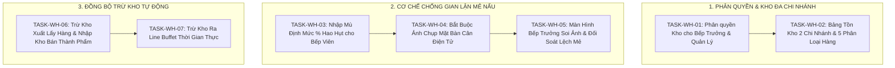

# 📋 ĐẶC TẢ NGHIỆP VỤ & DANH SÁCH TASK CHO THỢ CODE: QUẢN LÝ KHO BUFFET & CƠ CHẾ CHỐNG GIAN LẬN
### (Hệ thống Nhà hàng Buffet Sen Việt — Cơ sở Thái Nguyên & Quế Võ)

> **Mã kế hoạch**: `SPEC-WAREHOUSE-ANTI-THEFT-2026`  
> **Người giao việc**: Ban Điều Hành / Chủ Đầu Tư Sen Việt Buffet  
> **Đối tượng thực hiện**: Đội ngũ lập trình viên (Frontend, Backend, Database)  
> **Mục tiêu tối thượng**: **Bịt kín 100% các lỗ hổng thất thoát nguyên liệu, quản lý kho 2 chi nhánh minh bạch theo thời gian thực, biến Bếp Trưởng thành người gác kho tối cao và cưỡng chế quy trình bằng chứng ảnh chụp bàn cân.**

---

## 🎯 1. BẢN CHẤT NGHIỆP VỤ & TRIẾT LÝ VẬN HÀNH (BẮT BUỘC ĐỌC TRƯỚC KHI CODE)

### 1.1. Bếp Trưởng không nấu ăn — Bếp Trưởng là "Thủ Kho Trưởng" & Giám Sát Chất Lượng
* Trong mô hình buffet công nghiệp (hàng trăm đến hàng nghìn khách/ngày), **Bếp Trưởng tuyệt đối không đứng chảo xào nấu**.
* Trách nhiệm cốt lõi của Bếp Trưởng:
  1. Nắm toàn bộ lượng tồn kho của chi nhánh (nguyên liệu sống, đồ sơ chế đông lạnh, gia vị, đồ uống).
  2. Kiểm soát chặt chẽ việc xuất - nhập - tồn hàng ngày.
  3. Duyệt hủy nguyên liệu hỏng/chết.
  4. Giám sát mẻ nấu và đối chiếu ảnh chụp bàn cân của nhân viên để ngăn chặn hành vi tuồn đồ ra ngoài.
* **Quyền hạn phần mềm**: Bếp Trưởng và Quản Lý Chi Nhánh phải có quyền truy cập và điều hành phân hệ Kho tương đương hoặc cao hơn Thủ kho.

### 1.2. Kho Buffet không chỉ có nguyên liệu thô — Có cả "Bán thành phẩm đông lạnh"
* Kho thực phẩm buffet gồm 5 nhóm rõ rệt:
  1. **Đồ chế biến sẵn / Bán thành phẩm cấp đông**: Các món đã tẩm ướp, nấu chín một phần hoặc làm mẻ sẵn (ví dụ: nước lẩu cô đặc, thịt bò ướp sẵn, sốt me, tôm rim, chả cua) trữ trong kho lạnh để dùng dần.
  2. **Hải sản & Thịt tươi sống**: Cua Cà Mau, Ghẹ Nghệ An, Tôm càng, Hàu, Ba chỉ bò Mỹ, Dẻ sườn...
  3. **Rau củ quả tươi**: Nấm kim châm, cải thảo, rau muống, ngô ngọt...
  4. **Đồ uống / Quầy Bar**: Bia Tiger, Trúc Bạch, Coca, nước ép hoa quả...
  5. **Hàng khô, Gia vị & Tiêu hao**: Bún gạo, dầu ăn, than hoa, khăn lạnh, cồn khô...
* Hệ thống phải cho phép xem tồn kho tách biệt hoặc tổng hợp theo 2 cơ sở: **Thái Nguyên (TN)** và **Quế Võ (QV)**.

### 1.3. Lỗ hổng ăn cắp mẻ nấu & Quy tắc sống còn "NHẬP MÙ ĐỊNH MỨC" (Blind Weighing)
* **Kẽ hở cũ nguy hiểm**: Nếu phần mềm hiện cho nhân viên bếp thấy: *"Định mức hao hụt mẻ này là 8.0%"*, nhân viên nấu 10kg bò ra 9.5kg (thực tế hao 5%), họ sẽ biết ngay mình "thừa" 0.3kg thịt $\rightarrow$ Họ sẽ **lấy bớt 0.3kg giấu vào túi mang về**, rồi chỉ gõ vào phần mềm 9.2kg để vừa khít 8.0%!
* **Quy tắc sống còn mới (Blind Entry)**:
  * Khi nhân viên bếp cân thành phẩm: **TUYỆT ĐỐI CHE (ẨN) ĐỊNH MỨC % HAO HỤT CHUẨN**.
  * Nhân viên chỉ việc cân thực tế, **bắt buộc chụp ảnh mặt bàn cân điện tử (hiện rõ số kg)** rồi tải lên.
  * Nhân viên không được biết mình hao hụt bao nhiêu %, không hiện chữ "Đạt chuẩn" hay "Vượt định mức" trên màn hình của họ.
  * **Chỉ Bếp Trưởng, Quản Lý và Kế Toán** mới xem được bảng so sánh: Số kg đầu vào vs Số kg thành phẩm vs % Định mức chuẩn vs Cảnh báo đỏ mẻ lệch, kèm theo ảnh chụp bàn cân để phóng to soi số đối chứng!

### 1.4. Trừ kho tự động tại 3 điểm chốt chặn
1. **Lấy hàng từ kho (Xuất sơ chế / nấu)**: Trừ ngay kho nguyên liệu thô.
2. **Nấu mẻ xong**: Nhập vào kho Bán thành phẩm / Kho sẵn sàng phục vụ.
3. **Ra line buffet**: Trừ kho bán thành phẩm / hàng sẵn sàng, ghi nhận số lượng đã lên quầy.

---

## 🗺️ TỔNG QUAN DANH SÁCH TASK CHO THỢ CODE



---

## 🛠️ CHI TIẾT CÁC TASK KỸ THUẬT (DÀNH CHO DEV TRIỂN KHAI)

### 📌 TASK-WH-01: Nâng cấp Phân quyền RBAC cho Phân hệ Kho
- **Mã task**: `TASK-WH-01`
- **Mục tiêu**: Bếp Trưởng (`ql_bep_tn`) và Quản Lý Chi Nhánh (`ql_chinhanh_tn`) phải có toàn quyền vào phân hệ Kho (`warehouse`).
- **Tệp cần sửa**:
  - `frontend-demo/src/utils/rbac.ts`
  - `frontend-demo/src/components/layout/AdaptiveShell.tsx`
- **Yêu cầu chi tiết**:
  - Tại hàm `isViewAuthorized(viewId, user)`:
    ```typescript
    case 'warehouse':
      // Cho phép Kế toán chi nhánh, Bếp Trưởng, Quản Lý Chi Nhánh, Kế Toán Tổng và Chủ Chuỗi
      return isBrAcc || isHeadChef || isBranchMgr || isGenAcc || isChuChuoi;
    ```
  - Tại thanh điều hướng `AdaptiveShell.tsx`: Hiển thị tab `Kho Bếp & Lô Hàng` cho Bếp Trưởng và Quản Lý Chi Nhánh (không được ẩn đi như trước).
- **Tiêu chí nghiệm thu (DoD)**:
  - Đăng nhập `ql_bep_tn` (Trần Thị Bếp Trưởng) $\rightarrow$ Menu bên trái có mục "Kho Cơ Sở & Lô Hàng" và bấm vào xem bình thường, không bị văng ra màn hình Access Denied.

---

### 📌 TASK-WH-02: Bảng Tồn Kho Đa Chi Nhánh (TN vs QV) & 5 Nhóm Hàng
- **Mã task**: `TASK-WH-02`
- **Mục tiêu**: Người dùng có thể lọc xem tồn kho của từng cơ sở hoặc gộp cả chuỗi, phân loại đúng đặc thù nhà hàng buffet.
- **Tệp cần sửa**:
  - `frontend-demo/src/components/warehouse/StockCardsTab.tsx`
  - `frontend-demo/src/components/warehouse/WarehouseModule.tsx`
- **Yêu cầu chi tiết**:
  1. **Bộ lọc chi nhánh linh hoạt**:
     - Nút chuyển tab / Dropdown: `[Cơ sở Thái Nguyên (TN)]` | `[Cơ sở Quế Võ (QV)]` | `[Toàn Chuỗi (Tổng kho)]`.
     - Người thuộc chi nhánh nào thì mặc định chọn chi nhánh đó; Bếp trưởng / Kế toán / Giám đốc có thể đổi chi nhánh xem chéo.
  2. **Bộ lọc theo 5 nhóm thực phẩm buffet**:
     - `Tất cả`
     - ❄️ `Bán thành phẩm / Chế biến đông lạnh` (Thịt bò ướp sẵn, sốt lẩu, nem cua làm sẵn...)
     - 🦀 `Hải sản & Thịt tươi sống` (Cua, ghẹ, tôm càng, hàu, ba chỉ...)
     - 🥬 `Rau củ quả tươi` (Nấm, cải thảo, rau lẩu...)
     - 🍺 `Đồ uống & Bar` (Bia, nước ngọt lon, rượu...)
     - 📦 `Hàng khô & Gia vị tiêu hao` (Bún khô, sốt, gia vị, khăn lạnh...)
  3. **Hiển thị cột dữ liệu chuẩn**:
     - Mã hàng | Tên hàng | Nhóm danh mục | Đơn vị tính | **Tồn kho hiện tại** | Định mức an toàn tối thiểu | Giá trị tồn kho ước tính (VNĐ) | Trạng thái (Xanh: Đủ tồn / Đỏ: Sắp hết hàng).
- **Tiêu chí nghiệm thu (DoD)**:
  - Chọn "Cơ sở Quế Võ" $\rightarrow$ Bảng hiển thị đúng số tồn của QV.
  - Chọn nhóm "Bán thành phẩm đông lạnh" $\rightarrow$ Lọc ra đúng danh sách các món chế biến sẵn bảo quản tủ đông.

---

### 📌 TASK-WH-03: Cơ chế "Nhập Mù Định Mức" (Blind Weighing) cho Bếp Viên
- **Mã task**: `TASK-WH-03`
- **Mục tiêu**: Tuyệt đối giấu định mức % hao hụt trước mắt nhân viên bếp lúc cân mẻ để triệt tiêu hành vi làm giả trọng lượng thành phẩm.
- **Tệp cần sửa**:
  - `frontend-demo/src/components/kitchen/KitchenModule.tsx`
- **Yêu cầu chi tiết**:
  1. **Màn hình Mở mẻ mới**:
     - Ẩn dòng chữ `(Chuẩn hao hụt: X.X%)` trên danh sách chọn món của bếp viên.
     - Bếp viên chỉ chọn món và gõ khối lượng nguyên liệu xuất chế biến (Ví dụ: 15.0 kg cá hồi).
  2. **Màn hình Cân thành phẩm mẻ nấu**:
     - Ẩn cột `Chuẩn hụt: X%` trong danh sách các mẻ đang chờ cân.
     - **TUYỆT ĐỐI XÓA BỎ** khối thông tin tính toán tự động:
       - ❌ *Không hiện*: `Hao hụt thực tế: X%`
       - ❌ *Không hiện*: `Chuẩn cho phép: Y%`
       - ❌ *Không hiện*: `CẢNH BÁO: Vượt định mức hao hụt Z%!`
       - ❌ *Không hiện*: `Đạt chuẩn định mức cho phép.`
     - **Giao diện bếp viên chỉ được phép thấy**:
       - Tên mẻ: `BATCH-202611-002 - Cá hồi phi lê Nauy`
       - Khối lượng đầu vào: `15.0 kg`
       - Ô nhập: `Khối lượng thành phẩm sau chế biến (kg)` (Bắt buộc gõ số thực tế).
       - Nút: `[Chụp ảnh / Đính kèm ảnh bàn cân điện tử]` (Bắt buộc).
       - Nút: `[Xác nhận hoàn tất mẻ]`.
- **Tiêu chí nghiệm thu (DoD)**:
  - Nhân viên bếp khi gõ số cân thành phẩm không có cách nào biết được mình hao hụt bao nhiêu % hay mẻ đó có bị lệch chuẩn hay không.

---

### 📌 TASK-WH-04: Bắt Buộc Đính Kèm Ảnh Chụp Mặt Bàn Cân Điện Tử
- **Mã task**: `TASK-WH-04`
- **Mục tiêu**: Không cho phép lưu mẻ chế biến nếu không có ảnh chụp trực tiếp mặt bàn cân hiển thị số kg.
- **Tệp cần sửa**:
  - `frontend-demo/src/components/kitchen/KitchenModule.tsx`
  - `frontend-demo/src/api/kitchen.ts`
  - `frontend-demo/src/db/schema.ts`
- **Yêu cầu chi tiết**:
  1. **Thêm trường dữ liệu**:
     - Bổ sung trường `scalePhotoUrl` (chuỗi base64 hoặc URL ảnh) vào bảng `batches` trong IndexedDB và API payload.
  2. **Validation chặn cứng**:
     - Nếu bấm nút "Xác nhận hoàn tất mẻ" mà chưa chụp/chọn ảnh bàn cân $\rightarrow$ Báo lỗi đỏ nổi bật: `⚠️ BẮT BUỘC chụp ảnh mặt bàn cân điện tử hiển thị rõ số kg thành phẩm để chống gian lận!`.
     - Nút Submit bị disable hoặc chặn validate.
  3. **Hỗ trợ nén ảnh & Camera di động**:
     - Hỗ trợ chụp trực tiếp từ camera điện thoại hoặc chọn ảnh từ thư viện.
     - Tự động nén ảnh qua `compressImage()` để lưu trữ nhẹ nhàng mượt mà trong trình duyệt/database.
- **Tiêu chí nghiệm thu (DoD)**:
  - Nhập số kg thành phẩm nhưng không tải ảnh $\rightarrow$ Hệ thống chặn không cho lưu.
  - Tải ảnh bàn cân hợp lệ $\rightarrow$ Lưu mẻ thành công và hiển thị ảnh thu nhỏ xem trước.

---

### 📌 TASK-WH-05: Màn Hình Bếp Trưởng & Quản Lý Soi Ảnh Cân Đối Soát Mẻ
- **Mã task**: `TASK-WH-05`
- **Mục tiêu**: Nơi Bếp Trưởng, Quản Lý Chi Nhánh và Kế Toán xem toàn bộ sự thật về mẻ nấu: % hao hụt thực tế vs % định mức chuẩn, cảnh báo đỏ và soi ảnh chụp bàn cân.
- **Tệp cần sửa**:
  - `frontend-demo/src/components/kitchen/HeadChefDashboard.tsx`
  - `frontend-demo/src/components/branch-manager/BranchManagerCenter.tsx`
  - `frontend-demo/src/components/dashboard/ExecutiveCockpit.tsx`
- **Yêu cầu chi tiết**:
  1. **Bảng Đối Soát Mẻ Chế Biến (Chỉ dành cho cấp Quản lý)**:
     - Cột hiển thị: *Mã mẻ | Người nấu | Tên món | Cân đầu vào (kg) | Cân thành phẩm (kg) | **% Hao hụt thực tế** | **% Định mức chuẩn** | **Chênh lệch (%)** | **Ảnh bàn cân** | Trạng thái*.
  2. **Cảnh báo màu sắc thông minh**:
     - 🟢 **Xanh lá**: Hao hụt nằm trong biên độ cho phép ($\le$ Định mức).
     - 🔴 **Đỏ rực**: Vượt định mức hao hụt (Ví dụ: Cá hồi cho phép hụt 8%, thực tế hụt 12% $\rightarrow$ Cảnh báo: `Vượt định mức +4.0% - Nguy cơ ăn bớt nguyên liệu!`).
  3. **Tính năng phóng to ảnh (Lightbox Zoom)**:
     - Bấm vào ảnh bàn cân $\rightarrow$ Mở popup HD xem cận cảnh mặt đồng hồ cân điện tử để đối chiếu xem nhân viên có gõ đúng số trên cân hay gõ bậy.
  4. **Nút phê duyệt mẻ**:
     - Bếp trưởng bấm: `[Xác nhận mẻ hợp lệ]` hoặc `[Lập biên bản giải trình hao hụt]`.
- **Tiêu chí nghiệm thu (DoD)**:
  - Bếp trưởng vào xem thấy danh sách các mẻ của ca, mẻ nào vượt định mức bị tô đỏ nổi bật.
  - Click vào ảnh xem được rõ mặt bàn cân để kiểm tra tính trung thực.

---

### 📌 TASK-WH-06: Trừ Kho Xuất Lấy Hàng & Tự Động Nhập Kho Bán Thành Phẩm
- **Mã task**: `TASK-WH-06`
- **Mục tiêu**: Dòng luân chuyển kho khép kín: Xuất nguyên liệu thô $\rightarrow$ Trừ kho thô $\rightarrow$ Nấu mẻ xong $\rightarrow$ Tăng kho bán thành phẩm đông lạnh.
- **Tệp cần sửa**:
  - `frontend-demo/src/api/kitchen.ts`
  - `frontend-demo/src/api/warehouse.ts`
- **Yêu cầu chi tiết**:
  1. **Khi Bếp bấm "Xác nhận lấy hàng từ kho"**:
     - Trừ số lượng tồn kho nguyên liệu thô tương ứng tại chi nhánh hiện tại.
     - Tạo bản ghi xuất kho trong thẻ kho (Stock Card Transaction): `Loại: XUẤT_CHẾ_BIẾN`.
  2. **Khi mẻ chế biến hoàn tất thành công**:
     - Tạo bản ghi tăng tồn kho cho mặt hàng thành phẩm tương ứng (ví dụ: Thịt bò ướp sẵn, Nước lẩu Tomyum cốt đặc) vào kho chi nhánh.
     - Ghi chú: `Nhập từ mẻ [MÃ_MẺ], khối lượng thành phẩm: X kg`.
- **Tiêu chí nghiệm thu (DoD)**:
  - Lấy 20kg cá hồi thô $\rightarrow$ Tồn kho cá hồi thô giảm đúng 20kg trên thẻ kho.
  - Nấu xong mẻ ra 13.2kg cá hồi sơ chế $\rightarrow$ Tồn kho cá hồi sơ chế tăng 13.2kg.

---

### 📌 TASK-WH-07: Trừ Kho Thời Gian Thực Khi Món "Ra Line Buffet"
- **Mã task**: `TASK-WH-07`
- **Mục tiêu**: Mỗi lần bấm nút "Ra Line (+1)" hoặc xuất khay buffet lên quầy, kho bán thành phẩm phải được khấu trừ tương ứng.
- **Tệp cần sửa**:
  - `frontend-demo/src/components/kitchen/KitchenModule.tsx`
  - `frontend-demo/src/api/kitchen.ts`
- **Yêu cầu chi tiết**:
  - Khi bếp bấm nút "Ra Line (+1)":
    - Hệ thống ghi nhận 1 đơn vị định mức món ra quầy (Ví dụ: 1 khay = 2.5 kg thịt ba chỉ hoặc 1 đĩa = 1 con cua).
    - Khấu trừ trực tiếp số lượng tương ứng trong kho thành phẩm của chi nhánh.
    - Cập nhật số liệu lũy kế vào cột `SL ra line` trong ngày (phục vụ đối soát với số lượng khách ăn CukCuk cuối ca).
- **Tiêu chí nghiệm thu (DoD)**:
  - Bấm Ra line 4 khay tôm càng $\rightarrow$ Tồn kho tôm càng chín giảm 4 khay, bảng đối soát CukCuk ghi nhận đúng 4 khay đã phục vụ khách.

---

## 📊 BẢNG TỔNG HỢP GIAO VIỆC CHO ĐỘI CODE

| Mã Task | Tên Việc | Phân Hệ | Người Phụ Trách Đề Xuất | Độ Khó | Ưu Tiên |
|:---|:---|:---:|:---:|:---:|:---:|
| `TASK-WH-01` | Phân quyền Kho cho Bếp Trưởng & Quản Lý | RBAC / Menu | Frontend Dev | Dễ | **P0 (Làm ngay)** |
| `TASK-WH-02` | Tồn kho 2 chi nhánh & 5 nhóm hàng buffet | Kho / UI | Frontend + Backend | Trung bình | **P0 (Làm ngay)** |
| `TASK-WH-03` | Nhập Mù Định Mức: Che % hao hụt trước bếp viên | Bếp / Cân mẻ | Frontend Dev | Dễ | **P0 (Sống còn)** |
| `TASK-WH-04` | Bắt buộc ảnh chụp bàn cân điện tử khi cân mẻ | Bếp / Camera | Frontend + API | Trung bình | **P0 (Sống còn)** |
| `TASK-WH-05` | Bếp Trưởng soi ảnh cân & đối soát lệch mẻ | Dashboard QL | Frontend Dev | Trung bình | **P1** |
| `TASK-WH-06` | Trừ kho lấy hàng & tăng kho bán thành phẩm mẻ | Kho / Logic | Fullstack Dev | Khá | **P1** |
| `TASK-WH-07` | Trừ kho thời gian thực khi bấm Ra Line buffet | Bếp / Kho | Fullstack Dev | Khá | **P1** |

---

## 💡 LỜI NHẮC CỐT LÕI CHO ĐỘI NGŨ PHÁT TRIỂN

> [!CAUTION]
> **Không bao giờ tin lời khai chay của nhân viên trong nhà hàng Buffet!**  
> Mọi con số cân nặng thành phẩm và báo hỏng **đều vô giá trị nếu không đi kèm ảnh chụp bằng chứng thực tế tại thời điểm cân**.  
> Việc che định mức % không phải là giấu giếm, mà là biện pháp bảo vệ tài sản doanh nghiệp, buộc nhân viên phải làm thật - cân thật - ghi thật.
