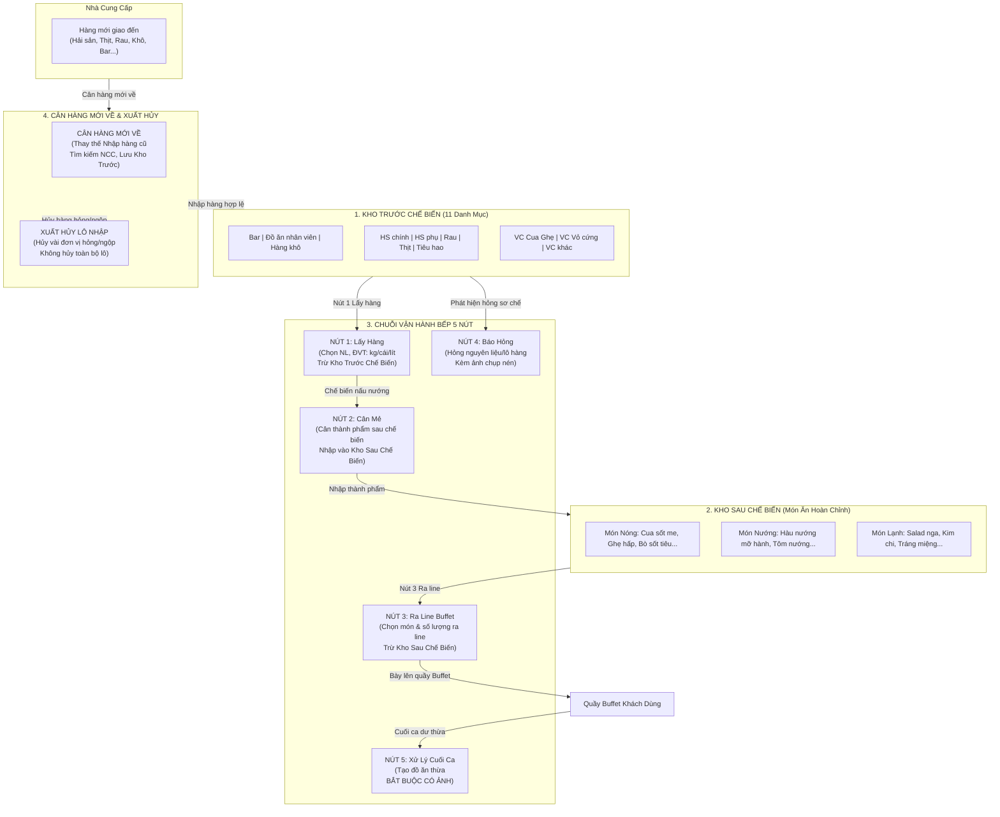

# 🍳 KẾ HOẠCH & DANH SÁCH TASK: TÁI CẤU TRÚC KHO 2 TẦNG (TRƯỚC & SAU CHẾ BIẾN) VÀ CHUẨN HÓA LUỒNG BẾP 5 NÚT
### (Hệ Thống Quản Trị Kho Bếp Sen Việt Buffet — Triển Khai Trực Tiếp Trên Production)

> **Mã kế hoạch**: `SPEC-KITCHEN-5-BUTTONS-DUAL-INVENTORY-2026`  
> **Ngày lập**: 22/11/2026  
> **Nguồn phát sinh**: Chỉ đạo nghiệp vụ trực tiếp từ Ban Điều Hành / Chủ Đầu Tư Sen Việt Buffet  
> **Môi trường thực hiện**: Nhánh `dev` $\rightarrow$ Thư mục `frontend/`, `backend/`, `database/`

---

## 🗺️ I. TỔNG QUAN LUỒNG NGHIỆP VỤ KHO 2 TẦNG & BẾP 5 NÚT

---

## 📊 II. MA TRẬN TASK CHI TIẾT CHO ĐỘI NGŨ SWARM

| Mã Task | Tên Công Việc | Phân Hệ / Tệp Nguồn | Ưu Tiên | Thời Gian |
|:---|:---|:---:|:---:|:---:|
| **`TASK-FLOW-01`** | **Tái Cấu Trúc Mô Hình Dữ Liệu Kho 2 Tầng (Trước & Sau Chế Biến)** • Cấu hình 11 danh mục Kho Trước Chế Biến: `Bar`, `Đồ ăn nhân viên`, `Hàng khô`, `HS chính`, `HS phụ`, `Rau`, `Thịt`, `Tiêu hao`, `VC Cua Ghẹ`, `VC Vỏ cứng`, `VC khác`. • Khởi tạo bảng danh mục và tồn kho **Kho Sau Chế Biến** (gồm các món ăn hoàn chỉnh). | `frontend/src/api/warehouse.ts` `frontend/src/db/seedData.ts` `frontend/src/db/schema.ts` | **P0** | 2.5 giờ |
| **`TASK-FLOW-02`** | **Nút 1 (Lấy Hàng): Chỉ Lấy Từ Kho Trước Chế Biến** • Lựa chọn nguyên liệu theo 11 nhóm Kho Trước Chế Biến. • Hỗ trợ linh hoạt các ĐVT: `kg`, `cái`, `lít`, `con`, `gói`. • Khấu trừ tức thời tồn kho Trước Chế Biến trong DB. | `frontend/src/components/kitchen/KitchenModule.tsx` `frontend/src/api/kitchen.ts` | **P0** | 2.0 giờ |
| **`TASK-FLOW-03`** | **Nút 2 (Cân Mẻ) $\rightarrow$ Nhập Tồn Kho Vào Kho Sau Chế Biến** • Cân khối lượng thành phẩm sau chế biến. • Tự động **nhập thành phẩm vào Kho Sau Chế Biến** của món ăn đó để phục vụ Nút 3 ra line. • Tính % hao hụt đối chiếu với định mức chuẩn. | `frontend/src/components/kitchen/KitchenModule.tsx` `frontend/src/api/kitchen.ts` | **P0** | 2.5 giờ |
| **`TASK-FLOW-04`** | **Nút 3 (Ra Line): Danh Sách Món & Khấu Trừ Kho Sau Chế Biến** • Hiển thị danh sách món ăn trong Kho Sau Chế Biến kèm số lượng tồn khả dụng. • Khi bấm Ra Line (`+1` hoặc nhập số lượng): **khấu trừ chính xác tồn kho Sau Chế Biến**. • Cảnh báo nếu kho sau chế biến không đủ để ra line. | `frontend/src/components/kitchen/KitchenModule.tsx` `frontend/src/api/kitchen.ts` | **P0** | 2.0 giờ |
| **`TASK-FLOW-05`** | **Nút 5: Tạo Đồ Ăn Thừa Cuối Ca (Bắt Buộc Đính Kèm Ảnh)** • Giao diện tạo đồ ăn thừa cuối ca: chọn món, số lượng thừa (kg/đĩa), phân loại (trên line / trong bếp). • **Bắt buộc chụp ảnh mặt bàn cân / thức ăn thừa đính kèm** (nén tự động Canvas API). | `frontend/src/components/kitchen/KitchenModule.tsx` `frontend/src/api/kitchen.ts` | **P0** | 2.0 giờ |
| **`TASK-FLOW-06`** | **Hợp Nhất "Cân Hàng Mới Về" & Xóa Nút Nhập Hàng Cũ** • Xóa bỏ form / nút "Nhập hàng" cũ gây trùng lặp. • Chuẩn hóa "Cân hàng mới về": Tìm kiếm NCC (Search-as-you-type), nhập khối lượng 2 cột, bắt buộc ảnh cân, **lưu trữ mặc định vào Kho Trước Chế Biến** (gắn vào 1 trong 11 nhóm). | `frontend/src/components/warehouse/WarehouseModule.tsx` `frontend/src/api/warehouse.ts` | **P0** | 2.0 giờ |
| **`TASK-FLOW-07`** | **Làm Lại Logic Phiếu Xuất Hủy (Hủy Từng Phần Lô Hàng Nhập)** • Chọn lô hàng vừa nhập về, nhập số lượng hủy cụ thể (ví dụ: hủy 2.5kg trên lô 50kg cua chết/ngộp). • Khấu trừ đúng số lượng hủy của lô trong Kho Trước Chế Biến, không hủy cả lô. • Gắn ảnh chụp hỏng và lý do hủy. | `frontend/src/components/warehouse/WarehouseModule.tsx` `frontend/src/api/warehouse.ts` | **P0** | 2.0 giờ |
| **`TASK-FLOW-08`** | **Kiểm Thử Toàn Diện Test Suite 19 & Build Production** • Viết Suite 19 trong `frontend/tests/test_qa_suite.ts` bao phủ toàn bộ luồng 2 kho và 5 nút. • Chạy `npm test` đạt 100% PASS (225+ tests) & `npm run build` 0 lỗi. | `frontend/tests/test_qa_suite.ts` `frontend/` | **P0** | 1.5 giờ |
| **TỔNG CỘNG** | **8 Task Tái Cấu Trúc Kho 2 Tầng & Luồng Bếp 5 Nút** | **Toàn Hệ Thống** | | **~16.5 giờ** |

---

## 🛠️ CHI TIẾT TỪNG TASK THỰC HIỆN

### 1. `TASK-FLOW-01`: 11 Danh Mục Kho Trước Chế Biến & Kho Sau Chế Biến
- **Kho Trước Chế Biến**:
  1. `BAR`: Đồ uống, siro, hoa quả bar, rượu, bia, chè.
  2. `DO_AN_NHAN_VIEN`: Thực phẩm, gạo, gia vị dùng riêng cho ca ăn nhân viên.
  3. `HANG_KHO`: Gia vị, bột, dầu ăn, đồ khô đóng hộp, mì miến.
  4. `HS_CHINH`: Cua biển Cà Mau, Ghẹ xanh, Bề bề, Tôm càng sen, Cá hồi phi lê.
  5. `HS_PHU`: Mực trứng, hàu sữa, ngao hoa, sò lụa, cá viên, ốc móng tay.
  6. `RAU`: Rau muống, cải chíp, nấm kim châm, củ quả tươi, xà lách.
  7. `THIT`: Ba chỉ bò Mỹ cuộn, sườn sụn non, thịt gà, thịt ba chỉ heo.
  8. `TIEU_HAO`: Cồn khô, khăn ướt, màng bọc thực phẩm, găng tay, giấy ăn.
  9. `VC_CUA_GHE`: Lô Cua, Ghẹ sống trong bể sủi oxy.
  10. `VC_VO_CUNG`: Sò huyết, tu hài, ốc hương, ngao hai cùi.
  11. `VC_KHAC`: Các loại vỏ cứng và thủy hải sản đặc biệt khác.
- **Kho Sau Chế Biến**:
  - Gồm các món ăn hoàn chỉnh sẵn sàng phục vụ khách: Cua rang me, Ghẹ hấp sả gừng, Bề bề chiên muối, Tôm càng nướng phô mai, Cá hồi sốt chanh leo, Ba chỉ bò nướng Bulgogi, Hàu nướng mỡ hành, v.v.

### 2. `TASK-FLOW-02`: Nút 1 (Lấy Hàng)
- Lọc theo 11 nhóm Kho Trước Chế Biến.
- Chọn nguyên liệu thô $\rightarrow$ Hiển thị tồn khả dụng $\rightarrow$ Nhập số lượng lấy (kg, cái, lít, con, gói).
- Chặn cứng nếu số lượng lấy > tồn kho khả dụng.
- Khấu trừ tồn kho thô trong Kho Trước Chế Biến.

### 3. `TASK-FLOW-03`: Nút 2 (Cân Mẻ)
- Sau khi bếp nấu xong: Bấm "Cân Xong" $\rightarrow$ Nhập số cân thành phẩm thực tế + chụp ảnh bàn cân.
- **Nhập tự động vào Kho Sau Chế Biến**: Tăng số lượng tồn của món ăn hoàn chỉnh tương ứng.
- Đánh cờ cảnh báo nếu hao hụt vượt định mức.

### 4. `TASK-FLOW-04`: Nút 3 (Ra Line)
- Hiển thị danh sách món ăn đang có trong Kho Sau Chế Biến kèm số lượng tồn khả dụng (ví dụ: *Cua rang me: còn 8 đĩa*).
- Nhấn `+1` hoặc nhập số đĩa mang ra quầy line $\rightarrow$ **Trừ ngay số lượng trong Kho Sau Chế Biến**.
- Báo hết hàng nếu kho sau chế biến $= 0$.

### 5. `TASK-FLOW-05`: Nút 5 (Tạo Đồ Ăn Thừa Cuối Ca)
- Form tạo đồ ăn thừa cuối ca:
  - Chọn món ăn thừa (món trên line hoặc món trong bếp).
  - Nhập khối lượng thừa (kg hoặc đĩa).
  - Chọn lý do: Khách dùng không hết / Quá thời gian trưng bày / Sơ chế dư thừa.
  - **Bắt buộc chụp ảnh mặt bàn cân / thức ăn thừa đính kèm** (Validate chặn lưu nếu thiếu ảnh).

### 6. `TASK-FLOW-06`: Hợp Nhất "Cân Hàng Mới Về"
- Xóa bỏ nút / form "Nhập hàng" cũ.
- Chỉ giữ lại duy nhất nút **"⚖️ CÂN HÀNG MỚI VỀ"**:
  - Tìm kiếm NCC bằng ô gõ nhanh (Search-as-you-type).
  - Cân 2 cột: Cân thực tế vs NCC báo (tính tiền thiếu).
  - Bắt buộc ảnh bàn cân.
  - Phân loại lưu vào **Kho Trước Chế Biến** (thuộc 1 trong 11 nhóm).

### 7. `TASK-FLOW-07`: Logic Phiếu Xuất Hủy Lô Hàng
- Lập phiếu xuất hủy:
  - Chọn lô hàng vừa nhập về (hoặc mặt hàng trong kho trước chế biến).
  - Nhập số lượng hủy (ví dụ: hủy 2.5kg trong lô 50kg).
  - Khấu trừ đúng số lượng hủy của lô, giữ nguyên phần còn lại của lô hàng.
  - Gắn ảnh chụp hỏng và lý do hủy.
