# TÀI LIỆU ĐẶC TẢ CƠ SỞ DỮ LIỆU (DATABASE SCHEMA SPECIFICATION)
## HỆ THỐNG QUẢN TRỊ KHO BẾP, NHÂN SỰ & CHỐNG THẤT THOÁT — SEN VIỆT BUFFET

> **Dự án**: Sen Việt Buffet Management System  
> **Chủ quản**: Công ty TNHH T&T Nguyễn Dương  
> **Chi nhánh**: 2 Chi nhánh (Thái Nguyên `CN_THAI_NGUYEN` & Quế Võ `CN_QUE_VO`)  
> **Công nghệ lưu trữ**: PostgreSQL 16 (Alpine Container)  
> **Quản lý Migration**: Flyway Migration Engine (11 phiên bản `V1` $\rightarrow$ `V11`)  
> **Encoding**: UTF-8 | **Múi giờ**: `Asia/Ho_Chi_Minh` (`UTC+7`)  
> **Tổng số bảng nghiệp vụ**: **35 bảng** (+ 1 bảng lịch sử `flyway_schema_history`)  

---

## 1. TỔNG QUAN KIẾN TRÚC DỮ LIỆU & QUY TẮC CỐT LÕI

Hệ thống cơ sở dữ liệu được thiết kế theo mô hình **Multi-branch Tenant-isolated Relational Schema** nhằm đáp ứng 4 bài toán lớn:
1. **Cô lập dữ liệu giữa các chi nhánh**: Hầu hết các bảng nghiệp vụ đều có cột `branch_id` liên kết tới bảng `branches`. Các truy vấn kho, chế biến, chấm công, bảng lương đều lọc nghiêm ngặt theo `branch_id` để tránh rò rỉ dữ liệu giữa Thái Nguyên và Quế Võ.
2. **Quy trình Bếp 4 Nút & Chống Gian Lận Cân Mẻ**:
   - Nút 1 (`take_out_logs`): Trừ kho tức thời, cấm rút quá số lượng tồn khả dụng trong kho.
   - Nút 2 (`processing_batches`): Cân nguyên liệu đầu vào, ẩn định mức % hao hụt đối với nhân viên bếp, chụp ảnh cân thành phẩm thực tế, cảnh báo khi mở mẻ thứ hai trùng món.
   - Nút 3 (`damage_reports`): Báo hỏng nguyên liệu kèm nén ảnh qua canvas và quy trình duyệt của Quản lý Bếp.
   - Nút 4 (`line_item_logs`): Ghi nhận số lượng đĩa/khay đưa ra line buffet, cơ chế chống double-click.
3. **Đối Soát Khép Kín Với Doanh Thu POS CukCuk**:
   - Bảng `daily_reconciliations` tự động tính chênh lệch không rõ nguyên nhân theo công thức:  
     $$\text{Lệch} = (\text{Tồn đầu} + \text{Nhập}) - (\text{Xuất chế biến} + \text{Hỏng có báo} + \text{Tồn cuối ngày}) - \text{Khách dùng (CukCuk)}$$
   - Tự động ghi nhật ký cảnh báo Zalo qua `notification_logs` khi số tiền lệch $> 300.000$ đ hoặc tỷ lệ thất thoát $> 5\%$.
4. **Vết Kiểm Toán & Khóa Sổ Tài Chính**:
   - Mọi hành động nhạy cảm đều được ghi lại trong `audit_logs`.
   - Các kỳ tính lương được chốt bằng cờ `is_locked = true` trong `payroll_periods` để ngăn chặn việc sửa đổi số liệu quá khứ.

---

## 2. SƠ ĐỒ THỰC THỂ QUAN HỆ TỔNG QUAN (MERMAID ERD)

```mermaid
erDiagram
    BRANCHES ||--o{ USERS : "thuộc chi nhánh"
    BRANCHES ||--o{ INVENTORY_STOCKS : "quản lý kho"
    BRANCHES ||--o{ PROCESSING_BATCHES : "mẻ chế biến"
    BRANCHES ||--o{ DAILY_RECONCILIATIONS : "đối soát cuối ngày"
    BRANCHES ||--o{ ATTENDANCES : "chấm công"
    BRANCHES ||--o{ PAYROLLS : "tính lương"

    USERS ||--o{ USER_ROLES : "sở hữu"
    ROLES ||--o{ USER_ROLES : "gán cho"
    USERS ||--o{ AUDIT_LOGS : "thực hiện"

    ITEMS ||--o{ RECIPES : "món chế biến"
    RECIPES ||--o{ RECIPE_INGREDIENTS : "định mức"
    ITEMS ||--o{ RECIPE_INGREDIENTS : "nguyên liệu thô"
    ITEMS ||--o{ INVENTORY_STOCKS : "tồn kho"
    ITEMS ||--o{ PROCESSING_BATCHES : "thành phẩm mẻ"
    ITEMS ||--o{ TAKE_OUT_LOGS : "rút kho bếp"
    ITEMS ||--o{ DAMAGE_REPORTS : "báo hỏng"
    ITEMS ||--o{ LINE_ITEM_LOGS : "ra line buffet"

    SUPPLIERS ||--o{ IMPORT_BATCHES : "cung cấp"
    ITEMS ||--o{ IMPORT_BATCHES : "lô nguyên liệu"
    IMPORT_BATCHES ||--o{ INVENTORY_STOCKS : "tồn theo lô"
    SUPPLIERS ||--o{ WAREHOUSE_DOCUMENTS : "nhập hàng"
    WAREHOUSE_DOCUMENTS ||--o{ WAREHOUSE_DOCUMENT_ITEMS : "chi tiết phiếu"
    ITEMS ||--o{ WAREHOUSE_DOCUMENT_ITEMS : "mặt hàng"

    CUKCUK_SALES_IMPORTS ||--o{ DAILY_RECONCILIATIONS : "dữ liệu bán"
    ITEMS ||--o{ DAILY_RECONCILIATIONS : "món đối soát"

    USERS ||--o{ ATTENDANCES : "quẹt thẻ GPS"
    USERS ||--o{ UNIFORM_ALLOCATIONS : "nhận đồng phục"
    UNIFORM_ITEMS ||--o{ UNIFORM_ALLOCATIONS : "loại đồng phục"
    USERS ||--o{ RESIGNATION_REQUESTS : "xin nghỉ việc"
    USERS ||--o{ SALARY_ADVANCES : "xin ứng lương"
    USERS ||--o{ PAYROLLS : "bảng lương tháng"
    PAYROLL_PERIODS ||--o{ PAYROLLS : "kỳ lương khóa sổ"
```



---

## 3. CHI TIẾT 6 PHÂN HỆ VÀ 35 BẢNG CƠ SỞ DỮ LIỆU

### PHÂN HỆ 1: XÁC THỰC, PHÂN QUYỀN & CHI NHÁNH (5 BẢNG)

#### 1.1. Bảng `branches` (Danh mục Chi nhánh)
Quản lý các chi nhánh nhà hàng Sen Việt, tọa độ GPS phục vụ chấm công Geofencing bán kính 50m.
* **PK**: `id` (`BIGINT`)
* **Unique**: `branch_code` (`VARCHAR(50)`)

| Tên Cột | Kiểu Dữ Liệu | Nullable | Mặc Định | Mô Tả Nghiệp Vụ |
| :--- | :--- | :---: | :---: | :--- |
| `id` | `BIGINT` | NO | Auto | Khóa chính |
| `branch_code` | `VARCHAR(50)` | NO | | Mã chi nhánh (`CN_THAI_NGUYEN`, `CN_QUE_VO`) |
| `branch_name` | `VARCHAR(150)` | NO | | Tên chi nhánh đầy đủ |
| `address` | `VARCHAR(255)` | YES | | Địa chỉ thực tế của chi nhánh |
| `phone` | `VARCHAR(50)` | YES | | Số điện thoại liên hệ |
| `latitude` | `NUMERIC(10,7)` | YES | | Tọa độ Vĩ độ GPS trung tâm chi nhánh |
| `longitude` | `NUMERIC(10,7)` | YES | | Tọa độ Kinh độ GPS trung tâm chi nhánh |
| `is_active` | `BOOLEAN` | NO | `true` | Trạng thái hoạt động |
| `created_at` | `TIMESTAMPTZ` | NO | `now()` | Thời điểm tạo chi nhánh |
| `updated_at` | `TIMESTAMPTZ` | NO | `now()` | Thời điểm cập nhật cuối cùng |

#### 1.2. Bảng `roles` (Danh mục Vai trò)
Định nghĩa 5 vai trò theo ma trận RBAC doanh nghiệp.
* **PK**: `id` (`BIGINT`)
* **Unique**: `role_name` (`VARCHAR(50)`)

| Tên Cột | Kiểu Dữ Liệu | Nullable | Mặc Định | Mô Tả Nghiệp Vụ |
| :--- | :--- | :---: | :---: | :--- |
| `id` | `BIGINT` | NO | Auto | Khóa chính |
| `role_name` | `VARCHAR(50)` | NO | | Mã vai trò: `ROLE_KITCHEN_STAFF`, `ROLE_HEAD_CHEF`, `ROLE_RESTAURANT_MANAGER`, `ROLE_BRANCH_ACCOUNTANT`, `ROLE_GENERAL_ACCOUNTANT` |
| `description` | `VARCHAR(255)` | YES | | Mô tả chức năng và phạm vi quyền hạn |
| `created_at` | `TIMESTAMPTZ` | NO | `now()` | Thời điểm tạo vai trò |

#### 1.3. Bảng `users` (Danh mục Nhân sự & Người dùng)
Lưu thông tin nhân viên, tài khoản đăng nhập, chi nhánh trực thuộc, tài khoản ngân hàng và mức lương cơ bản.
* **PK**: `id` (`BIGINT`)
* **Unique**: `username` (`VARCHAR(50)`)
* **FK**: `branch_id` $\rightarrow$ `branches(id)`

| Tên Cột | Kiểu Dữ Liệu | Nullable | Mặc Định | Mô Tả Nghiệp Vụ |
| :--- | :--- | :---: | :---: | :--- |
| `id` | `BIGINT` | NO | Auto | Khóa chính |
| `username` | `VARCHAR(50)` | NO | | Tên đăng nhập (duy nhất) |
| `password` | `VARCHAR(255)` | NO | | Mật khẩu băm BCrypt |
| `full_name` | `VARCHAR(100)` | NO | | Họ và tên nhân viên |
| `email` | `VARCHAR(100)` | YES | | Email liên hệ |
| `phone` | `VARCHAR(20)` | YES | | Số điện thoại di động |
| `branch_id` | `BIGINT` | YES | | Chi nhánh làm việc chính |
| `status` | `VARCHAR(30)` | NO | `'ACTIVE'` | Trạng thái: `ACTIVE`, `SUSPENDED`, `RESIGNED` |
| `bank_name` | `VARCHAR(100)` | YES | | Tên ngân hàng nhận lương (Vietcombank, MB...) |
| `bank_account_number`| `VARCHAR(50)` | YES | | Số tài khoản ngân hàng |
| `bank_account_holder`| `VARCHAR(100)` | YES | | Tên chủ tài khoản ngân hàng |
| `base_salary` | `NUMERIC(15,2)`| YES | `7500000` | Mức lương cơ bản thỏa thuận (VNĐ) |
| `role` | `VARCHAR(50)` | YES | | Vai trò chính gán trực tiếp (tùy chọn) |
| `created_at` | `TIMESTAMPTZ` | NO | `now()` | Ngày tạo tài khoản |
| `updated_at` | `TIMESTAMPTZ` | NO | `now()` | Ngày cập nhật gần nhất |

#### 1.4. Bảng `user_roles` (Bảng phân quyền Người dùng - Vai trò)
Hỗ trợ một nhân sự đảm nhiệm đồng thời nhiều vai trò (kiêm nhiệm).
* **PK**: `(user_id, role_id)`
* **FK**: `user_id` $\rightarrow$ `users(id)`, `role_id` $\rightarrow$ `roles(id)`

| Tên Cột | Kiểu Dữ Liệu | Nullable | Mặc Định | Mô Tả Nghiệp Vụ |
| :--- | :--- | :---: | :---: | :--- |
| `user_id` | `BIGINT` | NO | | ID người dùng |
| `role_id` | `BIGINT` | NO | | ID vai trò |
| `role_name` | `VARCHAR(50)` | YES | | Tên vai trò (đệm phục vụ đọc nhanh) |
| `assigned_at` | `TIMESTAMPTZ` | YES | `now()` | Thời điểm gán quyền |

#### 1.5. Bảng `audit_logs` (Nhật ký Vết kiểm toán)
Ghi nhận toàn bộ thao tác thêm, sửa, xóa, duyệt đơn nhạy cảm trong hệ thống.
* **PK**: `id` (`BIGINT`)
* **FK**: `user_id` $\rightarrow$ `users(id)`

| Tên Cột | Kiểu Dữ Liệu | Nullable | Mặc Định | Mô Tả Nghiệp Vụ |
| :--- | :--- | :---: | :---: | :--- |
| `id` | `BIGINT` | NO | Auto | Khóa chính |
| `user_id` | `BIGINT` | YES | | Người thực hiện thao tác |
| `action` | `VARCHAR(100)` | NO | | Hành động (`BATCH_CREATE`, `WEIGH_OUTPUT`, `LOCK_PAYROLL`...) |
| `target_entity` | `VARCHAR(100)` | NO | | Bảng mục tiêu (`processing_batches`, `payrolls`...) |
| `target_id` | `BIGINT` | YES | | ID của bản ghi mục tiêu |
| `details` | `TEXT` | YES | | Chi tiết dữ liệu trước/sau thay đổi (JSON) |
| `ip_address` | `VARCHAR(50)` | YES | | Địa chỉ IP của thiết bị client |
| `created_at` | `TIMESTAMPTZ` | NO | `now()` | Thời điểm ghi log |

---

### PHÂN HỆ 2: VẬN HÀNH BẾP & QUY TRÌNH 4 NÚT (8 BẢNG)

#### 2.1. Bảng `items` (Danh mục Hàng hóa & Món ăn)
Quản lý tất cả mặt hàng: nguyên liệu thô, bán thành phẩm, món line buffet, đồ uống, gia vị.
* **PK**: `id` (`BIGINT`)
* **Unique**: `item_code` (`VARCHAR(50)`)

| Tên Cột | Kiểu Dữ Liệu | Nullable | Mặc Định | Mô Tả Nghiệp Vụ |
| :--- | :--- | :---: | :---: | :--- |
| `id` | `BIGINT` | NO | Auto | Khóa chính |
| `item_code` | `VARCHAR(50)` | NO | | Mã hàng (`THIT_BO_MY`, `CA_HOI_PHI_LE`...) |
| `item_name` | `VARCHAR(150)` | NO | | Tên mặt hàng hiển thị |
| `category` | `VARCHAR(50)` | NO | | Phân loại: `HAI_SAN`, `THIT`, `RAU_CU`, `DO_UONG`, `GIA_VI` |
| `item_type` | `VARCHAR(30)` | NO | `'RAW_MATERIAL'`| Loại: `RAW_MATERIAL`, `SEMI_FINISHED`, `FINISHED_DISH` |
| `unit` | `VARCHAR(20)` | NO | | Đơn vị tính: `kg`, `gam`, `hop`, `chai`, `dia`, `khay` |
| `standard_loss_rate`| `NUMERIC(5,2)`| YES | `0` | % Tỷ lệ hao hụt chế biến tiêu chuẩn cho phép |
| `cost_price` | `NUMERIC(15,2)`| YES | `0` | Giá vốn định mức (ẩn đối với Bếp và Bếp trưởng) |
| `selling_price` | `NUMERIC(15,2)`| YES | `0` | Giá bán niêm yết (nếu có) |
| `is_active` | `BOOLEAN` | NO | `true` | Trạng thái sử dụng |
| `created_at` | `TIMESTAMPTZ` | NO | `now()` | Ngày tạo |
| `updated_at` | `TIMESTAMPTZ` | NO | `now()` | Ngày cập nhật |

#### 2.2. Bảng `recipes` (Công thức & Định mức Món)
Định nghĩa công thức chế biến thành phẩm từ các nguyên liệu thô.
* **PK**: `id` (`BIGINT`)
* **FK**: `item_id` $\rightarrow$ `items(id)` (Món ăn thành phẩm)

| Tên Cột | Kiểu Dữ Liệu | Nullable | Mặc Định | Mô Tả Nghiệp Vụ |
| :--- | :--- | :---: | :---: | :--- |
| `id` | `BIGINT` | NO | Auto | Khóa chính |
| `item_id` | `BIGINT` | NO | | Món thành phẩm đầu ra |
| `recipe_name` | `VARCHAR(150)` | NO | | Tên công thức chế biến |
| `expected_output_weight`| `NUMERIC(10,3)`| YES | | Khối lượng thành phẩm dự kiến (kg) |
| `standard_loss_rate`| `NUMERIC(5,2)`| YES | `0` | Tỷ lệ hao hụt chuẩn cho phép (%) |
| `instructions` | `TEXT` | YES | | Hướng dẫn các bước nấu/sơ chế |
| `is_active` | `BOOLEAN` | NO | `true` | Trạng thái áp dụng |
| `created_at` | `TIMESTAMPTZ` | NO | `now()` | Ngày tạo |

#### 2.3. Bảng `recipe_ingredients` (Chi tiết Định mức Nguyên liệu Công thức)
Danh sách nguyên liệu cấu thành 1 mẻ công thức.
* **PK**: `id` (`BIGINT`)
* **FK**: `recipe_id` $\rightarrow$ `recipes(id)`, `ingredient_item_id` $\rightarrow$ `items(id)`

| Tên Cột | Kiểu Dữ Liệu | Nullable | Mặc Định | Mô Tả Nghiệp Vụ |
| :--- | :--- | :---: | :---: | :--- |
| `id` | `BIGINT` | NO | Auto | Khóa chính |
| `recipe_id` | `BIGINT` | NO | | Thuộc công thức nào |
| `ingredient_item_id`| `BIGINT` | NO | | Nguyên liệu thô đầu vào |
| `quantity` | `NUMERIC(10,3)`| NO | | Khối lượng tiêu chuẩn đầu vào cho 1 mẻ (kg) |
| `loss_tolerance_percent`| `NUMERIC(5,2)`| YES | `0` | Biên độ hao hụt cho phép của riêng nguyên liệu này (%) |

#### 2.4. Bảng `take_out_logs` (NÚT 1: Lấy Hàng Ra Chế Biến)
Ghi nhận việc nhân viên bếp lấy nguyên liệu từ kho ra khu vực sơ chế. Trừ tồn kho tức thời.
* **PK**: `id` (`BIGINT`)
* **FK**: `branch_id` $\rightarrow$ `branches(id)`, `item_id` $\rightarrow$ `items(id)`, `user_id` $\rightarrow$ `users(id)`

| Tên Cột | Kiểu Dữ Liệu | Nullable | Mặc Định | Mô Tả Nghiệp Vụ |
| :--- | :--- | :---: | :---: | :--- |
| `id` | `BIGINT` | NO | Auto | Khóa chính |
| `branch_id` | `BIGINT` | NO | | Chi nhánh lấy hàng |
| `item_id` | `BIGINT` | NO | | Nguyên liệu lấy ra |
| `user_id` | `BIGINT` | NO | | Nhân viên bếp thực hiện lấy hàng |
| `quantity` | `NUMERIC(10,3)`| NO | | Khối lượng lấy ra (kg) — Phải $\le$ tồn khả dụng |
| `purpose` | `VARCHAR(100)` | YES | `'CHE_BIEN'` | Mục đích: `CHE_BIEN`, `SO_CHE`, `DE_LINE` |
| `note` | `VARCHAR(255)` | YES | | Ghi chú lý do lấy |
| `created_at` | `TIMESTAMPTZ` | NO | `now()` | Thời điểm bấm nút lấy hàng |

#### 2.5. Bảng `processing_batches` (NÚT 2: Cân Mẻ & Cân Thành Phẩm)
Quản lý quy trình nấu mẻ: Cân đầu vào thô $\rightarrow$ Chế biến $\rightarrow$ Cân thành phẩm đầu ra $\rightarrow$ Chụp ảnh bàn cân $\rightarrow$ Tự động kiểm tra vượt hao hụt.
* **PK**: `id` (`BIGINT`)
* **Unique**: `batch_code` (`VARCHAR(50)`)
* **FK**: `branch_id` $\rightarrow$ `branches(id)`, `item_id` $\rightarrow$ `items(id)`, `recipe_id` $\rightarrow$ `recipes(id)`, `started_by_user_id` $\rightarrow$ `users(id)`, `finished_by_user_id` $\rightarrow$ `users(id)`

| Tên Cột | Kiểu Dữ Liệu | Nullable | Mặc Định | Mô Tả Nghiệp Vụ |
| :--- | :--- | :---: | :---: | :--- |
| `id` | `BIGINT` | NO | Auto | Khóa chính |
| `batch_code` | `VARCHAR(50)` | NO | | Mã mẻ tự sinh duy nhất (`BATCH-20261122-001`) |
| `branch_id` | `BIGINT` | NO | | Chi nhánh chế biến |
| `item_id` | `BIGINT` | NO | | Món thành phẩm đầu ra |
| `recipe_id` | `BIGINT` | YES | | Công thức áp dụng |
| `started_by_user_id`| `BIGINT` | NO | | Nhân viên bấm bắt đầu mẻ |
| `finished_by_user_id`| `BIGINT` | YES | | Nhân viên bấm hoàn tất và cân thành phẩm |
| `input_weight` | `NUMERIC(10,3)`| NO | | Khối lượng nguyên liệu thô đầu vào (kg) |
| `output_weight` | `NUMERIC(10,3)`| YES | | Khối lượng thành phẩm sau chế biến (kg) |
| `standard_loss_rate`| `NUMERIC(5,2)`| YES | | % Hao hụt tiêu chuẩn (ẩn đối với thợ nấu) |
| `actual_loss_rate` | `NUMERIC(5,2)`| YES | | % Hao hụt thực tế: $\frac{\text{Vào} - \text{Ra}}{\text{Vào}} \times 100\%$ |
| `is_over_standard` | `BOOLEAN` | NO | `false` | Cờ cảnh báo nếu hao hụt thực tế $>$ hao hụt chuẩn |
| `scale_image_url` | `TEXT` | YES | | URL ảnh chụp mặt đồng hồ cân thành phẩm (bắt buộc) |
| `status` | `VARCHAR(30)` | NO | `'DANG_LAM'`| Trạng thái: `DANG_LAM`, `HOAN_THANH`, `HUY` |
| `started_at` | `TIMESTAMPTZ` | NO | `now()` | Thời điểm bắt đầu nấu mẻ |
| `finished_at` | `TIMESTAMPTZ` | YES | | Thời điểm cân thành phẩm |
| `note` | `VARCHAR(255)` | YES | | Ghi chú giải trình nếu mẻ bị cháy/chênh lệch |

#### 2.6. Bảng `damage_reports` (NÚT 3: Báo Hỏng Nguyên Liệu)
Ghi nhận hàng hóa bị ôi thiu, vỡ dập, hư hỏng. Bắt buộc chụp ảnh hiện trường và qua xét duyệt của Quản lý Bếp.
* **PK**: `id` (`BIGINT`)
* **FK**: `branch_id` $\rightarrow$ `branches(id)`, `item_id` $\rightarrow$ `items(id)`, `batch_id` $\rightarrow$ `import_batches(id)`, `reported_by_user_id` $\rightarrow$ `users(id)`, `approved_by_user_id` $\rightarrow$ `users(id)`, `supplier_id` $\rightarrow$ `suppliers(id)`

| Tên Cột | Kiểu Dữ Liệu | Nullable | Mặc Định | Mô Tả Nghiệp Vụ |
| :--- | :--- | :---: | :---: | :--- |
| `id` | `BIGINT` | NO | Auto | Khóa chính |
| `branch_id` | `BIGINT` | NO | | Chi nhánh phát hiện hỏng |
| `item_id` | `BIGINT` | NO | | Mặt hàng bị hỏng |
| `batch_id` | `BIGINT` | YES | | Thuộc lô nhập nào |
| `reported_by_user_id`| `BIGINT` | NO | | Nhân viên chụp ảnh báo hỏng |
| `approved_by_user_id`| `BIGINT` | YES | | Quản lý bếp/chi nhánh duyệt |
| `quantity` | `NUMERIC(10,3)`| NO | | Khối lượng hỏng đề xuất hủy (kg) |
| `damage_type` | `VARCHAR(50)` | NO | | Phân loại: `HONG_DO_NCC`, `HONG_KHO`, `HONG_CHẾ_BIEN` |
| `reason` | `VARCHAR(255)` | NO | | Lý do chi tiết (chua, bốc mùi, dập nát...) |
| `image_url` | `TEXT` | NO | | URL ảnh chụp bằng chứng (nén Canvas $\le 250$ KB) |
| `supplier_id` | `BIGINT` | YES | | Nhà cung cấp liên quan (nếu hỏng do NCC để trừ công nợ) |
| `status` | `VARCHAR(30)` | NO | `'CHO_DUYET'`| Trạng thái: `CHO_DUYET`, `DA_DUYET`, `TU_CHOI` |
| `created_at` | `TIMESTAMPTZ` | NO | `now()` | Thời điểm gửi báo cáo |
| `approved_at` | `TIMESTAMPTZ` | YES | | Thời điểm quản lý duyệt |

#### 2.7. Bảng `line_item_logs` (NÚT 4: Bấm Ra Line +1)
Ghi nhận mỗi lần nhân viên bếp đưa đĩa thức ăn/khay thịt ra quầy phục vụ khách.
* **PK**: `id` (`BIGINT`)
* **FK**: `branch_id` $\rightarrow$ `branches(id)`, `item_id` $\rightarrow$ `items(id)`, `user_id` $\rightarrow$ `users(id)`

| Tên Cột | Kiểu Dữ Liệu | Nullable | Mặc Định | Mô Tả Nghiệp Vụ |
| :--- | :--- | :---: | :---: | :--- |
| `id` | `BIGINT` | NO | Auto | Khóa chính |
| `branch_id` | `BIGINT` | NO | | Chi nhánh |
| `item_id` | `BIGINT` | NO | | Món đưa ra line |
| `user_id` | `BIGINT` | NO | | Nhân viên bấm nút |
| `quantity` | `NUMERIC(10,3)`| NO | `1.0` | Số lượng ra line (mặc định 1 đĩa/khay) |
| `request_id` | `VARCHAR(64)` | YES | | Khóa Idempotency Key chống bấm đúp khi mạng lag |
| `created_at` | `TIMESTAMPTZ` | NO | `now()` | Thời điểm ghi nhận ra line |

#### 2.8. Bảng `daily_waste_confirmations` (Biên bản Chốt Hủy Thức Ăn Cuối Ngày)
Ghi nhận khối lượng thức ăn còn thừa trên line buffet bị tiêu hủy khi hết ca phục vụ.
* **PK**: `id` (`BIGINT`)
* **FK**: `branch_id` $\rightarrow$ `branches(id)`, `item_id` $\rightarrow$ `items(id)`, `confirmed_by_user_id` $\rightarrow$ `users(id)`

| Tên Cột | Kiểu Dữ Liệu | Nullable | Mặc Định | Mô Tả Nghiệp Vụ |
| :--- | :--- | :---: | :---: | :--- |
| `id` | `BIGINT` | NO | Auto | Khóa chính |
| `branch_id` | `BIGINT` | NO | | Chi nhánh |
| `item_id` | `BIGINT` | NO | | Món ăn bị hủy trên line |
| `confirmed_by_user_id`| `BIGINT` | NO | | Bếp trưởng/Quản lý chi nhánh xác nhận |
| `waste_weight` | `NUMERIC(10,3)`| NO | | Khối lượng đem đổ hủy (kg) |
| `waste_date` | `DATE` | NO | | Ngày chốt hủy |
| `image_url` | `TEXT` | YES | | Ảnh chụp thùng đổ thức ăn thừa |
| `note` | `VARCHAR(255)` | YES | | Ghi chú tình hình khách ăn thừa |
| `created_at` | `TIMESTAMPTZ` | NO | `now()` | Thời điểm xác nhận |

---

### PHÂN HỆ 3: QUẢN LÝ KHO, LÔ HÀNG & NHÀ CUNG CẤP (7 BẢNG)

#### 3.1. Bảng `suppliers` (Danh mục Nhà Cung Cấp)
Quản lý các đối tác giao nguyên liệu thịt, hải sản, rau củ, đồ khô, đồ uống.
* **PK**: `id` (`BIGINT`)
* **Unique**: `supplier_code` (`VARCHAR(50)`)

| Tên Cột | Kiểu Dữ Liệu | Nullable | Mặc Định | Mô Tả Nghiệp Vụ |
| :--- | :--- | :---: | :---: | :--- |
| `id` | `BIGINT` | NO | Auto | Khóa chính |
| `supplier_code` | `VARCHAR(50)` | NO | | Mã NCC (`NCC_VIFOOD`, `NCC_MEATDELI`...) |
| `supplier_name` | `VARCHAR(150)` | NO | | Tên đơn vị cung ứng |
| `contact_person` | `VARCHAR(100)` | YES | | Người đại diện giao nhận |
| `phone` | `VARCHAR(50)` | YES | | Số điện thoại liên hệ |
| `address` | `VARCHAR(255)` | YES | | Địa chỉ kho nhà cung cấp |
| `debt_balance` | `NUMERIC(15,2)`| NO | `0` | Công nợ hiện tại với nhà cung cấp (VNĐ) |
| `is_active` | `BOOLEAN` | NO | `true` | Trạng thái hợp tác |
| `created_at` | `TIMESTAMPTZ` | NO | `now()` | Ngày tạo |

#### 3.2. Bảng `import_batches` (Quản lý Lô Hàng Nhập Kho)
Theo dõi hạn sử dụng, ngày sản xuất và số lượng của từng đợt nhập để xuất kho theo nguyên tắc FIFO (Hàng nhập trước xuất trước / Hàng cận date xuất trước).
* **PK**: `id` (`BIGINT`)
* **Unique**: `batch_code` (`VARCHAR(50)`)
* **FK**: `branch_id` $\rightarrow$ `branches(id)`, `item_id` $\rightarrow$ `items(id)`, `supplier_id` $\rightarrow$ `suppliers(id)`

| Tên Cột | Kiểu Dữ Liệu | Nullable | Mặc Định | Mô Tả Nghiệp Vụ |
| :--- | :--- | :---: | :---: | :--- |
| `id` | `BIGINT` | NO | Auto | Khóa chính |
| `batch_code` | `VARCHAR(50)` | NO | | Mã lô hàng (`LOT-202611-001`) |
| `branch_id` | `BIGINT` | NO | | Chi nhánh nhập lô |
| `item_id` | `BIGINT` | NO | | Mặt hàng nhập |
| `supplier_id` | `BIGINT` | YES | | Nhà cung cấp xuất kho |
| `initial_quantity` | `NUMERIC(10,3)`| NO | | Khối lượng lúc nhập về (kg) |
| `remaining_quantity`| `NUMERIC(10,3)`| NO | | Khối lượng còn lại trong kho (kg) |
| `unit_price` | `NUMERIC(15,2)`| NO | `0` | Đơn giá nhập thực tế (VNĐ/đơn vị) |
| `manufacture_date` | `DATE` | YES | | Ngày sản xuất |
| `expiry_date` | `DATE` | YES | | Hạn sử dụng của lô hàng |
| `status` | `VARCHAR(30)` | NO | `'CON_HANG'`| Trạng thái: `CON_HANG`, `HET_HANG`, `HET_HAN` |
| `created_at` | `TIMESTAMPTZ` | NO | `now()` | Thời điểm nhập lô |

#### 3.3. Bảng `warehouse_documents` (Phiếu Nhập / Xuất Kho)
Lưu thông tin hóa đơn nhập hàng từ NCC, phiếu xuất kho bếp, phiếu xuất hủy, phiếu điều chuyển.
* **PK**: `id` (`BIGINT`)
* **Unique**: `doc_code` (`VARCHAR(50)`)
* **FK**: `branch_id` $\rightarrow$ `branches(id)`, `supplier_id` $\rightarrow$ `suppliers(id)`, `created_by_user_id` $\rightarrow$ `users(id)`

| Tên Cột | Kiểu Dữ Liệu | Nullable | Mặc Định | Mô Tả Nghiệp Vụ |
| :--- | :--- | :---: | :---: | :--- |
| `id` | `BIGINT` | NO | Auto | Khóa chính |
| `doc_code` | `VARCHAR(50)` | NO | | Số phiếu (`PNK-202611-001`, `PXK-202611-005`) |
| `doc_type` | `VARCHAR(30)` | NO | | Loại phiếu: `NHAP_NCC`, `XUAT_BEP`, `XUAT_HUY`, `DIEU_CHUYEN` |
| `branch_id` | `BIGINT` | NO | | Chi nhánh lập phiếu |
| `supplier_id` | `BIGINT` | YES | | Nhà cung cấp (với phiếu nhập) |
| `created_by_user_id`| `BIGINT` | YES | | Nhân viên/Bếp trưởng/Thủ kho lập phiếu |
| `status` | `VARCHAR(30)` | NO | `'HOAN_THANH'`| Trạng thái: `TAM_TINH`, `HOAN_THANH`, `DA_HUY` |
| `total_amount` | `NUMERIC(15,2)`| NO | `0` | Tổng giá trị phiếu nhập/xuất (VNĐ) |
| `image_urls` | `TEXT` | YES | | Danh sách link ảnh chụp phiếu giao hàng/hóa đơn NCC |
| `note` | `VARCHAR(255)` | YES | | Diễn giải nội dung nhập xuất |
| `created_at` | `TIMESTAMPTZ` | NO | `now()` | Ngày lập phiếu |
| `updated_at` | `TIMESTAMPTZ` | NO | `now()` | Ngày cập nhật |

#### 3.4. Bảng `warehouse_document_items` (Chi Tiết Mặt Hàng Trong Phiếu Kho)
* **PK**: `id` (`BIGINT`)
* **FK**: `document_id` $\rightarrow$ `warehouse_documents(id)`, `item_id` $\rightarrow$ `items(id)`, `batch_id` $\rightarrow$ `import_batches(id)`

| Tên Cột | Kiểu Dữ Liệu | Nullable | Mặc Định | Mô Tả Nghiệp Vụ |
| :--- | :--- | :---: | :---: | :--- |
| `id` | `BIGINT` | NO | Auto | Khóa chính |
| `document_id` | `BIGINT` | NO | | ID phiếu kho |
| `item_id` | `BIGINT` | NO | | Mặt hàng nhập/xuất |
| `batch_id` | `BIGINT` | YES | | Lô hàng liên quan |
| `quantity` | `NUMERIC(10,3)`| NO | | Khối lượng/Số lượng thực nhập hoặc thực xuất |
| `unit_price` | `NUMERIC(15,2)`| NO | `0` | Đơn giá thực tế tại thời điểm lập phiếu |
| `note` | `VARCHAR(255)` | YES | | Ghi chú riêng cho dòng hàng |

#### 3.5. Bảng `inventory_stocks` (Sổ Theo Dõi Tồn Kho Thực Tế)
Lưu số lượng tồn kho theo từng chi nhánh, từng mặt hàng và từng kho (Kho mát, Kho đông lạnh, Kho đồ khô...).
* **PK**: `id` (`BIGINT`)
* **FK**: `branch_id` $\rightarrow$ `branches(id)`, `item_id` $\rightarrow$ `items(id)`, `batch_id` $\rightarrow$ `import_batches(id)`

| Tên Cột | Kiểu Dữ Liệu | Nullable | Mặc Định | Mô Tả Nghiệp Vụ |
| :--- | :--- | :---: | :---: | :--- |
| `id` | `BIGINT` | NO | Auto | Khóa chính |
| `branch_id` | `BIGINT` | NO | | Chi nhánh lưu kho |
| `item_id` | `BIGINT` | NO | | Mặt hàng tồn |
| `batch_id` | `BIGINT` | YES | | Lô hàng (nếu theo dõi chi tiết theo lô) |
| `warehouse_type` | `VARCHAR(50)` | NO | `'KHO_TONG'` | Phân loại kho: `KHO_DONG_LANH`, `KHO_MAT`, `KHO_DO_KHO`, `KHO_BEP` |
| `quantity` | `NUMERIC(10,3)`| NO | `0` | Tổng khối lượng tồn trong kho (kg) |
| `reserved_quantity`| `NUMERIC(10,3)`| NO | `0` | Khối lượng đang được giữ chỗ / đang chế biến dở |
| `available_quantity`| `NUMERIC(10,3)`| NO | `0` | Khối lượng thực tế khả dụng cho phép bếp rút ra |
| `min_stock_level` | `NUMERIC(10,3)`| YES | `0` | Định mức tồn tối thiểu (dưới mức này sẽ cảnh báo nhập) |
| `max_stock_level` | `NUMERIC(10,3)`| YES | | Định mức tồn tối đa |
| `updated_at` | `TIMESTAMPTZ` | NO | `now()` | Thời điểm số dư kho cập nhật gần nhất |

#### 3.6. Bảng `inventory_checks` (Phiếu Kiểm Kê Kho Định Kỳ)
* **PK**: `id` (`BIGINT`)
* **Unique**: `check_code` (`VARCHAR(50)`)
* **FK**: `branch_id` $\rightarrow$ `branches(id)`, `checked_by_user_id` $\rightarrow$ `users(id)`

| Tên Cột | Kiểu Dữ Liệu | Nullable | Mặc Định | Mô Tả Nghiệp Vụ |
| :--- | :--- | :---: | :---: | :--- |
| `id` | `BIGINT` | NO | Auto | Khóa chính |
| `check_code` | `VARCHAR(50)` | NO | | Mã đợt kiểm kê (`KK-202611-001`) |
| `branch_id` | `BIGINT` | NO | | Chi nhánh kiểm kê |
| `checked_by_user_id`| `BIGINT` | NO | | Người phụ trách kiểm kê (Bếp trưởng / Kế toán) |
| `check_date` | `DATE` | NO | | Ngày kiểm kê thực tế |
| `status` | `VARCHAR(30)` | NO | `'HOAN_THANH'`| Trạng thái: `DANG_KIEM`, `HOAN_THANH`, `CAN_XU_LY_LECH` |
| `note` | `VARCHAR(255)` | YES | | Đánh giá tổng quan đợt kiểm kê |
| `created_at` | `TIMESTAMPTZ` | NO | `now()` | Thời điểm tạo phiếu |

#### 3.7. Bảng `inventory_check_items` (Chi Tiết Mặt Hàng Kiểm Kê)
* **PK**: `id` (`BIGINT`)
* **FK**: `check_id` $\rightarrow$ `inventory_checks(id)`, `item_id` $\rightarrow$ `items(id)`, `batch_id` $\rightarrow$ `import_batches(id)`

| Tên Cột | Kiểu Dữ Liệu | Nullable | Mặc Định | Mô Tả Nghiệp Vụ |
| :--- | :--- | :---: | :---: | :--- |
| `id` | `BIGINT` | NO | Auto | Khóa chính |
| `check_id` | `BIGINT` | NO | | Thuộc đợt kiểm kê nào |
| `item_id` | `BIGINT` | NO | | Mặt hàng kiểm đếm |
| `batch_id` | `BIGINT` | YES | | Lô hàng kiểm tra |
| `book_quantity` | `NUMERIC(10,3)`| NO | | Tồn sổ sách theo hệ thống (kg) |
| `actual_quantity` | `NUMERIC(10,3)`| NO | | Tồn thực tế cân đếm được tại kho (kg) |
| `discrepancy_quantity`| `NUMERIC(10,3)`| NO| | Chênh lệch: $\text{Thực tế} - \text{Sổ sách}$ |
| `reason` | `VARCHAR(255)` | YES | | Giải trình lý do lệch (bay hơi, hao hụt tự nhiên, nhầm lẫn) |

---

### PHÂN HỆ 4: ĐỐI SOÁT BÁN HÀNG CUKCUK POS & CHỐNG THẤT THOÁT (4 BẢNG)

#### 4.1. Bảng `cukcuk_sales_imports` (Đợt Nhập Dữ Liệu Bán Hàng Từ POS CukCuk)
Lưu nhật ký các lần kế toán upload file Excel doanh thu xuất từ phần mềm bán hàng CukCuk.
* **PK**: `id` (`BIGINT`)
* **FK**: `branch_id` $\rightarrow$ `branches(id)`, `imported_by_user_id` $\rightarrow$ `users(id)`

| Tên Cột | Kiểu Dữ Liệu | Nullable | Mặc Định | Mô Tả Nghiệp Vụ |
| :--- | :--- | :---: | :---: | :--- |
| `id` | `BIGINT` | NO | Auto | Khóa chính |
| `branch_id` | `BIGINT` | NO | | Chi nhánh đối soát |
| `imported_by_user_id`| `BIGINT` | NO | | Kế toán thực hiện upload file |
| `import_date` | `DATE` | NO | | Ngày bán hàng được import |
| `file_name` | `VARCHAR(255)` | NO | | Tên file Excel CukCuk gốc |
| `total_records` | `INTEGER` | NO | `0` | Tổng số dòng món ăn đọc được |
| `total_sales_amount`| `NUMERIC(15,2)`| NO | `0` | Tổng tiền bán hàng ghi nhận từ POS (VNĐ) |
| `created_at` | `TIMESTAMPTZ` | NO | `now()` | Thời điểm import |

#### 4.2. Bảng `inventory_snapshots` (Ảnh Chụp Tồn Kho Đầu / Cuối Ngày)
Cố định trạng thái tồn kho tại các thời điểm giao ban để làm mốc đối soát chuẩn xác.
* **PK**: `id` (`BIGINT`)
* **FK**: `branch_id` $\rightarrow$ `branches(id)`, `item_id` $\rightarrow$ `items(id)`, `checked_by_user_id` $\rightarrow$ `users(id)`

| Tên Cột | Kiểu Dữ Liệu | Nullable | Mặc Định | Mô Tả Nghiệp Vụ |
| :--- | :--- | :---: | :---: | :--- |
| `id` | `BIGINT` | NO | Auto | Khóa chính |
| `branch_id` | `BIGINT` | NO | | Chi nhánh |
| `item_id` | `BIGINT` | NO | | Mặt hàng |
| `snapshot_date` | `DATE` | NO | | Ngày chốt số tồn |
| `snapshot_type` | `VARCHAR(30)` | NO | | Thời điểm: `DAU_NGAY`, `CUOI_NGAY` |
| `quantity` | `NUMERIC(10,3)`| NO | | Khối lượng tồn được ghi nhận (kg) |
| `checked_by_user_id`| `BIGINT` | YES | | Người kiểm tra và chốt số liệu |
| `created_at` | `TIMESTAMPTZ` | NO | `now()` | Thời điểm tạo bản ghi snapshot |

#### 4.3. Bảng `daily_reconciliations` (Bảng Cân Đối & Báo Cáo Thất Thoát Cuối Ngày)
Bảng trung tâm phát hiện thất thoát nguyên vật liệu. Tự động tính chênh lệch không rõ nguyên nhân giữa kho và POS.
* **PK**: `id` (`BIGINT`)
* **FK**: `branch_id` $\rightarrow$ `branches(id)`, `item_id` $\rightarrow$ `items(id)`

| Tên Cột | Kiểu Dữ Liệu | Nullable | Mặc Định | Mô Tả Nghiệp Vụ |
| :--- | :--- | :---: | :---: | :--- |
| `id` | `BIGINT` | NO | Auto | Khóa chính |
| `reconciliation_date`| `DATE` | NO | | Ngày thực hiện đối soát |
| `branch_id` | `BIGINT` | NO | | Chi nhánh đối soát |
| `item_id` | `BIGINT` | NO | | Mặt hàng đối soát |
| `opening_stock` | `NUMERIC(10,3)`| NO | `0` | Tồn đầu ngày (kg) |
| `imported_stock` | `NUMERIC(10,3)`| NO | `0` | Nhập trong ngày từ NCC (kg) |
| `kitchen_takeout` | `NUMERIC(10,3)`| NO | `0` | Tổng xuất cho bếp chế biến (kg) |
| `reported_damage` | `NUMERIC(10,3)`| NO | `0` | Hỏng hóc có chụp ảnh báo cáo hợp lệ (kg) |
| `pos_sold_quantity`| `NUMERIC(10,3)`| NO | `0` | Số lượng khách đã dùng theo POS CukCuk quy đổi (kg) |
| `closing_stock_actual`| `NUMERIC(10,3)`| NO | `0`| Tồn thực tế kiểm đếm tại kho cuối ngày (kg) |
| `unexplained_loss` | `NUMERIC(10,3)`| NO | `0` | Lệch không rõ nguyên nhân: $(\text{Đầu} + \text{Nhập}) - (\text{Xuất} + \text{Hỏng} + \text{Tồn thực}) - \text{POS}$ |
| `loss_amount` | `NUMERIC(15,2)`| NO | `0` | Quy đổi lượng thất thoát thành tiền (VNĐ) |
| `loss_rate_percent`| `NUMERIC(5,2)`| NO | `0` | Tỷ lệ thất thoát (%) trên tổng nguồn hàng |
| `is_alert_triggered`| `BOOLEAN` | NO | `false`| Bật cờ cảnh báo đỏ nếu thất thoát $> 300.000$ đ hoặc $> 5\%$ |
| `explanation` | `TEXT` | YES | | Giải trình của Bếp trưởng / Quản lý chi nhánh |
| `created_at` | `TIMESTAMPTZ` | NO | `now()` | Thời điểm tạo |

#### 4.4. Bảng `notification_logs` (Nhật Ký Cảnh Báo Zalo Webhook)
* **PK**: `id` (`BIGINT`)
* **FK**: `branch_id` $\rightarrow$ `branches(id)`

| Tên Cột | Kiểu Dữ Liệu | Nullable | Mặc Định | Mô Tả Nghiệp Vụ |
| :--- | :--- | :---: | :---: | :--- |
| `id` | `BIGINT` | NO | Auto | Khóa chính |
| `branch_id` | `BIGINT` | NO | | Chi nhánh xảy ra cảnh báo |
| `notification_type`| `VARCHAR(50)` | NO | | Loại: `LOSS_WARNING`, `BATCH_OVER_STANDARD`, `SALARY_ADVANCE` |
| `recipient_group` | `VARCHAR(100)` | NO | | Nhóm nhận tin (Group Zalo Ban Giám Đốc, Group Chi nhánh) |
| `content` | `TEXT` | NO | | Nội dung tin nhắn gửi qua Webhook |
| `status` | `VARCHAR(30)` | NO | `'SENT'` | Trạng thái gửi: `SENT`, `FAILED`, `RETRYING` |
| `retry_count` | `INTEGER` | NO | `0` | Số lần gửi lại nếu mất kết nối |
| `created_at` | `TIMESTAMPTZ` | NO | `now()` | Thời điểm bắn tin |

---

### PHÂN HỆ 5: NHÂN SỰ, CHẤM CÔNG GPS & ĐỒNG PHỤC (6 BẢNG)

#### 5.1. Bảng `attendances` (Sổ Chấm Công GPS Geofencing)
Lưu lịch sử chấm công Check-in / Check-out, đo khoảng cách Haversine tới chi nhánh (bán kính 50m), ảnh selfie chống gian lận chấm công hộ.
* **PK**: `id` (`BIGINT`)
* **FK**: `branch_id` $\rightarrow$ `branches(id)`, `user_id` $\rightarrow$ `users(id)`

| Tên Cột | Kiểu Dữ Liệu | Nullable | Mặc Định | Mô Tả Nghiệp Vụ |
| :--- | :--- | :---: | :---: | :--- |
| `id` | `BIGINT` | NO | Auto | Khóa chính |
| `user_id` | `BIGINT` | NO | | Nhân viên chấm công |
| `branch_id` | `BIGINT` | NO | | Chi nhánh làm việc |
| `attendance_date` | `DATE` | NO | | Ngày làm việc |
| `shift_name` | `VARCHAR(50)` | NO | `'CA_SANG'`| Ca làm việc: `CA_SANG`, `CA_CHIEU`, `CA_TOI`, `CA_GAY` |
| `check_in_time` | `TIMESTAMPTZ` | NO | | Giờ quẹt vào |
| `check_in_selfie_url`| `TEXT` | YES | | Ảnh selfie lúc check-in |
| `check_in_latitude`| `NUMERIC(10,7)`| YES | | Vĩ độ GPS lúc check-in |
| `check_in_longitude`| `NUMERIC(10,7)`| YES | | Kinh độ GPS lúc check-in |
| `check_in_distance_meters`| `NUMERIC(8,2)`| YES | `0` | Khoảng cách từ vị trí đứng đến chi nhánh (mét) |
| `is_valid_location`| `BOOLEAN` | NO | `true` | Hợp lệ nếu khoảng cách $\le 50$ mét |
| `late_minutes` | `INTEGER` | NO | `0` | Số phút đi muộn so với quy định ca |
| `check_out_time` | `TIMESTAMPTZ` | YES | | Giờ quẹt ra |
| `check_out_selfie_url`| `TEXT` | YES | | Ảnh selfie lúc check-out |
| `check_out_distance_meters`| `NUMERIC(8,2)`| YES | `0`| Khoảng cách lúc check-out (mét) |
| `early_minutes` | `INTEGER` | NO | `0` | Số phút về sớm |
| `work_shift_hours` | `NUMERIC(5,2)`| YES | `8.0` | Số giờ công tiêu chuẩn của ca |
| `actual_hours` | `NUMERIC(5,2)`| YES | `0` | Số giờ làm việc thực tế được ghi nhận |
| `status` | `VARCHAR(30)` | NO | `'DANG_LAM'`| Trạng thái: `DANG_LAM`, `HOAN_THANH`, `NGHI_KHONG_PHEP` |
| `created_at` | `TIMESTAMPTZ` | NO | `now()` | Thời điểm tạo |

#### 5.2. Bảng `exam_questions` (Ngân Hàng Đề Thi Tay Nghề Nội Bộ)
* **PK**: `id` (`BIGINT`)

| Tên Cột | Kiểu Dữ Liệu | Nullable | Mặc Định | Mô Tả Nghiệp Vụ |
| :--- | :--- | :---: | :---: | :--- |
| `id` | `BIGINT` | NO | Auto | Khóa chính |
| `department` | `VARCHAR(50)` | NO | | Bộ phận thi: `BEP`, `BAR`, `PHUC_VU`, `THU_NGAN` |
| `question_type` | `VARCHAR(30)` | NO | | Loại câu hỏi: `TRAC_NGHIEM`, `THUC_HANH_CAN` |
| `question_text` | `TEXT` | NO | | Nội dung câu hỏi nghiệp vụ / kỹ thuật |
| `options_json` | `TEXT` | YES | | Danh sách đáp án lựa chọn (JSON) |
| `correct_answer` | `VARCHAR(255)` | YES | | Đáp án chuẩn xác |
| `score_weight` | `INTEGER` | NO | `10` | Thang điểm câu hỏi |
| `is_active` | `BOOLEAN` | NO | `true` | Đang sử dụng |

#### 5.3. Bảng `exam_submissions` (Bài Thi & Kết Quả Sát Hạch Của Nhân Viên)
* **PK**: `id` (`BIGINT`)
* **FK**: `user_id` $\rightarrow$ `users(id)`, `branch_id` $\rightarrow$ `branches(id)`, `graded_by_user_id` $\rightarrow$ `users(id)`

| Tên Cột | Kiểu Dữ Liệu | Nullable | Mặc Định | Mô Tả Nghiệp Vụ |
| :--- | :--- | :---: | :---: | :--- |
| `id` | `BIGINT` | NO | Auto | Khóa chính |
| `user_id` | `BIGINT` | NO | | Thí sinh dự thi |
| `branch_id` | `BIGINT` | NO | | Chi nhánh |
| `exam_title` | `VARCHAR(150)` | NO | | Tên kỳ sát hạch (Thi hết việc thử việc, Nâng bậc lương) |
| `total_score` | `NUMERIC(5,2)`| NO | `0` | Tổng điểm đạt được |
| `is_passed` | `BOOLEAN` | NO | `false` | Đạt yêu cầu nếu điểm $\ge 80/100$ |
| `graded_by_user_id`| `BIGINT` | YES | | Quản lý/Bếp trưởng chấm thi |
| `evaluation_notes`| `TEXT` | YES | | Nhận xét thái độ và kỹ năng thực tế |
| `exam_date` | `DATE` | NO | | Ngày thi |
| `created_at` | `TIMESTAMPTZ` | NO | `now()` | Thời điểm nộp bài |

#### 5.4. Bảng `uniform_items` (Danh Mục Đồng Phục & Tiền Đặt Cọc)
* **PK**: `id` (`BIGINT`)

| Tên Cột | Kiểu Dữ Liệu | Nullable | Mặc Định | Mô Tả Nghiệp Vụ |
| :--- | :--- | :---: | :---: | :--- |
| `id` | `BIGINT` | NO | Auto | Khóa chính |
| `item_name` | `VARCHAR(150)` | NO | | Tên loại đồng phục (Áo bếp trưởng, Tạp dề, Mũ line...) |
| `deposit_value` | `NUMERIC(15,2)`| NO | `100000` | Mức tiền cọc giữ trên bảng lương khi cấp phát (VNĐ) |
| `created_at` | `TIMESTAMPTZ` | NO | `now()` | Ngày tạo danh mục |

#### 5.5. Bảng `uniform_allocations` (Sổ Cấp Phát & Thu Hồi Đồng Phục)
* **PK**: `id` (`BIGINT`)
* **FK**: `branch_id` $\rightarrow$ `branches(id)`, `user_id` $\rightarrow$ `users(id)`, `uniform_item_id` $\rightarrow$ `uniform_items(id)`, `received_by_user_id` $\rightarrow$ `users(id)`

| Tên Cột | Kiểu Dữ Liệu | Nullable | Mặc Định | Mô Tả Nghiệp Vụ |
| :--- | :--- | :---: | :---: | :--- |
| `id` | `BIGINT` | NO | Auto | Khóa chính |
| `branch_id` | `BIGINT` | NO | | Chi nhánh cấp |
| `user_id` | `BIGINT` | NO | | Nhân viên được nhận đồng phục |
| `uniform_item_id` | `BIGINT` | NO | | Loại đồng phục |
| `quantity` | `INTEGER` | NO | `1` | Số lượng cấp (bộ/chiếc) |
| `deposit_amount` | `NUMERIC(15,2)`| NO | `100000` | Tổng tiền cọc bị giữ |
| `is_returned` | `BOOLEAN` | NO | `false` | Trạng thái: `true` khi đã trả lại đồng phục nguyên vẹn |
| `allocated_date` | `DATE` | NO | | Ngày giao đồng phục |
| `returned_date` | `DATE` | YES | | Ngày trả đồng phục |
| `received_by_user_id`| `BIGINT` | YES | | Quản lý xác nhận thu hồi |
| `note` | `VARCHAR(255)` | YES | | Tình trạng đồng phục khi thu hồi (rách, cũ, mất cúc...) |
| `created_at` | `TIMESTAMPTZ` | NO | `now()` | Thời điểm tạo |

#### 5.6. Bảng `resignation_requests` (Đơn Xin Nghỉ Việc & Ràng Buộc Trả Lương)
Quản lý quy trình nghỉ việc chuẩn hoặc bỏ việc đột xuất. **Chỉ được mở trạng thái chi trả lương giữ lại khi đã thu hồi đầy đủ đồng phục**.
* **PK**: `id` (`BIGINT`)
* **FK**: `branch_id` $\rightarrow$ `branches(id)`, `user_id` $\rightarrow$ `users(id)`, `approved_by_user_id` $\rightarrow$ `users(id)`, `cancelled_by_user_id` $\rightarrow$ `users(id)`

| Tên Cột | Kiểu Dữ Liệu | Nullable | Mặc Định | Mô Tả Nghiệp Vụ |
| :--- | :--- | :---: | :---: | :--- |
| `id` | `BIGINT` | NO | Auto | Khóa chính |
| `user_id` | `BIGINT` | NO | | Nhân viên xin nghỉ |
| `branch_id` | `BIGINT` | NO | | Chi nhánh |
| `resignation_type` | `VARCHAR(50)` | NO | | Phân loại: `NGHI_CO_BAO_TRUOC`, `BO_VIEC_DOT_XUAT` |
| `request_date` | `DATE` | NO | | Ngày nộp đơn |
| `expected_last_day`| `DATE` | NO | | Ngày làm việc cuối cùng dự kiến |
| `reason` | `TEXT` | NO | | Lý do xin nghỉ việc |
| `uniform_returned` | `BOOLEAN` | NO | `false` | Quản lý tick xác nhận đã thu hồi toàn bộ đồng phục |
| `retention_salary_cleared`| `BOOLEAN`| NO | `false`| Kế toán mở thanh toán phần lương giữ lại |
| `approved_by_user_id`| `BIGINT` | YES | | Quản lý chi nhánh duyệt |
| `status` | `VARCHAR(30)` | NO | `'CHO_DUYET'`| Trạng thái: `CHO_DUYET`, `DA_DUYET`, `HOAN_TAT_BAN_GIAO` |
| `created_at` | `TIMESTAMPTZ` | NO | `now()` | Thời điểm tạo |

---

### PHÂN HỆ 6: TIỀN LƯƠNG, ỨNG LƯƠNG & KHÓA SỔ KỲ LƯƠNG (5 BẢNG)

#### 6.1. Bảng `salary_rules` (Quy Tắc Tính Thưởng / Phạt / Phụ Cấp)
* **PK**: `id` (`BIGINT`)
* **FK**: `branch_id` $\rightarrow$ `branches(id)`

| Tên Cột | Kiểu Dữ Liệu | Nullable | Mặc Định | Mô Tả Nghiệp Vụ |
| :--- | :--- | :---: | :---: | :--- |
| `id` | `BIGINT` | NO | Auto | Khóa chính |
| `branch_id` | `BIGINT` | NO | | Chi nhánh áp dụng quy tắc |
| `rule_name` | `VARCHAR(100)` | NO | | Tên quy tắc (Phạt đi muộn, Thưởng chuyên cần...) |
| `rule_type` | `VARCHAR(30)` | NO | | Loại: `PHAT_DI_MUON`, `THUONG_CHUYEN_CAN`, `PHU_CAP_CA_GAY` |
| `condition_threshold`| `NUMERIC(10,2)`| NO | `0` | Mốc điều kiện (ví dụ: $>$ 15 phút đi muộn, làm $\ge 26$ công) |
| `amount` | `NUMERIC(15,2)`| NO | `0` | Số tiền phạt hoặc thưởng tương ứng (VNĐ) |
| `is_active` | `BOOLEAN` | NO | `true` | Trạng thái hiệu lực |

#### 6.2. Bảng `salary_advances` (Đơn Xin Ứng Lương Giữa Tháng)
Quản lý việc nhân viên ứng lương. Số tiền ứng sẽ tự động bị khấu trừ trên bảng lương tháng cuối cùng.
* **PK**: `id` (`BIGINT`)
* **FK**: `branch_id` $\rightarrow$ `branches(id)`, `user_id` $\rightarrow$ `users(id)`, `approved_by_user_id` $\rightarrow$ `users(id)`

| Tên Cột | Kiểu Dữ Liệu | Nullable | Mặc Định | Mô Tả Nghiệp Vụ |
| :--- | :--- | :---: | :---: | :--- |
| `id` | `BIGINT` | NO | Auto | Khóa chính |
| `user_id` | `BIGINT` | NO | | Nhân viên xin ứng |
| `branch_id` | `BIGINT` | NO | | Chi nhánh |
| `amount` | `NUMERIC(15,2)`| NO | | Số tiền xin ứng (tối đa không quá 50% lương thực làm) |
| `advance_date` | `DATE` | NO | | Ngày đề nghị ứng tiền |
| `reason` | `VARCHAR(255)` | NO | | Lý do ứng lương |
| `status` | `VARCHAR(30)` | NO | `'CHO_DUYET'`| Trạng thái: `CHO_DUYET`, `DA_DUYET`, `DA_CHI_TIEN`, `TU_CHOI` |
| `approved_by_user_id`| `BIGINT` | YES | | Quản lý chi nhánh xét duyệt |
| `created_at` | `TIMESTAMPTZ` | NO | `now()` | Thời điểm tạo đơn |

#### 6.3. Bảng `salary_increase_proposals` (Đề Xuất Tăng Lương Nhân Viên)
* **PK**: `id` (`BIGINT`)
* **FK**: `branch_id` $\rightarrow$ `branches(id)`, `user_id` $\rightarrow$ `users(id)`, `approved_by_user_id` $\rightarrow$ `users(id)`

| Tên Cột | Kiểu Dữ Liệu | Nullable | Mặc Định | Mô Tả Nghiệp Vụ |
| :--- | :--- | :---: | :---: | :--- |
| `id` | `BIGINT` | NO | Auto | Khóa chính |
| `user_id` | `BIGINT` | NO | | Nhân viên được đề xuất |
| `branch_id` | `BIGINT` | NO | | Chi nhánh |
| `current_salary` | `NUMERIC(15,2)`| NO | | Mức lương hiện tại (VNĐ) |
| `proposed_salary` | `NUMERIC(15,2)`| NO | | Mức lương mới đề xuất (VNĐ) |
| `reason` | `TEXT` | NO | | Lý do tăng lương (vượt qua kỳ thi sát hạch, thành tích tốt) |
| `effective_date` | `DATE` | NO | | Ngày bắt đầu áp dụng mức lương mới |
| `status` | `VARCHAR(30)` | NO | `'CHO_DUYET'`| Trạng thái: `CHO_DUYET`, `DA_DUYET`, `TU_CHOI` |
| `approved_by_user_id`| `BIGINT` | YES | | Chủ chuỗi / Admin duyệt |
| `created_at` | `TIMESTAMPTZ` | NO | `now()` | Thời điểm đề xuất |

#### 6.4. Bảng `payroll_periods` (Kỳ Tính Lương & Trạng Thái Khóa Sổ)
Quản lý từng chu kỳ tính lương tháng. Khi đã khóa sổ (`is_locked = true`), cấm mọi hành động sửa đổi công hoặc tiền thưởng/phạt.
* **PK**: `id` (`BIGINT`)
* **FK**: `branch_id` $\rightarrow$ `branches(id)`, `locked_by` $\rightarrow$ `users(id)`

| Tên Cột | Kiểu Dữ Liệu | Nullable | Mặc Định | Mô Tả Nghiệp Vụ |
| :--- | :--- | :---: | :---: | :--- |
| `id` | `BIGINT` | NO | Auto | Khóa chính |
| `branch_id` | `BIGINT` | NO | | Chi nhánh tính lương |
| `period_name` | `VARCHAR(50)` | NO | | Tên kỳ lương (`THANG_11_2026`) |
| `start_date` | `DATE` | NO | | Ngày đầu kỳ |
| `end_date` | `DATE` | NO | | Ngày cuối kỳ |
| `is_locked` | `BOOLEAN` | NO | `false` | Cờ khóa sổ (chống sửa đổi số liệu tài chính) |
| `locked_at` | `TIMESTAMPTZ` | YES | | Thời điểm khóa sổ |
| `locked_by` | `BIGINT` | YES | | Kế toán tổng / Chủ chuỗi khóa sổ |
| `created_at` | `TIMESTAMPTZ` | NO | `now()` | Ngày tạo kỳ lương |

#### 6.5. Bảng `payrolls` (Bảng Lương Chi Tiết Từng Nhân Viên)
Tổng hợp toàn bộ công, lương cứng, phụ cấp ca gãy, thưởng chuyên cần, trừ đi các khoản phạt muộn, ứng lương, tiền cọc đồng phục và tính ra thực lĩnh.
* **PK**: `id` (`BIGINT`)
* **FK**: `branch_id` $\rightarrow$ `branches(id)`, `user_id` $\rightarrow$ `users(id)`, `locked_by` $\rightarrow$ `users(id)`

| Tên Cột | Kiểu Dữ Liệu | Nullable | Mặc Định | Mô Tả Nghiệp Vụ |
| :--- | :--- | :---: | :---: | :--- |
| `id` | `BIGINT` | NO | Auto | Khóa chính |
| `period` | `VARCHAR(50)` | NO | | Kỳ lương liên kết (`THANG_11_2026`) |
| `user_id` | `BIGINT` | NO | | Nhân viên nhận lương |
| `branch_id` | `BIGINT` | NO | | Chi nhánh làm việc |
| `standard_work_days`| `NUMERIC(5,2)`| NO | `26.0` | Số ngày công tiêu chuẩn của tháng |
| `actual_work_days` | `NUMERIC(5,2)`| NO | `0` | Số ngày công thực tế đi làm qua GPS |
| `base_salary` | `NUMERIC(15,2)`| NO | `0` | Mức lương cơ bản thỏa thuận |
| `actual_base_salary`| `NUMERIC(15,2)`| NO | `0`| Lương cứng theo ngày công thực tế |
| `allowance` | `NUMERIC(15,2)`| NO | `0` | Tổng phụ cấp (trách nhiệm, ca gãy, ăn trưa) |
| `bonus` | `NUMERIC(15,2)`| NO | `0` | Tiền thưởng (chuyên cần, hiệu suất mẻ bếp) |
| `penalty` | `NUMERIC(15,2)`| NO | `0` | Tổng tiền phạt (đi muộn, bỏ ca, làm cháy mẻ) |
| `advance_deduction`| `NUMERIC(15,2)`| NO | `0` | Tiền đã ứng trong tháng trừ lại |
| `retention_salary` | `NUMERIC(15,2)`| NO | `0` | Tiền giữ lại theo quy chế (10% hoặc cọc đồng phục) |
| `net_salary` | `NUMERIC(15,2)`| NO | `0` | **Thực lĩnh**: $\text{Lương cứng} + \text{Phụ cấp} + \text{Thưởng} - \text{Phạt} - \text{Ứng} - \text{Giữ lại}$ |
| `is_paid` | `BOOLEAN` | NO | `false` | Đã giải ngân chuyển khoản thành công |
| `is_locked` | `BOOLEAN` | NO | `false` | Cờ khóa số liệu cá nhân |
| `locked_at` | `TIMESTAMPTZ` | YES | | Thời điểm khóa |
| `locked_by` | `BIGINT` | YES | | Người khóa |
| `created_at` | `TIMESTAMPTZ` | NO | `now()` | Ngày tính lương |

---

## 4. CHIẾN LƯỢC ĐÁNH CHỈ MỤC TỐI ƯU HIỆU NĂNG (INDEXES)

Để ngăn chặn hoàn toàn lỗi **N+1 Query** và tối ưu tốc độ đọc khi dữ liệu tăng trưởng hàng triệu dòng:

1. **Chỉ mục Cô lập Chi nhánh & Thời gian**:
   - `idx_batches_branch_created`: `processing_batches (branch_id, created_at DESC)`
   - `idx_takeout_branch_created`: `take_out_logs (branch_id, created_at DESC)`
   - `idx_damage_branch_created`: `damage_reports (branch_id, created_at DESC)`
   - `idx_reconcile_branch_date`: `daily_reconciliations (branch_id, reconciliation_date)`
   - `idx_attendance_branch_date`: `attendances (branch_id, attendance_date)`
2. **Chỉ mục Truy vấn Tồn Kho Nhanh**:
   - `idx_stocks_branch_item`: `inventory_stocks (branch_id, item_id)`
   - `idx_stocks_warehouse`: `inventory_stocks (warehouse_type)`
3. **Chỉ mục Truy vấn Khách Hàng / POS CukCuk**:
   - `idx_cukcuk_branch_date`: `cukcuk_sales_imports (branch_id, import_date)`

---

## 5. HƯỚNG DẪN QUẢN LÝ VÀ CHẠY MIGRATION VỚI FLYWAY

Mọi thay đổi cấu trúc bảng trong tương lai **bắt buộc tuân thủ quy tắc**:
1. Không sửa trực tiếp trên production database.
2. Tạo file migration mới theo định dạng: `V<Next_Version>__<Mo_ta_thay_doi>.sql` đặt tại thư mục:
   `backend/src/main/resources/db/migration/`
3. Khi Spring Boot khởi động, Flyway sẽ tự động nhận diện và thực thi tuần tự trong transaction an toàn.

```bash
# Kiểm tra lịch sử migration trực tiếp từ container PostgreSQL:
docker exec -it senviet-postgres psql -U senviet_user -d senviet_db -c "SELECT installed_rank, version, description, success, installed_on FROM flyway_schema_history ORDER BY installed_rank;"
```
