# TÀI LIỆU ĐẶC TẢ CƠ SỞ DỮ LIỆU (DATABASE SCHEMA SPECIFICATION)
## HỆ THỐNG QUẢN TRỊ KHO BẾP, NHÂN SỰ & CHỐNG THẤT THOÁT — SEN VIỆT BUFFET

> **Dự án**: Sen Việt Buffet Management System  
> **Chủ quản**: Công ty TNHH T&T Nguyễn Dương (Đại diện: Chị Thêm)  
> **Chi nhánh ban đầu**: 2 Chi nhánh (Thái Nguyên `CN_THAI_NGUYEN` & Quế Võ `CN_QUE_VO`)  
> **Công nghệ lưu trữ**: PostgreSQL 16 (Container `senviet-postgres`) & IndexedDB Dexie (Offline Resilience Frontend)  
> **Quản lý Migration**: Flyway Migration Engine (13 phiên bản `V1` $\rightarrow$ `V13`)  
> **Encoding**: UTF-8 | **Múi giờ**: `Asia/Ho_Chi_Minh` (`UTC+7`)  
> **Tổng số bảng nghiệp vụ**: **36 bảng** (+ 1 bảng lịch sử `flyway_schema_history`)  

---

## 1. TỔNG QUAN KIẾN TRÚC DỮ LIỆU & QUY TẮC CỐT LÕI

Hệ thống cơ sở dữ liệu được thiết kế theo mô hình **Multi-branch Tenant-isolated Relational Schema** nhằm đáp ứng 5 bài toán lớn của Sen Việt Buffet:

### 1.1. Kiến Trúc Kho 2 Tầng (Dual-Tier Warehouse Inventory)
* **Kho Trước Chế Biến (`items`, `inventory_stocks`, `import_batches`)**:
  * Quản lý toàn bộ **217 mặt hàng nguyên vật liệu thô thực tế** trích xuất từ bảng kê T11/2026 chi nhánh Quế Võ.
  * Phân loại chặt chẽ vào **11 nhóm danh mục chuẩn hóa**:
    1. `HS_CHINH`: Hải sản chính (9 món: Cua thịt, Ghẹ, Bề bề, Hàu, Tôm càng xanh, Tôm sú, Tôm mũ ni, Mực, Ốc hương)
    2. `VC_VO_CUNG`: Hải sản vỏ cứng (8 món: Sò lông, Sò huyết, Vẹm xanh, Ngao hai cùi, Ngao mỡ, Ốc nhồi, Ốc mít, Sò méo)
    3. `HS_PHU`: Hải sản phụ (4 món: Cá lăng, Cá trích, Cá hồi, Tôm lớp)
    4. `THIT`: Thịt & Gia cầm (20 món: Bắp bò, Ba chỉ bò thanh, Cánh gà, Xúc xích, Lườn ngỗng...)
    5. `RAU`: Rau, củ, quả & nấm tươi (70 món: Dứa, Cải canh, Nấm kim châm, Bắp ngô, Mướp...)
    6. `HANG_KHO`: Hàng khô & Gia vị (63 món: Bột bánh xèo, Bánh bao kim sa, Muối Hảo Hảo, Dầu hào...)
    7. `DO_AN_NHAN_VIEN`: Đồ ăn nhân viên ca (15 món: Cá rô phi, Thịt nạc vai, Giò lụa...)
    8. `BAR`: Bar & Đồ uống (3 món: Bia bão tuyết, Rượu Quang Huệ, Đá xay)
    9. `TIEU_HAO`: Vật tư tiêu hao & Vận hành (23 món: Cồn khô, Gas Hồng Lĩnh, Bao đũa, Giấy rút...)
    10. `VC_CUA_GHE`: Vận chuyển Cua, Ghẹ (1 món)
    11. `VC_KHAC`: Vận chuyển Khác (1 món)
  * Cổng nhập duy nhất: Thao tác **`⚖️ CÂN HÀNG MỚI VỀ`** (kiểm tra đối chiếu cân thực tế vs hóa đơn giao nhận NCC).
* **Kho Sau Chế Biến (`processed_dishes`)**:
  * Quản lý các **món ăn hoàn chỉnh** đã nấu chín sẵn sàng đưa lên phục vụ line buffet (Đơn vị tính: `đĩa`, `bát`, `khay`).
  * Ví dụ điển hình: **Hàu nướng mỡ hành** (`DISH-HAU-NUONG`, 16 đĩa tại Quế Võ, 25 đĩa tại Thái Nguyên), **Cua sốt me**, **Ghẹ hấp sả**, **Bò sốt tiêu đen**, **Tôm sú nướng muối ớt**...
  * Liên kết công thức định mức nguyên liệu trước chế biến qua bảng `recipes` & `recipe_ingredients`.
  * **Cơ chế biến động tồn đĩa tự động**:
    * **Tăng tồn đĩa (+)**: Khi Nút 2 hoàn tất cân mẻ chế biến (`warehouseApi.addProcessedDishStock`).
    * **Giảm tồn đĩa (-)**: Khi Nút 3 nhân viên bấm ra line buffet (`warehouseApi.deductProcessedDishStock`). Chặn cứng không cho ra line nếu số đĩa tồn $\le 0$.

### 1.2. Quy Trình Vận Hành Bếp 5 Nút Cảm Ứng (Touch-First 5-Button Flow)
* **Nút 1 (`take_out_logs` & `processing_batches`)**: Lấy hàng theo công thức & Tạo mẻ trước chế biến:
  * Nhân viên chọn món ăn cần nấu (Hàu nướng mỡ hành...) $\rightarrow$ Hệ thống tự động bung các nguyên liệu thô theo công thức (Hàu, Hành lá, Mỡ phần...) $\rightarrow$ Nhập số lượng thực tế lấy nấu $\rightarrow$ **Bắt buộc chụp ảnh khay/bàn cân nguyên liệu thô trước chế biến (`raw_photo_url`)** $\rightarrow$ Khấu trừ nguyên liệu khỏi Kho Trước Chế Biến và mở mẻ ở trạng thái `DANG_LAM`.
* **Nút 2 (`processing_batches`)**: Cân thành phẩm mẻ hoàn thành & Nhập Kho Sau Chế Biến:
  * **Đã xóa bỏ nút 2.1 (Mở mẻ mới)** do đã gộp vào Nút 1.
  * Chỉ làm nhiệm vụ: Chọn mẻ đang làm $\rightarrow$ Cân khối lượng thành phẩm (`output_weight`) và quy đổi ra số lượng **ĐĨA** thành phẩm (`output_plates`) $\rightarrow$ **Bắt buộc chụp ảnh mặt bàn cân điện tử (`scale_photo_url`)** $\rightarrow$ Tự động cộng số đĩa vào Kho Sau Chế Biến (`processed_dishes`).
* **Nút 3 (`line_item_logs`)**: Bấm ra line buffet (+1 đĩa):
  * Khấu trừ trực tiếp số đĩa từ Kho Sau Chế Biến (`processed_dishes`). Trang bị cơ chế chống double-click và cảnh báo làm mẻ mới khi hết đĩa.
* **Nút 4 (`damage_reports`)**: Báo hỏng mẻ chế biến:
  * Đầu bếp báo hỏng mẻ bị cháy/khét/sự cố, đính kèm ảnh bằng chứng nén Canvas $\le 250$ KB và gửi Quản lý Bếp duyệt.
* **Nút 5 (`daily_waste_confirmations` & `daily_remaining`)**: Tổng hợp món dùng trong ngày & Chốt đồ ăn thừa cuối ca:
  * Tab 1: Bảng tổng hợp món dùng trong ngày theo công thức:  
    $$\text{Tồn đầu ca} + \text{Nhập Nút 2} - \text{Ra line Nút 3} = \text{Tồn kho sau (Hiện tại)}$$
  * Tab 2: Chốt đồ ăn thừa cuối ca trên line / trong bếp, bắt buộc chụp ảnh bàn cân thức ăn thừa để đối soát với CukCuk POS.
* **Header Bếp**: Đã loại bỏ nút "Cân hàng mới về" khỏi màn hình Bếp để tránh trùng lặp với phân hệ Kho cơ sở.

### 1.3. Cô Lập Dữ Liệu Đa Chi Nhánh (Tenant Isolation)
* Toàn bộ 36 bảng nghiệp vụ đều liên kết chặt chẽ qua khóa ngoại `branch_id` $\rightarrow$ `branches(id)`.
* Mọi truy vấn đọc/ghi đều lọc theo `branch_id` của phiên đăng nhập người dùng, tuyệt đối không rò rỉ dữ liệu tồn kho, giá vốn, doanh thu hay tiền lương giữa Thái Nguyên và Quế Võ.

### 1.4. Đối Soát Khép Kín Với POS CukCuk & Báo Động Zalo
* Bảng `daily_reconciliations` tự động tính chênh lệch không rõ nguyên nhân:  
  $$\text{Lệch} = (\text{Tồn đầu} + \text{Nhập}) - (\text{Xuất chế biến} + \text{Hỏng có báo} + \text{Tồn cuối ngày}) - \text{Khách dùng (CukCuk)}$$
* Tự động gửi cảnh báo qua Zalo Webhook (`notification_logs`) khi thất thoát $> 300.000$ VNĐ hoặc tỷ lệ lệch $> 5\%$.

### 1.5. Vết Kiểm Toán & Khóa Sổ Tài Chính
* Bảng `audit_logs` lưu trữ mọi hành động nhạy cảm: duyệt hủy hàng, chỉnh sửa định mức, khóa kỳ lương.
* Bảng `payroll_periods` sử dụng cờ `is_locked = true` niêm phong dữ liệu lương, cấm sửa đổi lịch sử.

---

## 2. SƠ ĐỒ THỰC THỂ QUAN HỆ TỔNG QUAN (MERMAID ERD)

```mermaid
erDiagram
    BRANCHES ||--o{ USERS : "thuộc chi nhánh"
    BRANCHES ||--o{ INVENTORY_STOCKS : "quản lý kho thô"
    BRANCHES ||--o{ PROCESSING_BATCHES : "mẻ chế biến"
    BRANCHES ||--o{ PROCESSED_DISHES : "kho sau chế biến (đĩa)"
    BRANCHES ||--o{ DAILY_RECONCILIATIONS : "đối soát cuối ngày"
    BRANCHES ||--o{ ATTENDANCES : "chấm công"
    BRANCHES ||--o{ PAYROLLS : "tính lương"

    USERS ||--o{ USER_ROLES : "sở hữu"
    ROLES ||--o{ USER_ROLES : "gán cho"
    USERS ||--o{ AUDIT_LOGS : "thực hiện"

    ITEMS ||--o{ RECIPES : "công thức chế biến"
    RECIPES ||--o{ RECIPE_INGREDIENTS : "định mức mẻ"
    ITEMS ||--o{ RECIPE_INGREDIENTS : "nguyên liệu thô (Kho Trước)"
    ITEMS ||--o{ INVENTORY_STOCKS : "tồn kho thô"
    ITEMS ||--o{ PROCESSING_BATCHES : "nguyên liệu mẻ"
    ITEMS ||--o{ TAKE_OUT_LOGS : "Nút 1: rút kho thô"
    ITEMS ||--o{ DAMAGE_REPORTS : "Nút 4: báo hỏng"

    PROCESSING_BATCHES ||--o{ PROCESSED_DISHES : "Nút 2: nhập thành phẩm (+ đĩa)"
    PROCESSED_DISHES ||--o{ LINE_ITEM_LOGS : "Nút 3: ra line buffet (- đĩa)"
    PROCESSED_DISHES ||--o{ DAILY_WASTE_CONFIRMATIONS : "Nút 5: chốt thừa cuối ca"

    SUPPLIERS ||--o{ IMPORT_BATCHES : "giao lô hàng"
    ITEMS ||--o{ IMPORT_BATCHES : "lô nguyên liệu"
    IMPORT_BATCHES ||--o{ INVENTORY_STOCKS : "tồn theo lô"
    SUPPLIERS ||--o{ WAREHOUSE_DOCUMENTS : "chứng từ nhập"
    WAREHOUSE_DOCUMENTS ||--o{ WAREHOUSE_DOCUMENT_ITEMS : "chi tiết phiếu"
    ITEMS ||--o{ WAREHOUSE_DOCUMENT_ITEMS : "mặt hàng phiếu"

    CUKCUK_SALES_IMPORTS ||--o{ DAILY_RECONCILIATIONS : "dữ liệu bán POS"
    ITEMS ||--o{ DAILY_RECONCILIATIONS : "mặt hàng đối soát"

    USERS ||--o{ ATTENDANCES : "chấm công GPS"
    USERS ||--o{ UNIFORM_ALLOCATIONS : "mượn đồng phục"
    UNIFORM_ITEMS ||--o{ UNIFORM_ALLOCATIONS : "loại đồng phục"
    USERS ||--o{ RESIGNATION_REQUESTS : "xin nghỉ việc"
    USERS ||--o{ SALARY_ADVANCES : "xin ứng lương"
    USERS ||--o{ PAYROLLS : "bảng lương tháng"
    PAYROLL_PERIODS ||--o{ PAYROLLS : "kỳ lương niêm phong"
```



---

## 3. CHI TIẾT 6 PHÂN HỆ VÀ 36 BẢNG CƠ SỞ DỮ LIỆU

---

### PHÂN HỆ 1: XÁC THỰC, PHÂN QUYỀN & CHI NHÁNH (5 BẢNG)

#### 1.1. Bảng `branches` (Danh mục Chi nhánh)
Quản lý các cơ sở kinh doanh trong chuỗi buffet, lưu trữ tọa độ GPS để chấm công Geofencing bán kính 50m.
* **PK**: `id` (`BIGINT`)
* **Unique**: `branch_code` (`VARCHAR(50)`)

| Tên Cột | Kiểu Dữ Liệu | Nullable | Mặc Định | Mô Tả Nghiệp Vụ |
| :--- | :--- | :---: | :---: | :--- |
| `id` | `BIGINT` | NO | Auto | Khóa chính tự tăng |
| `branch_code` | `VARCHAR(50)` | NO | | Mã chi nhánh: `CN_THAI_NGUYEN`, `CN_QUE_VO` |
| `branch_name` | `VARCHAR(150)` | NO | | Tên chi nhánh: Sen Việt Thái Nguyên, Sen Việt Quế Võ |
| `address` | `VARCHAR(255)` | YES | | Địa chỉ mặt bằng kinh doanh |
| `phone` | `VARCHAR(50)` | YES | | Số hotline chi nhánh |
| `latitude` | `NUMERIC(10,7)`| YES | | Vĩ độ GPS tâm chi nhánh (phục vụ chấm công) |
| `longitude` | `NUMERIC(10,7)`| YES | | Kinh độ GPS tâm chi nhánh (phục vụ chấm công) |
| `geofence_radius_meters` | `INTEGER` | NO | `50` | Bán kính chấm công hợp lệ (mặc định 50m) |
| `is_active` | `BOOLEAN` | NO | `true` | Trạng thái hoạt động |
| `created_at` | `TIMESTAMPTZ` | NO | `now()` | Ngày tạo cơ sở |
| `updated_at` | `TIMESTAMPTZ` | NO | `now()` | Ngày cập nhật |

#### 1.2. Bảng `roles` (Danh mục Vai trò)
Định nghĩa 5 vai trò hệ thống theo RBAC Matrix (Sprint 3 & Sprint 4).
* **PK**: `id` (`BIGINT`)
* **Unique**: `role_code` (`VARCHAR(50)`)

| Tên Cột | Kiểu Dữ Liệu | Nullable | Mặc Định | Mô Tả Nghiệp Vụ |
| :--- | :--- | :---: | :---: | :--- |
| `id` | `BIGINT` | NO | Auto | Khóa chính |
| `role_code` | `VARCHAR(50)` | NO | | Mã vai trò: `ROLE_KITCHEN_STAFF`, `ROLE_HEAD_CHEF`, `ROLE_RESTAURANT_MANAGER`, `ROLE_BRANCH_ACCOUNTANT`, `ROLE_GENERAL_ACCOUNTANT`, `ROLE_CHU_CHUOI` |
| `role_name` | `VARCHAR(100)` | NO | | Tên hiển thị: Bếp viên, Bếp trưởng, Quản lý chi nhánh, Kế toán chi nhánh, Kế toán tổng, Chủ chuỗi |
| `description` | `VARCHAR(255)` | YES | | Diễn giải quyền hạn |

#### 1.3. Bảng `users` (Danh mục Nhân sự & Người dùng)
Lưu thông tin đăng nhập, nhân sự, chức danh, mức lương cơ sở và tài khoản ngân hàng.
* **PK**: `id` (`BIGINT`)
* **Unique**: `username` (`VARCHAR(50)`)
* **FK**: `branch_id` $\rightarrow$ `branches(id)`

| Tên Cột | Kiểu Dữ Liệu | Nullable | Mặc Định | Mô Tả Nghiệp Vụ |
| :--- | :--- | :---: | :---: | :--- |
| `id` | `BIGINT` | NO | Auto | Khóa chính |
| `branch_id` | `BIGINT` | YES | | Chi nhánh trực thuộc (`NULL` đối với Kế toán tổng / Chủ chuỗi) |
| `username` | `VARCHAR(50)` | NO | | Tên đăng nhập hệ thống (`bep_tn`, `ql_chinhanh_tn`...) |
| `password_hash`| `VARCHAR(255)`| NO | | Mật khẩu mã hóa BCrypt |
| `full_name` | `VARCHAR(100)` | NO | | Họ và tên đầy đủ |
| `phone` | `VARCHAR(50)` | YES | | Số điện thoại cá nhân |
| `email` | `VARCHAR(100)` | YES | | Email liên hệ |
| `base_salary` | `NUMERIC(15,2)`| NO | `0` | Mức lương cứng thỏa thuận theo tháng (VNĐ) |
| `bank_account_number` | `VARCHAR(50)` | YES | | Số tài khoản ngân hàng nhận lương |
| `bank_name` | `VARCHAR(100)` | YES | | Tên ngân hàng thụ hưởng (MBBank, Vietcombank...) |
| `employment_status` | `VARCHAR(30)` | NO | `'DANG_LAM'`| Trạng thái: `THU_VIEC`, `DANG_LAM`, `DA_NGHI_VIEC` |
| `is_active` | `BOOLEAN` | NO | `true` | Cho phép đăng nhập |
| `created_at` | `TIMESTAMPTZ` | NO | `now()` | Ngày tiếp nhận nhân sự |
| `updated_at` | `TIMESTAMPTZ` | NO | `now()` | Ngày cập nhật thông tin |

#### 1.4. Bảng `user_roles` (Bảng Phân Quyền Người Dùng - Vai Trò)
Hỗ trợ cơ chế đa vai trò (Multi-role Assignment), cho phép một tài khoản kiêm nhiệm nhiều nhiệm vụ.
* **PK**: `(user_id, role_id)`
* **FK**: `user_id` $\rightarrow$ `users(id)`, `role_id` $\rightarrow$ `roles(id)`

| Tên Cột | Kiểu Dữ Liệu | Nullable | Mặc Định | Mô Tả Nghiệp Vụ |
| :--- | :--- | :---: | :---: | :--- |
| `user_id` | `BIGINT` | NO | | ID người dùng |
| `role_id` | `BIGINT` | NO | | ID vai trò gán quyền |

#### 1.5. Bảng `audit_logs` (Nhật Ký Vết Kiểm Toán)
Ghi nhận toàn bộ thao tác nhạy cảm: sửa số liệu kho, xuất hủy, duyệt ứng lương, khóa sổ kỳ lương.
* **PK**: `id` (`BIGINT`)
* **FK**: `user_id` $\rightarrow$ `users(id)`, `branch_id` $\rightarrow$ `branches(id)`

| Tên Cột | Kiểu Dữ Liệu | Nullable | Mặc Định | Mô Tả Nghiệp Vụ |
| :--- | :--- | :---: | :---: | :--- |
| `id` | `BIGINT` | NO | Auto | Khóa chính |
| `branch_id` | `BIGINT` | YES | | Chi nhánh phát sinh thao tác |
| `user_id` | `BIGINT` | YES | | Tài khoản thực hiện hành động |
| `action` | `VARCHAR(100)` | NO | | Tên hành động (`DUYET_BAO_HONG`, `KHOA_SO_LUONG`, `XUAT_HUY_KHO`...) |
| `entity_name` | `VARCHAR(100)` | NO | | Bảng bị tác động (`processing_batches`, `damage_reports`...) |
| `entity_id` | `BIGINT` | YES | | ID bản ghi bị tác động |
| `old_value` | `TEXT` | YES | | Giá trị trước khi sửa (JSON format) |
| `new_value` | `TEXT` | YES | | Giá trị mới sau khi sửa (JSON format) |
| `ip_address` | `VARCHAR(45)` | YES | | Địa chỉ IP gửi request |
| `created_at` | `TIMESTAMPTZ` | NO | `now()` | Thời điểm ghi nhận vết kiểm toán |

---

### PHÂN HỆ 2: VẬN HÀNH BẾP 5 NÚT CẢM ỨNG & KHO SAU CHẾ BIẾN (9 BẢNG)

#### 2.1. Bảng `items` (KHO TRƯỚC CHẾ BIẾN — 217 Mặt Hàng Thực Tế)
Quản lý toàn bộ 217 mặt hàng nguyên vật liệu thô thực tế trích xuất từ bảng kê nhập hàng Quế Võ T11/2026 chia theo 11 nhóm danh mục chuẩn hóa.
* **PK**: `id` (`BIGINT`)
* **Unique**: `item_code` (`VARCHAR(50)`)

| Tên Cột | Kiểu Dữ Liệu | Nullable | Mặc Định | Mô Tả Nghiệp Vụ |
| :--- | :--- | :---: | :---: | :--- |
| `id` | `BIGINT` | NO | Auto | Khóa chính |
| `item_code` | `VARCHAR(50)` | NO | | Mã hàng thực tế (`QVBAP`, `QVBCBT`, `QVCUATHIT`, `QVGHE`, `QVHAU`...) |
| `barcode` | `VARCHAR(100)` | YES | | Mã vạch quét nhanh tại kho (`BAR-QVBAP`, `BAR-QVHAU`...) |
| `item_name` | `VARCHAR(150)` | NO | | Tên nguyên liệu hiển thị (Bắp Bò, Ba Chỉ Bò Thanh, Cua Thịt, Hàu...) |
| `category` | `VARCHAR(50)` | NO | | 11 nhóm chuẩn: `HS_CHINH`, `VC_VO_CUNG`, `HS_PHU`, `THIT`, `RAU`, `HANG_KHO`, `DO_AN_NHAN_VIEN`, `BAR`, `TIEU_HAO`, `VC_CUA_GHE`, `VC_KHAC` |
| `item_type` | `VARCHAR(30)` | NO | `'RAW_MATERIAL'`| Loại hàng: `RAW_MATERIAL` (Nguyên liệu thô trước chế biến) |
| `unit` | `VARCHAR(20)` | NO | | Đơn vị tính: `KG`, `CÁI`, `GÓI`, `QUẢ`, `BẮP`, `LON`, `LÍT` |
| `standard_loss_rate`| `NUMERIC(5,2)`| YES | `0` | % Hao hụt sơ chế tiêu chuẩn cho phép |
| `cost_price` | `NUMERIC(15,2)`| YES | `0` | Giá vốn nhập thực tế (ẩn đối với thợ nấu và Bếp trưởng) |
| `selling_price` | `NUMERIC(15,2)`| YES | `0` | Giá niêm yết (nếu có) |
| `is_buffet_line` | `BOOLEAN` | NO | `false`| Mặt hàng có phục vụ trực tiếp trên line không |
| `is_active` | `BOOLEAN` | NO | `true` | Trạng thái sử dụng |
| `created_at` | `TIMESTAMPTZ` | NO | `now()` | Ngày tạo |
| `updated_at` | `TIMESTAMPTZ` | NO | `now()` | Ngày cập nhật |

#### 2.2. Bảng `recipes` (Công Thức Chế Biến Món Ăn)
Định nghĩa công thức nấu mẻ từ các nguyên liệu thô trong Kho Trước Chế Biến.
* **PK**: `id` (`BIGINT`)
* **FK**: `item_id` $\rightarrow$ `items(id)`

| Tên Cột | Kiểu Dữ Liệu | Nullable | Mặc Định | Mô Tả Nghiệp Vụ |
| :--- | :--- | :---: | :---: | :--- |
| `id` | `BIGINT` | NO | Auto | Khóa chính |
| `item_id` | `BIGINT` | NO | | Nguyên liệu chủ lực hoặc liên kết món |
| `recipe_name` | `VARCHAR(150)` | NO | | Tên công thức (Hàu nướng mỡ hành, Cua sốt me, Ghẹ hấp sả...) |
| `expected_output_weight`| `NUMERIC(10,3)`| YES | | Khối lượng thành phẩm dự kiến (kg) |
| `standard_loss_rate`| `NUMERIC(5,2)`| YES | `0` | Tỷ lệ hao hụt chuẩn cho phép (%) |
| `instructions` | `TEXT` | YES | | Hướng dẫn kỹ thuật nấu |
| `is_active` | `BOOLEAN` | NO | `true` | Trạng thái áp dụng |
| `created_at` | `TIMESTAMPTZ` | NO | `now()` | Ngày tạo |

#### 2.3. Bảng `recipe_ingredients` (Chi Tiết Định Mức Nguyên Liệu Công Thức)
* **PK**: `id` (`BIGINT`)
* **FK**: `recipe_id` $\rightarrow$ `recipes(id)`, `ingredient_item_id` $\rightarrow$ `items(id)`

| Tên Cột | Kiểu Dữ Liệu | Nullable | Mặc Định | Mô Tả Nghiệp Vụ |
| :--- | :--- | :---: | :---: | :--- |
| `id` | `BIGINT` | NO | Auto | Khóa chính |
| `recipe_id` | `BIGINT` | NO | | ID công thức |
| `ingredient_item_id`| `BIGINT` | NO | | Nguyên liệu thô Kho Trước (`QVHAU`, `QVHANHLA`, `QVMO`...) |
| `quantity` | `NUMERIC(10,3)`| NO | | Khối lượng/Số lượng định mức tiêu chuẩn |
| `loss_tolerance_percent`| `NUMERIC(5,2)`| YES | `0` | Biên độ hao hụt cho phép của nguyên liệu này (%) |

#### 2.4. Bảng `take_out_logs` (NÚT 1: Lấy Hàng Theo Công Thức & Tạo Mẻ Trước Chế Biến)
Ghi nhận việc bếp lấy nguyên liệu thô theo công thức món ăn, khấu trừ tồn kho trước chế biến tức thời.
* **PK**: `id` (`BIGINT`)
* **FK**: `branch_id` $\rightarrow$ `branches(id)`, `item_id` $\rightarrow$ `items(id)`, `user_id` $\rightarrow$ `users(id)`

| Tên Cột | Kiểu Dữ Liệu | Nullable | Mặc Định | Mô Tả Nghiệp Vụ |
| :--- | :--- | :---: | :---: | :--- |
| `id` | `BIGINT` | NO | Auto | Khóa chính |
| `branch_id` | `BIGINT` | NO | | Chi nhánh lấy hàng |
| `item_id` | `BIGINT` | NO | | Nguyên liệu thô lấy ra từ Kho Trước Chế Biến |
| `user_id` | `BIGINT` | NO | | Bếp viên thực hiện lấy hàng |
| `quantity` | `NUMERIC(10,3)`| NO | | Khối lượng/Số lượng lấy ra ($\le$ tồn khả dụng) |
| `unit` | `VARCHAR(20)` | NO | `'kg'` | Đơn vị: `kg`, `con`, `gói`, `bắp`... |
| `purpose` | `VARCHAR(100)` | YES | `'CHE_BIEN'` | Mục đích xuất |
| `note` | `VARCHAR(255)` | YES | | Ghi chú mẻ nấu |
| `created_at` | `TIMESTAMPTZ` | NO | `now()` | Thời điểm bấm nút lấy hàng |

#### 2.5. Bảng `processing_batches` (NÚT 2: Cân Thành Phẩm Mẻ Hoàn Thành & Nhập Kho Sau Chế Biến)
Quản lý mẻ chế biến: Khởi tạo từ Nút 1 kèm ảnh khay nguyên liệu thô $\rightarrow$ Bếp nấu xong bấm Nút 2 cân thành phẩm $\rightarrow$ Nhập số đĩa hoàn thành $\rightarrow$ Chụp ảnh bàn cân $\rightarrow$ Tự động cộng số đĩa vào Kho Sau Chế Biến (`processed_dishes`).
* **PK**: `id` (`BIGINT`)
* **Unique**: `batch_code` (`VARCHAR(100)`)
* **FK**: `branch_id` $\rightarrow$ `branches(id)`, `item_id` $\rightarrow$ `items(id)`, `recipe_id` $\rightarrow$ `recipes(id)`, `started_by_user_id` $\rightarrow$ `users(id)`, `finished_by_user_id` $\rightarrow$ `users(id)`

| Tên Cột | Kiểu Dữ Liệu | Nullable | Mặc Định | Mô Tả Nghiệp Vụ |
| :--- | :--- | :---: | :---: | :--- |
| `id` | `BIGINT` | NO | Auto | Khóa chính |
| `batch_code` | `VARCHAR(100)`| NO | | Mã mẻ tự sinh (`BATCH-20261124-001`) |
| `branch_id` | `BIGINT` | NO | | Chi nhánh chế biến |
| `item_id` | `BIGINT` | NO | | Món ăn chế biến |
| `recipe_id` | `BIGINT` | YES | | Công thức món ăn áp dụng |
| `started_by_user_id`| `BIGINT` | NO | | Nhân viên tạo mẻ tại Nút 1 |
| `finished_by_user_id`| `BIGINT` | YES | | Nhân viên hoàn tất cân mẻ tại Nút 2 |
| `input_weight` | `NUMERIC(12,3)`| NO | | Khối lượng nguyên liệu thô đầu vào (kg) |
| `output_weight` | `NUMERIC(12,3)`| YES | | Khối lượng thành phẩm sau chế biến (kg) |
| `output_plates` | `INTEGER` | YES | `0` | **Số lượng ĐĨA thành phẩm** quy đổi (cộng vào Kho Sau Chế Biến) |
| `loss_rate` | `NUMERIC(5,2)`| YES | | % Hao hụt thực tế: $\frac{\text{Vào} - \text{Ra}}{\text{Vào}} \times 100\%$ |
| `standard_loss_rate`| `NUMERIC(5,2)`| NO | `0.00` | % Hao hụt tiêu chuẩn (ẩn đối với thợ nấu) |
| `is_over_standard` | `BOOLEAN` | NO | `false`| Đánh dấu cờ đỏ nếu hao hụt thực tế $>$ chuẩn |
| `is_second_batch` | `BOOLEAN` | NO | `false`| Cảnh báo nếu mở mẻ thứ hai khi mẻ cũ chưa hoàn tất |
| `raw_photo_url` | `TEXT` | YES | | **URL ảnh chụp khay/bàn cân nguyên liệu thô trước chế biến (Nút 1)** |
| `scale_photo_url` | `TEXT` | YES | | **URL ảnh chụp mặt bàn cân điện tử thành phẩm (Nút 2 - Bắt buộc)** |
| `approval_status` | `VARCHAR(50)` | NO | `'CHO_DUYET'`| Trạng thái duyệt mẻ: `CHO_DUYET`, `HOP_LE`, `BIEN_BAN` |
| `approval_note` | `VARCHAR(255)` | YES | | Ghi chú đánh giá của Bếp trưởng |
| `approved_by` | `VARCHAR(100)` | YES | | Bếp trưởng/Quản lý duyệt mẻ |
| `approved_at` | `TIMESTAMPTZ` | YES | | Thời điểm duyệt mẻ |
| `status` | `VARCHAR(50)` | NO | `'DANG_LAM'`| Trạng thái mẻ: `DANG_LAM`, `HOAN_THANH`, `HUY` |
| `started_at` | `TIMESTAMPTZ` | NO | `now()` | Thời điểm bắt đầu nấu mẻ |
| `finished_at` | `TIMESTAMPTZ` | YES | | Thời điểm cân hoàn tất thành phẩm |
| `created_at` | `TIMESTAMPTZ` | NO | `now()` | Ngày tạo bản ghi |
| `updated_at` | `TIMESTAMPTZ` | NO | `now()` | Ngày cập nhật |

#### 2.6. Bảng `processed_dishes` (KHO SAU CHẾ BIẾN — Món Ăn Hoàn Chỉnh) ⭐ BẢNG MỚI (V13)
Quản lý tồn kho các món ăn đã chế biến hoàn chỉnh sẵn sàng phục vụ line buffet theo chi nhánh.
* **PK**: `id` (`BIGINT`)
* **Unique**: `(branch_id, dish_code)`
* **FK**: `branch_id` $\rightarrow$ `branches(id)`, `raw_item_id` $\rightarrow$ `items(id)`

| Tên Cột | Kiểu Dữ Liệu | Nullable | Mặc Định | Mô Tả Nghiệp Vụ |
| :--- | :--- | :---: | :---: | :--- |
| `id` | `BIGINT` | NO | Auto | Khóa chính |
| `dish_code` | `VARCHAR(100)`| NO | | Mã món ăn (`DISH-HAU-NUONG`, `DISH-CUA-ME`, `DISH-GHE-HAP`...) |
| `dish_name` | `VARCHAR(255)`| NO | | Tên món hoàn chỉnh (Hàu nướng mỡ hành, Cua sốt me...) |
| `category` | `VARCHAR(100)`| NO | | Nhóm ẩm thực: `Món Nướng`, `Món Nóng`, `Món Hấp`, `Món Lạnh`, `Tráng Miệng` |
| `raw_item_id` | `BIGINT` | YES | | ID nguyên liệu chủ lực trong Kho Trước Chế Biến |
| `raw_item_code` | `VARCHAR(100)`| YES | | Mã nguyên liệu chủ lực (`QVHAU`, `QVCUATHIT`...) |
| `raw_item_name` | `VARCHAR(255)`| YES | | Tên nguyên liệu chủ lực |
| `branch_id` | `BIGINT` | NO | | Chi nhánh lưu trữ tồn đĩa |
| `quantity` | `NUMERIC(12,2)`| NO | `0.00` | **Tồn đĩa khả dụng hiện tại trong kho sau chế biến** |
| `unit` | `VARCHAR(50)` | NO | `'đĩa'` | Đơn vị tính: `đĩa`, `bát`, `khay`, `nồi` |
| `standard_portion_weight`| `NUMERIC(10,3)`| YES| `0.650` | Khối lượng tiêu chuẩn của 1 đĩa thành phẩm (kg) |
| `cost_price` | `NUMERIC(15,2)`| YES | `0.00` | Giá vốn định mức của 1 đĩa thành phẩm (VNĐ) |
| `status` | `VARCHAR(50)` | NO | `'AVAILABLE'`| Trạng thái: `AVAILABLE` (còn đĩa), `OUT_OF_STOCK` (hết đĩa) |
| `last_updated_at` | `TIMESTAMPTZ` | YES | `now()` | Thời điểm cập nhật số đĩa gần nhất |
| `created_at` | `TIMESTAMPTZ` | NO | `now()` | Ngày tạo món |
| `updated_at` | `TIMESTAMPTZ` | NO | `now()` | Ngày cập nhật |

#### 2.7. Bảng `line_item_logs` (NÚT 3: Bấm Ra Line +1 Đĩa)
Ghi nhận mỗi lần nhân viên bấm đưa đĩa thức ăn từ Kho Sau Chế Biến lên quầy buffet. Khấu trừ trực tiếp số đĩa của món đó trong bảng `processed_dishes`.
* **PK**: `id` (`BIGINT`)
* **FK**: `branch_id` $\rightarrow$ `branches(id)`, `item_id` $\rightarrow$ `items(id)`, `user_id` $\rightarrow$ `users(id)`

| Tên Cột | Kiểu Dữ Liệu | Nullable | Mặc Định | Mô Tả Nghiệp Vụ |
| :--- | :--- | :---: | :---: | :--- |
| `id` | `BIGINT` | NO | Auto | Khóa chính |
| `branch_id` | `BIGINT` | NO | | Chi nhánh ra line |
| `item_id` | `BIGINT` | NO | | ID món ăn ra line |
| `dish_code` | `VARCHAR(100)`| YES | | Mã món ăn trong Kho Sau Chế Biến (`DISH-HAU-NUONG`...) |
| `user_id` | `BIGINT` | NO | | Nhân viên bấm nút ra line |
| `quantity` | `NUMERIC(10,3)`| NO | `1.0` | Số đĩa đưa ra line (mặc định 1 đĩa) |
| `request_id` | `VARCHAR(64)` | YES | | Khóa Idempotency chống bấm đúp khi mạng lag |
| `created_at` | `TIMESTAMPTZ` | NO | `now()` | Thời điểm ghi nhận ra line |

#### 2.8. Bảng `damage_reports` (NÚT 4: Báo Hỏng Mẻ Chế Biến)
Ghi nhận hàng hóa/mẻ chế biến bị cháy, khét, hỏng hoặc nguyên liệu giao đến bị ôi thiu. Bắt buộc có ảnh chụp hiện trường nén Canvas $\le 250$ KB và qua xét duyệt của Quản lý Bếp.
* **PK**: `id` (`BIGINT`)
* **FK**: `branch_id` $\rightarrow$ `branches(id)`, `item_id` $\rightarrow$ `items(id)`, `batch_id` $\rightarrow$ `import_batches(id)`, `reported_by_user_id` $\rightarrow$ `users(id)`, `approved_by_user_id` $\rightarrow$ `users(id)`, `supplier_id` $\rightarrow$ `suppliers(id)`

| Tên Cột | Kiểu Dữ Liệu | Nullable | Mặc Định | Mô Tả Nghiệp Vụ |
| :--- | :--- | :---: | :---: | :--- |
| `id` | `BIGINT` | NO | Auto | Khóa chính |
| `branch_id` | `BIGINT` | NO | | Chi nhánh báo hỏng |
| `item_id` | `BIGINT` | NO | | Mặt hàng / Món ăn bị hỏng |
| `batch_id` | `BIGINT` | YES | | Thuộc lô nhập nào |
| `reported_by_user_id`| `BIGINT` | NO | | Nhân viên lập báo cáo hỏng |
| `approved_by_user_id`| `BIGINT` | YES | | Quản lý bếp/chi nhánh duyệt |
| `quantity` | `NUMERIC(10,3)`| NO | | Khối lượng hỏng đề xuất hủy (kg/đĩa) |
| `damage_type` | `VARCHAR(50)` | NO | | Phân loại: `HONG_DO_NCC`, `HONG_KHO`, `HONG_CHE_BIEN` (cháy mẻ) |
| `reason` | `VARCHAR(255)` | NO | | Lý do chi tiết |
| `image_url` | `TEXT` | NO | | URL ảnh chụp bằng chứng (nén Canvas $\le 250$ KB) |
| `supplier_id` | `BIGINT` | YES | | NCC liên quan (để kế toán trừ công nợ đối soát) |
| `status` | `VARCHAR(30)` | NO | `'CHO_DUYET'`| Trạng thái: `CHO_DUYET`, `DA_DUYET`, `TU_CHOI` |
| `created_at` | `TIMESTAMPTZ` | NO | `now()` | Thời điểm gửi báo cáo |
| `approved_at` | `TIMESTAMPTZ` | YES | | Thời điểm quản lý duyệt |

#### 2.9. Bảng `daily_waste_confirmations` (NÚT 5: Tổng Hợp Món Dùng & Chốt Đồ Ăn Thừa Cuối Ca)
Ghi nhận khối lượng thức ăn còn thừa trên line buffet hoặc trong bếp bị tiêu hủy/chốt cuối ca để đối soát thất thoát.
* **PK**: `id` (`BIGINT`)
* **FK**: `branch_id` $\rightarrow$ `branches(id)`, `item_id` $\rightarrow$ `items(id)`, `confirmed_by_user_id` $\rightarrow$ `users(id)`

| Tên Cột | Kiểu Dữ Liệu | Nullable | Mặc Định | Mô Tả Nghiệp Vụ |
| :--- | :--- | :---: | :---: | :--- |
| `id` | `BIGINT` | NO | Auto | Khóa chính |
| `branch_id` | `BIGINT` | NO | | Chi nhánh |
| `item_id` | `BIGINT` | NO | | Món ăn bị thừa |
| `confirmed_by_user_id`| `BIGINT` | NO | | Bếp trưởng/Quản lý chi nhánh xác nhận |
| `waste_weight` | `NUMERIC(10,3)`| NO | | Khối lượng/Số đĩa đem đổ hủy |
| `waste_date` | `DATE` | NO | | Ngày chốt hủy ca |
| `location` | `VARCHAR(50)` | YES | `'LINE'` | Vị trí thừa: `LINE` (trên quầy buffet), `BEP` (trong bếp) |
| `image_url` | `TEXT` | NO | | **Ảnh chụp mặt bàn cân thức ăn thừa (Bắt buộc chống gian lận)** |
| `note` | `VARCHAR(255)` | YES | | Ghi chú lý do thừa (khách ít, dự trù thừa...) |
| `created_at` | `TIMESTAMPTZ` | NO | `now()` | Thời điểm xác nhận |

---

### PHÂN HỆ 3: QUẢN LÝ KHO, LÔ HÀNG & NHÀ CUNG CẤP (7 BẢNG)

#### 3.1. Bảng `suppliers` (Danh mục Nhà Cung Cấp Thực Tế)
Quản lý 24 nhà cung cấp thực tế đối tác từ sổ nhập hàng Quế Võ (`QVTHN` - Chị Tâm Hà Nội, `QVLIENCUA` - Liên Cua Cà Mau, `QVCOPHUONG` - Cô Phượng Nghệ An, `QVDUNGCH` - Anh Khanh Cá Hồi, `QVANHLUC` - Công ty CP Shalom LG...).
* **PK**: `id` (`BIGINT`)
* **Unique**: `supplier_code` (`VARCHAR(50)`)

| Tên Cột | Kiểu Dữ Liệu | Nullable | Mặc Định | Mô Tả Nghiệp Vụ |
| :--- | :--- | :---: | :---: | :--- |
| `id` | `BIGINT` | NO | Auto | Khóa chính |
| `supplier_code` | `VARCHAR(50)` | NO | | Mã NCC thực tế (`QVTHN`, `QVLIENCUA`, `QVCOTHAO`...) |
| `supplier_name` | `VARCHAR(150)` | NO | | Tên đơn vị cung ứng |
| `contact_person` | `VARCHAR(100)` | YES | | Người đại diện giao hàng |
| `phone` | `VARCHAR(50)` | YES | | Số điện thoại liên hệ |
| `address` | `VARCHAR(255)` | YES | | Địa chỉ kho đối tác |
| `debt_balance` | `NUMERIC(15,2)`| NO | `0` | Công nợ hiện tại với NCC (VNĐ) |
| `is_active` | `BOOLEAN` | NO | `true` | Trạng thái hợp tác |
| `created_at` | `TIMESTAMPTZ` | NO | `now()` | Ngày tạo đối tác |

#### 3.2. Bảng `import_batches` (Quản Lý Lô Hàng Nhập Kho FEFO)
Theo dõi hạn sử dụng, ngày sản xuất và số lượng của từng đợt nhập để xuất kho theo nguyên tắc FEFO (Hàng cận date xuất trước).
* **PK**: `id` (`BIGINT`)
* **Unique**: `batch_code` (`VARCHAR(100)`)
* **FK**: `branch_id` $\rightarrow$ `branches(id)`, `item_id` $\rightarrow$ `items(id)`, `supplier_id` $\rightarrow$ `suppliers(id)`

| Tên Cột | Kiểu Dữ Liệu | Nullable | Mặc Định | Mô Tả Nghiệp Vụ |
| :--- | :--- | :---: | :---: | :--- |
| `id` | `BIGINT` | NO | Auto | Khóa chính |
| `batch_code` | `VARCHAR(100)`| NO | | Mã lô hàng (`LOT-QV-202611-QVBAP`) |
| `branch_id` | `BIGINT` | NO | | Chi nhánh nhập lô |
| `item_id` | `BIGINT` | NO | | Mặt hàng nhập |
| `supplier_id` | `BIGINT` | YES | | Nhà cung cấp giao lô |
| `initial_quantity` | `NUMERIC(10,3)`| NO | | Khối lượng lúc nhập về (kg/đơn vị) |
| `current_stock` | `NUMERIC(10,3)`| NO | | Khối lượng còn lại trong kho |
| `unit_price` | `NUMERIC(15,2)`| NO | `0` | Đơn giá nhập thực tế (VNĐ) |
| `unit` | `VARCHAR(50)` | NO | `'kg'` | Đơn vị tính |
| `import_date` | `DATE` | NO | | Ngày nhập kho |
| `expiry_date` | `DATE` | YES | | Hạn sử dụng của lô hàng |
| `status` | `VARCHAR(30)` | NO | `'CON_HANG'`| Trạng thái: `CON_HANG`, `HET_HANG`, `HET_HAN` |
| `created_at` | `TIMESTAMPTZ` | NO | `now()` | Thời điểm nhập lô |

#### 3.3. Bảng `warehouse_documents` (Phiếu Nhập / Xuất Kho)
Lưu trữ hóa đơn cân hàng mới về từ NCC, phiếu xuất kho bếp chế biến, phiếu xuất hủy hư hỏng vài đơn vị của lô.
* **PK**: `id` (`BIGINT`)
* **Unique**: `doc_code` (`VARCHAR(50)`)
* **FK**: `branch_id` $\rightarrow$ `branches(id)`, `supplier_id` $\rightarrow$ `suppliers(id)`, `created_by_user_id` $\rightarrow$ `users(id)`

| Tên Cột | Kiểu Dữ Liệu | Nullable | Mặc Định | Mô Tả Nghiệp Vụ |
| :--- | :--- | :---: | :---: | :--- |
| `id` | `BIGINT` | NO | Auto | Khóa chính |
| `doc_code` | `VARCHAR(50)` | NO | | Số phiếu (`PNK-202611-001`, `PXK-202611-005`, `PXH-202611-002`) |
| `doc_type` | `VARCHAR(30)` | NO | | Loại: `NHAP_NCC` (Cân hàng mới về), `XUAT_CHE_BIEN`, `XUAT_HUY`, `DIEU_CHUYEN` |
| `branch_id` | `BIGINT` | NO | | Chi nhánh lập phiếu |
| `supplier_id` | `BIGINT` | YES | | Nhà cung cấp liên quan |
| `created_by_user_id`| `BIGINT` | YES | | Thủ kho/Bếp viên lập phiếu |
| `status` | `VARCHAR(30)` | NO | `'HOAN_THANH'`| Trạng thái: `TAM_TINH`, `HOAN_THANH`, `DA_HUY` |
| `total_amount` | `NUMERIC(15,2)`| NO | `0` | Tổng giá trị tiền phiếu (VNĐ) |
| `image_urls` | `TEXT` | YES | | Link ảnh chụp phiếu cân/giao nhận NCC |
| `note` | `VARCHAR(255)` | YES | | Diễn giải lý do |
| `created_at` | `TIMESTAMPTZ` | NO | `now()` | Ngày lập phiếu |
| `updated_at` | `TIMESTAMPTZ` | NO | `now()` | Ngày cập nhật |

#### 3.4. Bảng `warehouse_document_items` (Chi Tiết Mặt Hàng Trong Phiếu Kho)
* **PK**: `id` (`BIGINT`)
* **FK**: `document_id` $\rightarrow$ `warehouse_documents(id)`, `item_id` $\rightarrow$ `items(id)`, `batch_id` $\rightarrow$ `import_batches(id)`

| Tên Cột | Kiểu Dữ Liệu | Nullable | Mặc Định | Mô Tả Nghiệp Vụ |
| :--- | :--- | :---: | :---: | :--- |
| `id` | `BIGINT` | NO | Auto | Khóa chính |
| `document_id` | `BIGINT` | NO | | ID phiếu kho |
| `item_id` | `BIGINT` | NO | | Mặt hàng nhập/xuất |
| `batch_id` | `BIGINT` | YES | | Lô hàng liên quan |
| `quantity` | `NUMERIC(10,3)`| NO | | Số lượng thực tế nhập hoặc xuất |
| `unit_price` | `NUMERIC(15,2)`| NO | `0` | Đơn giá thực tế tại thời điểm lập phiếu |
| `note` | `VARCHAR(255)` | YES | | Ghi chú dòng hàng |

#### 3.5. Bảng `inventory_stocks` (Sổ Theo Dõi Tồn Kho Thực Tế)
Lưu số lượng tồn kho tức thời theo chi nhánh, mặt hàng và phân vùng kho vật lý (`KHO_DONG_LANH`, `KHO_BE_SONG`, `KHO_KHO`, `KHO_BAR`).
* **PK**: `id` (`BIGINT`)
* **FK**: `branch_id` $\rightarrow$ `branches(id)`, `item_id` $\rightarrow$ `items(id)`, `batch_id` $\rightarrow$ `import_batches(id)`

| Tên Cột | Kiểu Dữ Liệu | Nullable | Mặc Định | Mô Tả Nghiệp Vụ |
| :--- | :--- | :---: | :---: | :--- |
| `id` | `BIGINT` | NO | Auto | Khóa chính |
| `branch_id` | `BIGINT` | NO | | Chi nhánh |
| `item_id` | `BIGINT` | NO | | Mặt hàng tồn |
| `batch_id` | `BIGINT` | YES | | Lô hàng chi tiết |
| `warehouse_type` | `VARCHAR(50)` | NO | `'KHO_KHO'` | Phân vùng kho vật lý |
| `quantity` | `NUMERIC(10,3)`| NO | `0` | Tổng khối lượng tồn trong kho |
| `reserved_quantity`| `NUMERIC(10,3)`| NO | `0` | Khối lượng đang giữ cho mẻ nấu |
| `available_quantity`| `NUMERIC(10,3)`| NO | `0` | Khối lượng thực tế khả dụng cho phép rút |
| `min_stock_level` | `NUMERIC(10,3)`| YES | `0` | Định mức tồn tối thiểu (cảnh báo nhập) |
| `max_stock_level` | `NUMERIC(10,3)`| YES | | Định mức tồn tối đa |
| `updated_at` | `TIMESTAMPTZ` | NO | `now()` | Thời điểm cập nhật số dư |

#### 3.6. Bảng `inventory_checks` (Phiếu Kiểm Kê Kho Định Kỳ)
* **PK**: `id` (`BIGINT`)
* **Unique**: `check_code` (`VARCHAR(50)`)
* **FK**: `branch_id` $\rightarrow$ `branches(id)`, `checked_by_user_id` $\rightarrow$ `users(id)`

| Tên Cột | Kiểu Dữ Liệu | Nullable | Mặc Định | Mô Tả Nghiệp Vụ |
| :--- | :--- | :---: | :---: | :--- |
| `id` | `BIGINT` | NO | Auto | Khóa chính |
| `check_code` | `VARCHAR(50)` | NO | | Mã đợt kiểm kê (`KK-202611-001`) |
| `branch_id` | `BIGINT` | NO | | Chi nhánh kiểm kê |
| `checked_by_user_id`| `BIGINT` | NO | | Người phụ trách (Bếp trưởng / Kế toán) |
| `check_date` | `DATE` | NO | | Ngày kiểm kê thực tế |
| `status` | `VARCHAR(30)` | NO | `'HOAN_THANH'`| Trạng thái: `DANG_KIEM`, `HOAN_THANH`, `CAN_XU_LY_LECH` |
| `note` | `VARCHAR(255)` | YES | | Đánh giá tổng quan |
| `created_at` | `TIMESTAMPTZ` | NO | `now()` | Thời điểm tạo phiếu |

#### 3.7. Bảng `inventory_check_items` (Chi Tiết Mặt Hàng Kiểm Kê)
* **PK**: `id` (`BIGINT`)
* **FK**: `check_id` $\rightarrow$ `inventory_checks(id)`, `item_id` $\rightarrow$ `items(id)`, `batch_id` $\rightarrow$ `import_batches(id)`

| Tên Cột | Kiểu Dữ Liệu | Nullable | Mặc Định | Mô Tả Nghiệp Vụ |
| :--- | :--- | :---: | :---: | :--- |
| `id` | `BIGINT` | NO | Auto | Khóa chính |
| `check_id` | `BIGINT` | NO | | ID phiếu kiểm kê |
| `item_id` | `BIGINT` | NO | | Mặt hàng kiểm đếm |
| `batch_id` | `BIGINT` | YES | | Lô hàng kiểm tra |
| `book_quantity` | `NUMERIC(10,3)`| NO | | Tồn sổ sách theo hệ thống |
| `actual_quantity` | `NUMERIC(10,3)`| NO | | Tồn thực tế cân đếm tại kho |
| `discrepancy_quantity`| `NUMERIC(10,3)`| NO| | Chênh lệch: $\text{Thực tế} - \text{Sổ sách}$ |
| `reason` | `VARCHAR(255)` | YES | | Giải trình lý do lệch |

---

### PHÂN HỆ 4: ĐỐI SOÁT BÁN HÀNG CUKCUK POS & CHỐNG THẤT THOÁT (4 BẢNG)

#### 4.1. Bảng `cukcuk_sales_imports` (Đợt Nhập Dữ Liệu Bán Hàng Từ POS CukCuk)
Lưu nhật ký các lần kế toán upload file Excel doanh thu xuất từ phần mềm bán hàng CukCuk POS.
* **PK**: `id` (`BIGINT`)
* **FK**: `branch_id` $\rightarrow$ `branches(id)`, `imported_by_user_id` $\rightarrow$ `users(id)`

| Tên Cột | Kiểu Dữ Liệu | Nullable | Mặc Định | Mô Tả Nghiệp Vụ |
| :--- | :--- | :---: | :---: | :--- |
| `id` | `BIGINT` | NO | Auto | Khóa chính |
| `branch_id` | `BIGINT` | NO | | Chi nhánh đối soát |
| `imported_by_user_id`| `BIGINT` | NO | | Kế toán thực hiện upload file |
| `import_date` | `DATE` | NO | | Ngày bán hàng được import |
| `file_name` | `VARCHAR(255)` | NO | | Tên file Excel CukCuk gốc |
| `total_records` | `INTEGER` | NO | `0` | Tổng số dòng món ăn đọc được |
| `total_sales_amount`| `NUMERIC(15,2)`| NO | `0` | Tổng tiền bán hàng ghi nhận từ POS (VNĐ) |
| `created_at` | `TIMESTAMPTZ` | NO | `now()` | Thời điểm import |

#### 4.2. Bảng `inventory_snapshots` (Ảnh Chụp Tồn Kho Đầu / Cuối Ngày)
Cố định trạng thái tồn kho tại các thời điểm giao ban làm mốc đối soát.
* **PK**: `id` (`BIGINT`)
* **FK**: `branch_id` $\rightarrow$ `branches(id)`, `item_id` $\rightarrow$ `items(id)`, `checked_by_user_id` $\rightarrow$ `users(id)`

| Tên Cột | Kiểu Dữ Liệu | Nullable | Mặc Định | Mô Tả Nghiệp Vụ |
| :--- | :--- | :---: | :---: | :--- |
| `id` | `BIGINT` | NO | Auto | Khóa chính |
| `branch_id` | `BIGINT` | NO | | Chi nhánh |
| `item_id` | `BIGINT` | NO | | Mặt hàng |
| `snapshot_date` | `DATE` | NO | | Ngày chốt số tồn |
| `snapshot_type` | `VARCHAR(30)` | NO | | Thời điểm: `DAU_NGAY`, `CUOI_NGAY` |
| `quantity` | `NUMERIC(10,3)`| NO | | Khối lượng tồn được ghi nhận |
| `checked_by_user_id`| `BIGINT` | YES | | Người kiểm tra và chốt số liệu |
| `created_at` | `TIMESTAMPTZ` | NO | `now()` | Thời điểm tạo bản ghi snapshot |

#### 4.3. Bảng `daily_reconciliations` (Bảng Cân Đối & Báo Cáo Thất Thoát Cuối Ngày)
Bảng trung tâm phát hiện thất thoát nguyên vật liệu. Tự động tính chênh lệch không rõ nguyên nhân giữa kho và POS.
* **PK**: `id` (`BIGINT`)
* **FK**: `branch_id` $\rightarrow$ `branches(id)`, `item_id` $\rightarrow$ `items(id)`

| Tên Cột | Kiểu Dữ Liệu | Nullable | Mặc Định | Mô Tả Nghiệp Vụ |
| :--- | :--- | :---: | :---: | :--- |
| `id` | `BIGINT` | NO | Auto | Khóa chính |
| `reconciliation_date`| `DATE` | NO | | Ngày thực hiện đối soát |
| `branch_id` | `BIGINT` | NO | | Chi nhánh đối soát |
| `item_id` | `BIGINT` | NO | | Mặt hàng đối soát |
| `opening_stock` | `NUMERIC(10,3)`| NO | `0` | Tồn đầu ngày (kg) |
| `imported_stock` | `NUMERIC(10,3)`| NO | `0` | Nhập trong ngày từ NCC (kg) |
| `kitchen_takeout` | `NUMERIC(10,3)`| NO | `0` | Tổng xuất cho bếp chế biến (kg) |
| `reported_damage` | `NUMERIC(10,3)`| NO | `0` | Hỏng hóc có chụp ảnh báo cáo hợp lệ (kg) |
| `pos_sold_quantity`| `NUMERIC(10,3)`| NO | `0` | Số lượng khách đã dùng theo POS CukCuk quy đổi (kg) |
| `closing_stock_actual`| `NUMERIC(10,3)`| NO | `0`| Tồn thực tế kiểm đếm tại kho cuối ngày (kg) |
| `unexplained_loss` | `NUMERIC(10,3)`| NO | `0` | Lệch không rõ nguyên nhân: $(\text{Đầu} + \text{Nhập}) - (\text{Xuất} + \text{Hỏng} + \text{Tồn thực}) - \text{POS}$ |
| `loss_amount` | `NUMERIC(15,2)`| NO | `0` | Quy đổi lượng thất thoát thành tiền (VNĐ) |
| `loss_rate_percent`| `NUMERIC(5,2)`| NO | `0` | Tỷ lệ thất thoát (%) trên tổng nguồn hàng |
| `is_alert_triggered`| `BOOLEAN` | NO | `false`| Bật cờ cảnh báo đỏ nếu thất thoát $> 300.000$ đ hoặc $> 5\%$ |
| `explanation` | `TEXT` | YES | | Giải trình của Bếp trưởng / Quản lý chi nhánh |
| `created_at` | `TIMESTAMPTZ` | NO | `now()` | Thời điểm tạo |

#### 4.4. Bảng `notification_logs` (Nhật Ký Cảnh Báo Zalo Webhook)
* **PK**: `id` (`BIGINT`)
* **FK**: `branch_id` $\rightarrow$ `branches(id)`

| Tên Cột | Kiểu Dữ Liệu | Nullable | Mặc Định | Mô Tả Nghiệp Vụ |
| :--- | :--- | :---: | :---: | :--- |
| `id` | `BIGINT` | NO | Auto | Khóa chính |
| `branch_id` | `BIGINT` | NO | | Chi nhánh xảy ra cảnh báo |
| `notification_type`| `VARCHAR(50)` | NO | | Loại: `LOSS_WARNING`, `BATCH_OVER_STANDARD`, `SALARY_ADVANCE` |
| `recipient_group` | `VARCHAR(100)` | NO | | Nhóm nhận tin (Group Zalo Ban Giám Đốc, Group Kế toán) |
| `content` | `TEXT` | NO | | Nội dung tin nhắn gửi qua Webhook |
| `status` | `VARCHAR(30)` | NO | `'SENT'` | Trạng thái gửi: `SENT`, `FAILED`, `RETRYING` |
| `retry_count` | `INTEGER` | NO | `0` | Số lần gửi lại nếu mất kết nối |
| `created_at` | `TIMESTAMPTZ` | NO | `now()` | Thời điểm bắn tin |

---

### PHÂN HỆ 5: NHÂN SỰ, CHẤM CÔNG GPS & ĐỒNG PHỤC (6 BẢNG)

#### 5.1. Bảng `attendances` (Sổ Chấm Công GPS Geofencing)
Lưu lịch sử chấm công Check-in / Check-out, đo khoảng cách Haversine tới chi nhánh (bán kính 50m), ảnh selfie chống gian lận chấm công hộ.
* **PK**: `id` (`BIGINT`)
* **FK**: `branch_id` $\rightarrow$ `branches(id)`, `user_id` $\rightarrow$ `users(id)`

| Tên Cột | Kiểu Dữ Liệu | Nullable | Mặc Định | Mô Tả Nghiệp Vụ |
| :--- | :--- | :---: | :---: | :--- |
| `id` | `BIGINT` | NO | Auto | Khóa chính |
| `user_id` | `BIGINT` | NO | | Nhân viên chấm công |
| `branch_id` | `BIGINT` | NO | | Chi nhánh làm việc |
| `attendance_date` | `DATE` | NO | | Ngày làm việc |
| `shift_name` | `VARCHAR(50)` | NO | `'CA_SANG'`| Ca làm việc: `CA_SANG`, `CA_CHIEU`, `CA_TOI`, `CA_GAY` |
| `check_in_time` | `TIMESTAMPTZ` | NO | | Giờ quẹt vào |
| `check_in_selfie_url`| `TEXT` | YES | | Ảnh selfie lúc check-in |
| `check_in_latitude`| `NUMERIC(10,7)`| YES | | Vĩ độ GPS lúc check-in |
| `check_in_longitude`| `NUMERIC(10,7)`| YES | | Kinh độ GPS lúc check-in |
| `check_in_distance_meters`| `NUMERIC(8,2)`| YES | `0` | Khoảng cách từ vị trí đứng đến chi nhánh (mét) |
| `is_valid_location`| `BOOLEAN` | NO | `true` | Hợp lệ nếu khoảng cách $\le 50$ mét |
| `late_minutes` | `INTEGER` | NO | `0` | Số phút đi muộn so với quy định ca |
| `check_out_time` | `TIMESTAMPTZ` | YES | | Giờ quẹt ra |
| `check_out_selfie_url`| `TEXT` | YES | | Ảnh selfie lúc check-out |
| `check_out_distance_meters`| `NUMERIC(8,2)`| YES | `0`| Khoảng cách lúc check-out (mét) |
| `early_minutes` | `INTEGER` | NO | `0` | Số phút về sớm |
| `work_shift_hours` | `NUMERIC(5,2)`| YES | `8.0` | Số giờ công tiêu chuẩn của ca |
| `actual_hours` | `NUMERIC(5,2)`| YES | `0` | Số giờ làm việc thực tế được ghi nhận |
| `status` | `VARCHAR(30)` | NO | `'DANG_LAM'`| Trạng thái: `DANG_LAM`, `HOAN_THANH`, `NGHI_KHONG_PHEP` |
| `created_at` | `TIMESTAMPTZ` | NO | `now()` | Thời điểm tạo |

#### 5.2. Bảng `exam_questions` (Ngân Hàng Đề Thi Tay Nghề Nội Bộ)
* **PK**: `id` (`BIGINT`)

| Tên Cột | Kiểu Dữ Liệu | Nullable | Mặc Định | Mô Tả Nghiệp Vụ |
| :--- | :--- | :---: | :---: | :--- |
| `id` | `BIGINT` | NO | Auto | Khóa chính |
| `department` | `VARCHAR(50)` | NO | | Bộ phận thi: `BEP`, `BAR`, `PHUC_VU`, `THU_NGAN` |
| `question_type` | `VARCHAR(30)` | NO | | Loại câu hỏi: `TRAC_NGHIEM`, `THUC_HANH_CAN` |
| `question_text` | `TEXT` | NO | | Nội dung câu hỏi nghiệp vụ / kỹ thuật |
| `options_json` | `TEXT` | YES | | Danh sách đáp án lựa chọn (JSON) |
| `correct_answer` | `VARCHAR(255)` | YES | | Đáp án chuẩn xác |
| `score_weight` | `INTEGER` | NO | `10` | Thang điểm câu hỏi |
| `is_active` | `BOOLEAN` | NO | `true` | Đang sử dụng |

#### 5.3. Bảng `exam_submissions` (Bài Thi & Kết Quả Sát Hạch Của Nhân Viên)
* **PK**: `id` (`BIGINT`)
* **FK**: `user_id` $\rightarrow$ `users(id)`, `branch_id` $\rightarrow$ `branches(id)`, `graded_by_user_id` $\rightarrow$ `users(id)`

| Tên Cột | Kiểu Dữ Liệu | Nullable | Mặc Định | Mô Tả Nghiệp Vụ |
| :--- | :--- | :---: | :---: | :--- |
| `id` | `BIGINT` | NO | Auto | Khóa chính |
| `user_id` | `BIGINT` | NO | | Thí sinh dự thi |
| `branch_id` | `BIGINT` | NO | | Chi nhánh |
| `exam_title` | `VARCHAR(150)` | NO | | Tên kỳ sát hạch (Thi hết thử việc, Nâng bậc lương) |
| `total_score` | `NUMERIC(5,2)`| NO | `0` | Tổng điểm đạt được |
| `is_passed` | `BOOLEAN` | NO | `false` | Đạt yêu cầu nếu điểm $\ge 80/100$ |
| `graded_by_user_id`| `BIGINT` | YES | | Quản lý/Bếp trưởng chấm thi |
| `evaluation_notes`| `TEXT` | YES | | Nhận xét thái độ và kỹ năng thực tế |
| `exam_date` | `DATE` | NO | | Ngày thi |
| `created_at` | `TIMESTAMPTZ` | NO | `now()` | Thời điểm nộp bài |

#### 5.4. Bảng `uniform_items` (Danh Mục Đồng Phục & Tiền Đặt Cọc)
* **PK**: `id` (`BIGINT`)

| Tên Cột | Kiểu Dữ Liệu | Nullable | Mặc Định | Mô Tả Nghiệp Vụ |
| :--- | :--- | :---: | :---: | :--- |
| `id` | `BIGINT` | NO | Auto | Khóa chính |
| `item_name` | `VARCHAR(150)` | NO | | Tên loại đồng phục (Áo bếp trưởng, Tạp dề, Mũ line...) |
| `deposit_value` | `NUMERIC(15,2)`| NO | `100000` | Mức tiền cọc giữ trên bảng lương khi cấp phát (VNĐ) |
| `created_at` | `TIMESTAMPTZ` | NO | `now()` | Ngày tạo danh mục |

#### 5.5. Bảng `uniform_allocations` (Sổ Cấp Phát & Thu Hồi Đồng Phục)
* **PK**: `id` (`BIGINT`)
* **FK**: `branch_id` $\rightarrow$ `branches(id)`, `user_id` $\rightarrow$ `users(id)`, `uniform_item_id` $\rightarrow$ `uniform_items(id)`, `received_by_user_id` $\rightarrow$ `users(id)`

| Tên Cột | Kiểu Dữ Liệu | Nullable | Mặc Định | Mô Tả Nghiệp Vụ |
| :--- | :--- | :---: | :---: | :--- |
| `id` | `BIGINT` | NO | Auto | Khóa chính |
| `branch_id` | `BIGINT` | NO | | Chi nhánh cấp |
| `user_id` | `BIGINT` | NO | | Nhân viên được nhận đồng phục |
| `uniform_item_id` | `BIGINT` | NO | | Loại đồng phục |
| `quantity` | `INTEGER` | NO | `1` | Số lượng cấp (bộ/chiếc) |
| `deposit_amount` | `NUMERIC(15,2)`| NO | `100000` | Tổng tiền cọc bị giữ |
| `is_returned` | `BOOLEAN` | NO | `false` | Trạng thái: `true` khi đã trả lại đồng phục nguyên vẹn |
| `allocated_date` | `DATE` | NO | | Ngày giao đồng phục |
| `returned_date` | `DATE` | YES | | Ngày trả đồng phục |
| `received_by_user_id`| `BIGINT` | YES | | Quản lý xác nhận thu hồi |
| `note` | `VARCHAR(255)` | YES | | Tình trạng đồng phục khi thu hồi (rách, cũ, mất cúc...) |
| `created_at` | `TIMESTAMPTZ` | NO | `now()` | Thời điểm tạo |

#### 5.6. Bảng `resignation_requests` (Đơn Xin Nghỉ Việc & Ràng Buộc Trả Lương)
Quản lý quy trình nghỉ việc chuẩn hoặc bỏ việc đột xuất. **Chỉ được mở trạng thái chi trả lương giữ lại khi Quản lý đã tick xác nhận `uniform_returned = true`**.
* **PK**: `id` (`BIGINT`)
* **FK**: `branch_id` $\rightarrow$ `branches(id)`, `user_id` $\rightarrow$ `users(id)`, `approved_by_user_id` $\rightarrow$ `users(id)`, `cancelled_by_user_id` $\rightarrow$ `users(id)`

| Tên Cột | Kiểu Dữ Liệu | Nullable | Mặc Định | Mô Tả Nghiệp Vụ |
| :--- | :--- | :---: | :---: | :--- |
| `id` | `BIGINT` | NO | Auto | Khóa chính |
| `user_id` | `BIGINT` | NO | | Nhân viên xin nghỉ |
| `branch_id` | `BIGINT` | NO | | Chi nhánh |
| `resignation_type` | `VARCHAR(50)` | NO | | Phân loại: `NGHI_CO_BAO_TRUOC`, `BO_VIEC_DOT_XUAT` |
| `request_date` | `DATE` | NO | | Ngày nộp đơn |
| `expected_last_day`| `DATE` | NO | | Ngày làm việc cuối cùng dự kiến |
| `reason` | `TEXT` | NO | | Lý do xin nghỉ việc |
| `uniform_returned` | `BOOLEAN` | NO | `false` | Quản lý tick xác nhận đã thu hồi toàn bộ đồng phục |
| `retention_salary_cleared`| `BOOLEAN`| NO | `false`| Kế toán mở thanh toán phần lương giữ lại |
| `approved_by_user_id`| `BIGINT` | YES | | Quản lý chi nhánh duyệt |
| `status` | `VARCHAR(30)` | NO | `'CHO_DUYET'`| Trạng thái: `CHO_DUYET`, `DA_DUYET`, `HOAN_TAT_BAN_GIAO` |
| `created_at` | `TIMESTAMPTZ` | NO | `now()` | Thời điểm tạo |

---

### PHÂN HỆ 6: TIỀN LƯƠNG, ỨNG LƯƠNG & KHÓA SỔ KỲ LƯƠNG (5 BẢNG)

#### 6.1. Bảng `salary_rules` (Quy Tắc Tính Thưởng / Phạt / Phụ Cấp)
* **PK**: `id` (`BIGINT`)
* **FK**: `branch_id` $\rightarrow$ `branches(id)`

| Tên Cột | Kiểu Dữ Liệu | Nullable | Mặc Định | Mô Tả Nghiệp Vụ |
| :--- | :--- | :---: | :---: | :--- |
| `id` | `BIGINT` | NO | Auto | Khóa chính |
| `branch_id` | `BIGINT` | NO | | Chi nhánh áp dụng quy tắc |
| `rule_name` | `VARCHAR(100)` | NO | | Tên quy tắc (Phạt đi muộn, Thưởng chuyên cần...) |
| `rule_type` | `VARCHAR(30)` | NO | | Loại: `PHAT_DI_MUON`, `THUONG_CHUYEN_CAN`, `PHU_CAP_CA_GAY` |
| `condition_threshold`| `NUMERIC(10,2)`| NO | `0` | Mốc điều kiện ($>$ 15 phút đi muộn, làm $\ge 26$ công...) |
| `amount` | `NUMERIC(15,2)`| NO | `0` | Số tiền phạt hoặc thưởng tương ứng (VNĐ) |
| `is_active` | `BOOLEAN` | NO | `true` | Trạng thái hiệu lực |

#### 6.2. Bảng `salary_advances` (Đơn Xin Ứng Lương Giữa Tháng)
Quản lý nhân viên xin ứng lương. Số tiền ứng tự động bị khấu trừ trên bảng lương tháng cuối cùng.
* **PK**: `id` (`BIGINT`)
* **FK**: `branch_id` $\rightarrow$ `branches(id)`, `user_id` $\rightarrow$ `users(id)`, `approved_by_user_id` $\rightarrow$ `users(id)`

| Tên Cột | Kiểu Dữ Liệu | Nullable | Mặc Định | Mô Tả Nghiệp Vụ |
| :--- | :--- | :---: | :---: | :--- |
| `id` | `BIGINT` | NO | Auto | Khóa chính |
| `user_id` | `BIGINT` | NO | | Nhân viên xin ứng |
| `branch_id` | `BIGINT` | NO | | Chi nhánh |
| `amount` | `NUMERIC(15,2)`| NO | | Số tiền xin ứng (tối đa không quá 50% lương thực làm) |
| `advance_date` | `DATE` | NO | | Ngày đề nghị ứng tiền |
| `reason` | `VARCHAR(255)` | NO | | Lý do ứng lương |
| `status` | `VARCHAR(30)` | NO | `'CHO_DUYET'`| Trạng thái: `CHO_DUYET`, `DA_DUYET`, `DA_CHI_TIEN`, `TU_CHOI` |
| `approved_by_user_id`| `BIGINT` | YES | | Quản lý chi nhánh xét duyệt |
| `created_at` | `TIMESTAMPTZ` | NO | `now()` | Thời điểm tạo đơn |

#### 6.3. Bảng `salary_increase_proposals` (Đề Xuất Tăng Lương Nhân Viên)
* **PK**: `id` (`BIGINT`)
* **FK**: `branch_id` $\rightarrow$ `branches(id)`, `user_id` $\rightarrow$ `users(id)`, `approved_by_user_id` $\rightarrow$ `users(id)`

| Tên Cột | Kiểu Dữ Liệu | Nullable | Mặc Định | Mô Tả Nghiệp Vụ |
| :--- | :--- | :---: | :---: | :--- |
| `id` | `BIGINT` | NO | Auto | Khóa chính |
| `user_id` | `BIGINT` | NO | | Nhân viên được đề xuất |
| `branch_id` | `BIGINT` | NO | | Chi nhánh |
| `current_salary` | `NUMERIC(15,2)`| NO | | Mức lương hiện tại (VNĐ) |
| `proposed_salary` | `NUMERIC(15,2)`| NO | | Mức lương mới đề xuất (VNĐ) |
| `reason` | `TEXT` | NO | | Lý do tăng lương |
| `effective_date` | `DATE` | NO | | Ngày bắt đầu áp dụng |
| `status` | `VARCHAR(30)` | NO | `'CHO_DUYET'`| Trạng thái: `CHO_DUYET`, `DA_DUYET`, `TU_CHOI` |
| `approved_by_user_id`| `BIGINT` | YES | | Chủ chuỗi / Admin duyệt |
| `created_at` | `TIMESTAMPTZ` | NO | `now()` | Thời điểm đề xuất |

#### 6.4. Bảng `payroll_periods` (Kỳ Tính Lương & Trạng Thái Khóa Sổ)
Quản lý từng chu kỳ tính lương tháng. Khi đã khóa sổ (`is_locked = true`), cấm mọi hành động sửa đổi công hoặc tiền thưởng/phạt.
* **PK**: `id` (`BIGINT`)
* **FK**: `branch_id` $\rightarrow$ `branches(id)`, `locked_by` $\rightarrow$ `users(id)`

| Tên Cột | Kiểu Dữ Liệu | Nullable | Mặc Định | Mô Tả Nghiệp Vụ |
| :--- | :--- | :---: | :---: | :--- |
| `id` | `BIGINT` | NO | Auto | Khóa chính |
| `branch_id` | `BIGINT` | NO | | Chi nhánh tính lương |
| `period_name` | `VARCHAR(50)` | NO | | Tên kỳ lương (`THANG_11_2026`) |
| `start_date` | `DATE` | NO | | Ngày đầu kỳ |
| `end_date` | `DATE` | NO | | Ngày cuối kỳ |
| `is_locked` | `BOOLEAN` | NO | `false` | Cờ khóa sổ (chống sửa đổi số liệu tài chính) |
| `locked_at` | `TIMESTAMPTZ` | YES | | Thời điểm khóa sổ |
| `locked_by` | `BIGINT` | YES | | Kế toán tổng / Chủ chuỗi khóa sổ |
| `created_at` | `TIMESTAMPTZ` | NO | `now()` | Ngày tạo kỳ lương |

#### 6.5. Bảng `payrolls` (Bảng Lương Chi Tiết Từng Nhân Viên)
Tổng hợp toàn bộ công, lương cứng, phụ cấp ca gãy, thưởng chuyên cần, trừ đi các khoản phạt muộn, ứng lương, tiền cọc đồng phục và tính ra thực lĩnh.
* **PK**: `id` (`BIGINT`)
* **FK**: `branch_id` $\rightarrow$ `branches(id)`, `user_id` $\rightarrow$ `users(id)`, `locked_by` $\rightarrow$ `users(id)`

| Tên Cột | Kiểu Dữ Liệu | Nullable | Mặc Định | Mô Tả Nghiệp Vụ |
| :--- | :--- | :---: | :---: | :--- |
| `id` | `BIGINT` | NO | Auto | Khóa chính |
| `period` | `VARCHAR(50)` | NO | | Kỳ lương liên kết (`THANG_11_2026`) |
| `user_id` | `BIGINT` | NO | | Nhân viên nhận lương |
| `branch_id` | `BIGINT` | NO | | Chi nhánh làm việc |
| `standard_work_days`| `NUMERIC(5,2)`| NO | `26.0` | Số ngày công tiêu chuẩn của tháng |
| `actual_work_days` | `NUMERIC(5,2)`| NO | `0` | Số ngày công thực tế đi làm qua GPS |
| `base_salary` | `NUMERIC(15,2)`| NO | `0` | Mức lương cơ bản thỏa thuận |
| `actual_base_salary`| `NUMERIC(15,2)`| NO | `0`| Lương cứng theo ngày công thực tế |
| `allowance` | `NUMERIC(15,2)`| NO | `0` | Tổng phụ cấp (trách nhiệm, ca gãy, ăn trưa) |
| `bonus` | `NUMERIC(15,2)`| NO | `0` | Tiền thưởng (chuyên cần, hiệu suất mẻ bếp) |
| `penalty` | `NUMERIC(15,2)`| NO | `0` | Tổng tiền phạt (đi muộn, bỏ ca, làm cháy mẻ) |
| `advance_deduction`| `NUMERIC(15,2)`| NO | `0` | Tiền đã ứng trong tháng trừ lại |
| `retention_salary` | `NUMERIC(15,2)`| NO | `0` | Tiền giữ lại theo quy chế (10% hoặc cọc đồng phục) |
| `net_salary` | `NUMERIC(15,2)`| NO | `0` | **Thực lĩnh**: $\text{Lương cứng} + \text{Phụ cấp} + \text{Thưởng} - \text{Phạt} - \text{Ứng} - \text{Giữ lại}$ |
| `is_paid` | `BOOLEAN` | NO | `false` | Đã giải ngân chuyển khoản thành công |
| `is_locked` | `BOOLEAN` | NO | `false` | Cờ khóa số liệu cá nhân |
| `locked_at` | `TIMESTAMPTZ` | YES | | Thời điểm khóa |
| `locked_by` | `BIGINT` | YES | | Người khóa |
| `created_at` | `TIMESTAMPTZ` | NO | `now()` | Ngày tính lương |

---

## 4. CHIẾN LƯỢC ĐÁNH CHỈ MỤC TỐI ƯU HIỆU NĂNG (INDEXES)

Để ngăn chặn hoàn toàn lỗi **N+1 Query** và tối ưu tốc độ đọc khi dữ liệu tăng trưởng hàng triệu dòng:

1. **Chỉ mục Cô lập Chi nhánh & Thời gian**:
   - `idx_batches_branch_created`: `processing_batches (branch_id, created_at DESC)`
   - `idx_takeout_branch_created`: `take_out_logs (branch_id, created_at DESC)`
   - `idx_damage_branch_created`: `damage_reports (branch_id, created_at DESC)`
   - `idx_reconcile_branch_date`: `daily_reconciliations (branch_id, reconciliation_date)`
   - `idx_attendance_branch_date`: `attendances (branch_id, attendance_date)`
2. **Chỉ mục Truy vấn Kho 2 Tầng (Kho Trước & Kho Sau)**:
   - `idx_stocks_branch_item`: `inventory_stocks (branch_id, item_id)`
   - `idx_stocks_warehouse`: `inventory_stocks (warehouse_type)`
   - `idx_processed_dishes_branch_status`: `processed_dishes (branch_id, status)`
   - `idx_processed_dishes_dish_code`: `processed_dishes (dish_code)`
3. **Chỉ mục Truy vấn Khách Hàng / POS CukCuk**:
   - `idx_cukcuk_branch_date`: `cukcuk_sales_imports (branch_id, import_date)`

---

## 5. HƯỚNG DẪN QUẢN LÝ VÀ CHẠY MIGRATION VỚI FLYWAY

Mọi thay đổi cấu trúc bảng trong tương lai **bắt buộc tuân thủ quy tắc**:
1. Không sửa trực tiếp trên production database.
2. Tạo file migration mới theo định dạng: `V<Next_Version>__<Mo_ta_thay_doi>.sql` đặt tại thư mục:
   `backend/src/main/resources/db/migration/`
3. Khi Spring Boot khởi động, Flyway sẽ tự động nhận diện và thực thi tuần tự trong transaction an toàn.

### Danh mục 13 Phiên Bản Flyway Migrations Hiện Tại:
| Phiên Bản | Tên Tệp Migration | Mô Tả Nghiệp Vụ |
| :---: | :--- | :--- |
| `V1` | `V1__init_auth_and_master.sql` | Khởi tạo bảng chi nhánh, quyền hạn, nhân sự cơ bản |
| `V2` | `V2__seed_branches_and_demo_users.sql` | Nạp dữ liệu 2 chi nhánh và tài khoản mẫu |
| `V3` | `V3__kitchen_and_processing_schema.sql` | Khởi tạo bảng mẻ chế biến, rút kho, báo hỏng, ra line |
| `V4` | `V4__reconciliation_and_cukcuk_schema.sql` | Khởi tạo bảng nhập POS CukCuk và bảng đối soát cuối ngày |
| `V5` | `V5__hr_and_attendance_schema.sql` | Khởi tạo bảng chấm công GPS, thi tay nghề và cấp phát đồng phục |
| `V6` | `V6__payroll_and_advances_schema.sql` | Khởi tạo bảng quy tắc lương, ứng lương và bảng lương tháng |
| `V7` | `V7__warehouse_lots_and_suppliers.sql` | Khởi tạo bảng nhà cung cấp, lô nhập FEFO và phiếu kho |
| `V8` | `V8__kitchen_rules_and_daily_items.sql` | Thiết lập cờ món dùng trong ngày và định mức mẻ |
| `V9` | `V9__multi_role_user_schema.sql` | Hỗ trợ người dùng kiêm nhiệm nhiều vai trò (Multi-role) |
| `V10`| `V10__payroll_enhancement_and_locks.sql` | Thêm cơ chế niêm phong khóa kỳ lương và khấu trừ ứng |
| `V11`| `V11__comprehensive_demo_seed_data.sql` | Nạp toàn bộ dữ liệu demo kiểm thử tự động |
| `V12`| `V12__seed_real_preprocessing_inventory_que_vo.sql` | Nạp 24 NCC thực tế, 217 mặt hàng thực tế Quế Võ T11/2026, 11 nhóm danh mục Kho Trước Chế Biến và tồn ban đầu |
| `V13`| `V13__create_processed_dishes_and_batch_extensions.sql` | Tạo bảng `processed_dishes` (Kho Sau Chế Biến), mở rộng `processing_batches` (`raw_photo_url`, `scale_photo_url`, `output_plates`, `approval_status`), nạp 8 món ăn hoàn chỉnh cho 2 chi nhánh |

```bash
# Kiểm tra lịch sử migration trực tiếp từ container PostgreSQL:
docker exec -it senviet-postgres psql -U senviet_user -d senviet_db -c "SELECT installed_rank, version, description, success, installed_on FROM flyway_schema_history ORDER BY installed_rank;"
```
