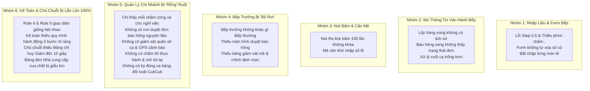

# BÁO CÁO TOÀN DIỆN CÁC BẤT TIỆN & LỖI TRẢI NGHIỆM (UX) TRÊN CẢ 5 VAI TRÒ
### (Sen Việt Buffet — Bếp, Bếp Trưởng, Quản Lý Chi Nhánh, Kế Toán Tổng & Chủ Chuỗi)
### (Người Test: `bep_tn`, `ql_bep_tn`, `ql_chinhanh_tn`, `ketoan_tong` & `admin_chu`)

> **Ngày cập nhật**: 20/11/2026  
> **Phiên bản test**: `frontend-demo` (Bản chạy thử tương tác độc lập trên Port 3000)  
> **Tài liệu tham chiếu**: [doc_content.txt](file:///run/media/tamdae/Data/Source%20code/restaurant_project/doc_content.txt), [HUONG_DAN_TRAI_NGHIEM_THEO_VAI_TRO.md](file:///run/media/tamdae/Data/Source%20code/restaurant_project/HUONG_DAN_TRAI_NGHIEM_THEO_VAI_TRO.md)

---

## 📌 TỔNG QUAN PHẢN HỒI THỰC TẾ CỦA NGƯỜI DÙNG

Sau khi trực tiếp thử nghiệm toàn bộ **5 vai trò vận hành trong hệ thống**, người dùng đã chỉ ra **10 điểm bất tiện và lỗi giao diện/nghiệp vụ nghiêm trọng**:

1. **Lỗi nhập số lượng**: Không gõ được số nguyên chẵn như `10` mà lại bị nhảy thành `10,1` hoặc bị chặn; bàn phím số thiếu phím dấu thập phân `.`.
2. **Thiếu phản hồi sau khi lấy hàng**: Bấm lấy hàng xong màn hình tắt ngấm, Bếp hoàn toàn không biết mình vừa lấy những món gì, bao nhiêu kg.
3. **Form không tự reset & phải nhập từng món lẻ**: Giá trị số lượng cũ không tự xóa, lần sau bấm lại tự cộng dồn giá trị cũ; không hỗ trợ chọn nhiều món cùng lúc (Multi-select).
4. **Báo hỏng gửi xong biến mất**: Bếp không thấy danh sách đơn báo hỏng đã gửi, không biết đơn có được ghi nhận hay Quản lý đã duyệt chưa.
5. **Nút Ra line (+1) bấm 100 lần không có phản hồi**: Bấm liên tục 100 lần vẫn nhận, không có hiệu ứng khóa nút cooldown, không có âm thanh hoặc biểu tượng xác nhận rõ ràng.
6. **Chế biến mẻ sai lệch khối lượng cân**: Bàn phím số khó gõ số lẻ, tính toán hao hụt chưa ăn khớp với số cân thực tế.
7. **Mục Xử lý cuối ca trống trơn ("chả có gì")**: Mở lên màn hình trắng, không có danh sách món cần kiểm đếm hủy bỏ do thiếu dữ liệu mẫu.
8. 🚨 **VAI TRÒ BẾP TRƯỞNG "KHÔNG KHÁC GÌ BẾP BÌNH THƯỜNG"**: Chuyển sang tài khoản Bếp trưởng (`ql_bep_tn`) nhưng giao diện vẫn chỉ có đúng 4 nút bấm giống hệt phụ bếp, hoàn toàn không có công cụ phê duyệt, giám sát mẻ hay chỉnh định mức hao hụt!
9. 🚨 **VAI TRÒ QUẢN LÝ CHI NHÁNH "CHẢ CÓ GÌ NGOÀI CHO NGHỈ VỚI CHẤM CÔNG"**: Người quản lý cả một cơ sở buffet hàng trăm khách/ngày nhưng vào app chỉ thấy mỗi việc chấm công và duyệt nghỉ việc / tick đồng phục! Hoàn toàn thiếu "Trung tâm điều hành chi nhánh" (Command Center), không có nơi duyệt đơn báo hỏng của Bếp, không có bảng giám sát quân số ca hôm nay (ai đi muộn, ai vi phạm GPS > 50m), không có giao diện chấm thi thực hành tay nghề (dao thớt, phục vụ), không có nút mở thi lại, và không có chỗ ký xác nhận bảng đối soát báo đỏ cuối ngày!
10. 🚨 **VAI TRÒ 4 (KẾ TOÁN TỔNG) & VAI TRÒ 5 (CHỦ CHUỖI) "CHẲNG BIẾT CÓ TÁC DỤNG GÌ"**:
    * Khi bấm chuyển giữa Vai trò 4 (`ketoan_tong`) và Vai trò 5 (`admin_chu`), **toàn bộ thanh menu và giao diện hiển thị giống hệt nhau 100%**, người dùng không phân biệt được ai làm việc gì!
    * **Vai trò 4 (Kế toán)** bị chìm trong các bảng số liệu tĩnh, không thấy rõ luồng hành động: *Nạp CukCuk $\rightarrow$ Bắt trộm nguyên liệu báo đỏ $\rightarrow$ Duyệt ứng lương $\rightarrow$ Khóa chi tiền người thiếu đồng phục*.
    * **Vai trò 5 (Chủ chuỗi / Giám đốc)** bị bắt xem menu kế toán, hoàn toàn thiếu hẳn **"Bảng Chỉ Huy Giám Đốc" (Executive Cockpit)** để trong 10 giây nhìn thấy ngay: Lãi/lỗ 2 cơ sở, Tỷ lệ cua chết của Nhà cung cấp Biển Đông để bắt đền tiền, và Phê duyệt tăng lương!

---

## 🔍 CHI TIẾT CÁC ĐIỂM BẤT TIỆN & PHƯƠNG ÁN KHẮC PHỤC



---

### 1. Lỗi nhập số lượng: Không nhập được số 10, bị nhảy số lẻ (10,1)

* **Hiện tượng thực tế**:
  * Khi nhập số cân lấy hàng hoặc cân mẻ, người dùng muốn gõ số nguyên chẵn như `10` thì bị lỗi, nhưng gõ số lẻ như `10,1` thì lại nhận hoặc ngược lại.
* **Nguyên nhân kỹ thuật**:
  * Trong tệp `KitchenModule.tsx`, thẻ input đang gán thuộc tính cứng: `step="0.5"`.
  * Theo chuẩn HTML5, khi khai báo `step="0.5"`, trình duyệt sẽ chặn hoặc báo lỗi constraint validation nếu người dùng gõ số không phải bội số của 0.5 (ví dụ gõ `10.1`, `10.2`).
  * Đồng thời, trên bàn phím tiếng Việt / di động, dấu phẩy `,` và dấu chấm `.` bị xung đột khi hàm `parseFloat()` xử lý chuỗi.
  * Bàn phím số ảo `VirtualNumpad` đang thiếu hẳn nút bấm dấu chấm thập phân `.`!
* **Giải pháp khắc phục**:
  * Đổi thuộc tính input thành: `step="any"` hoặc `step="0.01"` và `inputMode="decimal"`.
  * Thêm nút dấu chấm `.` vào bàn phím số ảo `VirtualNumpad`.
  * Tự động chuẩn hóa dấu phẩy `,` thành dấu chấm `.` trước khi parse số: `val.replace(',', '.')`.

---

### 2. Lấy hàng xong không biết mình đã lấy cái gì

* **Hiện tượng thực tế**:
  * Bếp bấm "Xác nhận lấy hàng" $\rightarrow$ Modal đóng lại $\rightarrow$ Chỉ có 1 thông báo Toast xanh hiện lên 2 giây rồi biến mất.
  * Nhân viên bếp bận tay quay đi quay lại là **quên sạch** vừa lấy mấy kg cá hồi, mấy kg thịt bò, không có chỗ nào trên màn hình để kiểm tra lại.
* **Nguyên nhân kỹ thuật**:
  * Màn hình Bếp hiện tại chỉ hiển thị danh sách tồn kho chung, **hoàn toàn không có component "Nhật Ký Xuất Kho Trong Ca"** (Shift Takeout History).
* **Giải pháp khắc phục**:
  * Bổ sung ngay 1 bảng thẻ danh sách: **"Lịch sử hàng đã lấy trong ca hôm nay"** ngay dưới 4 nút chính.
  * Hiển thị rõ: *Tên món - Số kg đã lấy - Thời gian lấy (ví dụ: 10:15) - Nút hoàn trả (nếu lấy nhầm)*.

---

### 3. Nhập từng món rất bất tiện & Form không tự reset giá trị cũ

* **Hiện tượng thực tế**:
  * Bếp vào kho thường lấy một lúc 3–5 món (thịt bò, cá hồi, rau cải, ngô ngọt). Nhưng app bắt mở modal 5 lần để nhập từng món một.
  * Nghiêm trọng hơn: Sau khi nhập xong 10kg cá hồi, lần sau mở lại modal để lấy món khác thì số `10` cũ **vẫn giữ nguyên ở ô số lượng**! Nhân viên không để ý bấm nút luôn là bị trừ trùng tiếp 10kg, phải ấn nút xóa bằng tay rất bực mình.
* **Nguyên nhân kỹ thuật**:
  * Hàm `handleTakeOutSubmit()` không gọi `setTakeOutQty(0)` và `setSelectedItemId(null)` sau khi submit thành công.
  * Chưa có tính năng "Giỏ lấy hàng" (Batch Pick List) cho phép chọn nhiều món cùng lúc trước khi bấm 1 nút Xuất kho chung.
* **Giải pháp khắc phục**:
  * Reset toàn bộ state form về rỗng/mặc định ngay khi submit thành công:
    ```typescript
    setTakeOutQty(0);
    setTakeOutNote('');
    setSelectedItemId(null);
    ```
  * Nâng cấp Modal Lấy Hàng thành dạng **Danh sách kiểm chọn (Checklist)**: Bếp tích chọn nhiều món, gõ số lượng cho từng món rồi bấm 1 nút *"Xuất kho cả 3 món"* duy nhất.

---

### 4. Báo hỏng xong không thấy trạng thái đơn (Không biết có hay không)

* **Hiện tượng thực tế**:
  * Bếp bấm chụp ảnh báo hỏng 1.5kg tôm chết $\rightarrow$ Bấm gửi $\rightarrow$ Màn hình đóng lại $\rightarrow$ Không thấy đơn hiển thị ở đâu cả.
  * Bếp hoang mang: *"Đơn đã gửi chưa? Có bị mất không? Quản lý đã duyệt chưa hay từ chối rồi?"*.
* **Nguyên nhân kỹ thuật**:
  * Màn hình Bếp chỉ có Form gửi báo hỏng, **thiếu hoàn toàn khu vực danh sách theo dõi đơn báo hỏng của Bếp**.
  * Chỉ khi đổi sang vai trò Quản lý mới thấy danh sách đơn chờ duyệt.
* **Giải pháp khắc phục**:
  * Thêm tab phụ hoặc danh sách bên dưới nút Báo hỏng: **"Đơn báo hỏng đã gửi ca này"**.
  * Hiển thị trạng thái bằng huy hiệu màu sắc rõ ràng:
    * 🟡 `Đang chờ Quản lý duyệt` (kèm ảnh thu nhỏ).
    * 🟢 `Đã duyệt lúc 10:30 (Trần Thị Bếp Trưởng)`.
    * 🔴 `Bị từ chối: Lý do...`.

---

### 5. Nút Ra Line (+1) bấm 100 lần nhận cả 100, không có phản hồi

* **Hiện tượng thực tế**:
  * Người dùng bấm nút `+1` liên tục 100 lần, hệ thống vẫn cho bấm tì tì, không thấy có độ trễ khóa nút, không có cảm giác nút đã nhận lệnh.
* **Nguyên nhân kỹ thuật**:
  * Trong bản demo cục bộ (Mock API), hàm `kitchenApi.recordLineItem()` phản hồi tức thì sau $2-5\text{ms}$.
  * Trong khối `finally`, biến `loadingLineButtons` bị chuyển về `false` ngay lập tức, triệt tiêu hoàn toàn cơ chế chống bấm đúp (chưa có thời gian khóa cooldown).
  * Giao diện thiếu hiệu ứng âm thanh (Audio beep click) hoặc popup số nhảy trực quan.
* **Giải pháp khắc phục**:
  * **Cưỡng chế thời gian khóa Cooldown tối thiểu 1.5 giây**:
    ```typescript
    setLoadingLineButtons(prev => ({ ...prev, [item.id]: true }));
    // Gọi API...
    setTimeout(() => {
      setLoadingLineButtons(prev => ({ ...prev, [item.id]: false }));
    }, 1500); // Khóa cứng 1.5 giây mới mở lại
    ```
  * Thêm hiệu ứng số nảy to `+1` bay lên (Floating animation) và âm thanh click xúc giác nhẹ khi bấm thành công.

---

### 6. Chế biến mẻ sai lệch số lượng cân

* **Hiện tượng thực tế**:
  * Khi nhập số cân nguyên liệu đầu vào và cân thành phẩm đầu ra, số liệu tính toán tỷ lệ hao hụt (%) hiển thị không đúng hoặc gây hiểu lầm.
* **Nguyên nhân kỹ thuật**:
  * Do `VirtualNumpad` thiếu nút chấm thập phân `.`, người dùng không thể gõ được các số cân thực tế có số lẻ như `8.2 kg` hay `7.5 kg` mà bị ép thành số nguyên hoặc cộng dồn sai.
  * Mẻ đang làm dở dang không hiển thị rõ khối lượng đầu vào ban đầu là bao nhiêu kg để bếp đối chiếu khi cân thành phẩm.
* **Giải pháp khắc phục**:
  * Cập nhật `VirtualNumpad` hỗ trợ đầy đủ số thập phân.
  * Hiển thị rõ công thức trực quan ngay trên thẻ mẻ cân:
    $$\text{Tỷ lệ hụt} = \frac{\text{Vào (10.0kg)} - \text{Ra (7.5kg)}}{\text{Vào (10.0kg)}} = 25.0\% \quad (\text{Chuẩn: } 15.0\%)$$

---

### 7. Mục "Xử lý cuối ca" trống trơn không có gì

* **Hiện tượng thực tế**:
  * Bếp bấm vào nút "Xử lý cuối ca" $\rightarrow$ Màn hình hiện thông báo xám xịt: *"Chưa có món nào được đánh dấu là Chỉ dùng trong ngày"*. Không có bất kỳ món nào để thao tác.
* **Nguyên nhân kỹ thuật**:
  * Trong tệp khởi tạo dữ liệu mẫu (`seedData.ts`), các mặt hàng tươi sống (Salad trộn, Kim chi, Nộm ngó sen, Bánh bao...) chưa được gán cờ `isDailyDisposable: true`.
  * Bộ lọc `items.filter(i => i.isDailyDisposable)` trả về mảng rỗng `[]`.
* **Giải pháp khắc phục**:
  * Cập nhật `seedData.ts`: Gán cờ `isDailyDisposable: true` cho 5 món tươi đặc trưng: *Salad cá hồi sốt mè, Nộm tai heo ngó sen, Kim chi Hàn Quốc, Bánh bao sữa chiên, Dưa chuột chẻ*.
  * Bổ sung thêm tính năng: **"Kiểm kê chốt số lượng tồn cuối ngày"** cho toàn bộ kho để chuẩn bị số liệu cho Kế toán đối soát với CukCuk.

---

### 8. 🚨 VAI TRÒ BẾP TRƯỞNG (QL_BEP) "KHÔNG KHÁC GÌ BẾP BÌNH THƯỜNG"

* **Hiện tượng thực tế của người dùng**:
  * Khi chuyển trên thanh toolbar sang tài khoản **Trần Thị Bếp Trưởng (`ql_bep_tn`)**, người dùng vẫn chỉ nhìn thấy **đúng 4 nút bấm** y hệt như nhân viên bếp Nam.
  * Không thấy bảng duyệt đơn báo hỏng ở đâu, không thấy quyền hạn của một người quản lý bếp, không thấy danh sách giám sát mẻ nấu của cả quán!
* **Nguyên nhân kỹ thuật qua kiểm tra mã nguồn (Code Audit)**:
  * Trong toàn bộ tệp `frontend-demo/src/components/kitchen/KitchenModule.tsx`, biến `user` chỉ được dùng để in tên ra góc màn hình (`user?.fullName`). **Không có bất kỳ câu lệnh `if (userHasRole(...))` nào** để phân biệt giữa phụ bếp và bếp trưởng!
  * Vai trò `ROLE_QL_BEP` bị bỏ rơi, không hề được xây dựng giao diện tương ứng.
  * Bếp trưởng bị xếp chung một giao diện với Bếp phụ, dẫn đến việc Bếp trưởng muốn duyệt đồ hỏng thì không có chỗ duyệt, muốn cấu hình định mức thì không có màn hình!

* **Đặc tả hợp đồng chuẩn ([doc_content.txt](file:///run/media/tamdae/Data/Source%20code/restaurant_project/doc_content.txt)) quy định quyền của Bếp Trưởng**:
  1. **Duyệt báo hỏng**: Xem các đơn báo hỏng kèm ảnh do Bếp phụ gửi lên, bấm *Duyệt* hoặc *Từ chối*.
  2. **Giám sát mẻ nấu toàn ca (Live Kitchen Monitor)**: Nhìn thấy toàn bộ các mẻ đang làm dở của mọi nhân viên trong ca, phát hiện mẻ nào bị hụt vượt chuẩn (tô đỏ), mẻ nào làm dở quá 2 tiếng.
  3. **Mở khóa mẻ thứ hai**: Khi nhân viên mở mẻ thứ hai cho cùng 1 món mà mẻ 1 chưa xong, Bếp trưởng là người được thông báo và phê duyệt cho làm tiếp.
  4. **Cấu hình định mức hao hụt chuẩn (% standard loss rate)**: Bếp trưởng có chuyên môn nghề nghiệp nên có quyền điều chỉnh định mức chuẩn cho từng món ăn (ví dụ: mùa đông cua gầy hơn thì chỉnh hụt chuẩn từ 15% lên 18%).

---

### 9. 🚨 VAI TRÒ QUẢN LÝ CHI NHÁNH BỊ "RỖNG" — CHỈ THẤY CHẤM CÔNG VÀ NGHỈ VIỆC

* **Hiện tượng thực tế & Nhận xét của người dùng**:
  * Người dùng thốt lên bức xúc: *"Vai trò quản lý chi nhánh chả có gì ngoài việc cho nghỉ với chấm công à?"*.
  * Thực tế khi đăng nhập bằng tài khoản Quản lý chi nhánh (`ql_chinhanh_tn` — Lê Hoàng Quản Lý), người dùng chỉ thấy:
    1. Vào mục "Nhân sự": Chỉ có nút tự chụp ảnh chấm công cho chính mình, xem bảng chấm công cá nhân, và một bảng duyệt đơn xin nghỉ việc kèm tick đồng phục.
    2. Vào mục "Bếp": Chỉ thấy 4 nút bấm thao tác của... phụ bếp, không có chỗ nào để Quản lý duyệt đồ hỏng.
    3. Vào mục "Kỳ thi": Chỉ thấy bài trắc nghiệm của nhân viên, không có chỗ để Quản lý chấm thực hành tay nghề hay mở thi lại.
    4. Vào mục "Tổng quan": Chỉ là các thẻ số liệu tĩnh, không có trung tâm điều hành hay danh sách việc cần xử lý.
  * **Hậu quả**: Một Quản lý chi nhánh — người chịu trách nhiệm điều hành toàn bộ một nhà hàng buffet doanh thu hàng trăm triệu mỗi ngày — lại có cảm giác như một "nhân viên hành chính quèn", không hề có công cụ chỉ huy, kiểm soát ca hay phê duyệt nghiệp vụ!

* **Đối chiếu Hợp đồng chuẩn ([doc_content.txt](file:///run/media/tamdae/Data/Source%20code/restaurant_project/doc_content.txt)) — 7 Trách nhiệm & Quyền hạn cốt lõi của Quản lý nhà hàng**:
  
  | Nghiệp vụ theo Hợp đồng (`doc_content.txt`) | Thực trạng trên App Demo hiện tại | Mức độ thiếu hụt |
  | :--- | :--- | :---: |
  | **1. Duyệt Báo Hỏng nguyên liệu** (Dòng 35, 157, 389: Bếp báo hỏng vượt ngưỡng hoặc tôm cua chết, Quản lý duyệt ảnh trừ kho) | ❌ **Hoàn toàn biến mất**: Bếp gửi đơn xong không biết đi đâu, Quản lý không có màn hình nào để xem ảnh và bấm Duyệt! | 🔴 Nghiêm trọng (Thất thoát kho) |
  | **2. Giám sát quân số ca & Chấm công GPS** (Dòng 35, 185: Biết ai thật sự đi làm, ai đi muộn, ai chấm công ngoài bán kính 50m) | ⚠️ **Chỉ có tự chấm công cá nhân**: Không có bảng điểm danh quân số ca hôm nay (Live Shift Roster) để Quản lý biết ca này có bao nhiêu nhân viên đã vào quán. | 🔴 Nghiêm trọng (Gian lận công) |
  | **3. Chấm điểm thi thực hành nghề nghiệp** (Dòng 189: "App tự chấm trắc nghiệm; quản lý chấm phần thực hành trên điện thoại") | ❌ **Không có giao diện**: Mục thi chỉ có phần trắc nghiệm của nhân viên, không có phiếu chấm điểm thực hành dao thớt, thái cá, phục vụ của Quản lý! | 🔴 Nghiêm trọng (Bỏ sót hợp đồng) |
  | **4. Mở quyền thi lại cho nhân viên trượt** (Dòng 190: "Thi lại do quản lý mở cho từng người") | ❌ **Không có nút mở thi lại**: Nhân viên thi dưới 80đ bị khóa cứng, Quản lý không có quyền mở lại kỳ thi. | 🟠 Cao |
  | **5. Xác nhận tự ý bỏ việc sau 3 ngày vắng mặt** (Dòng 201–203: Quét vắng 3 ngày, Quản lý bấm xác nhận hoặc bỏ qua) | ⚠️ **Bị giấu sâu**: Nằm tít dưới tab Đồng phục, không có thông báo đẩy hoặc cảnh báo đỏ trên Dashboard. | 🟡 Trung bình |
  | **6. Duyệt đơn nghỉ việc & Thu hồi đồng phục** (Dòng 207–210: Duyệt ngày nghỉ, tick nhận lại từng món đồng phục, thiếu thì giữ lương) | ✅ Đã có logic nhưng giao diện nghèo nàn, nằm tách rời khỏi luồng phê duyệt tổng thể. | 🟡 Cần tinh gọn UX |
  | **7. Xem Bảng đối soát cuối ngày & Ký Báo Đỏ thất thoát** (Dòng 20, 35: Mỗi tối mở điện thoại xem hàng hụt vì đâu, xem bảng cuối ngày và báo đỏ CukCuk) | ⚠️ **Chỉ là bảng tĩnh**: Quản lý chỉ được "nhìn", không có nút Ký xác nhận đóng ca và giải trình nguyên nhân thất thoát gửi Kế toán tổng. | 🟠 Cao (Quy trình đóng ca) |

---

## 🎨 BẢN THIẾT KẾ LẠI GIAO DIỆN PHÂN BIỆT RÕ 3 VAI TRÒ:

Để hệ thống phản ánh đúng chuẩn vận hành nhà hàng chuyên nghiệp:

### A. Với Nhân viên Bếp (`ROLE_BEP` — Anh Nam):
* **Giao diện Vận Hành Tối Giản (Worker View)**:
  * 4 Nút to lớn: Lấy hàng (dạng danh sách nhiều món) · Nấu mẻ · Báo hỏng · Ra line.
  * Bảng "Hàng tôi vừa lấy trong ca".
  * Bảng "Đơn báo hỏng tôi đã gửi (Trạng thái: Chờ Bếp trưởng duyệt)".
  * ❌ *Tuyệt đối ẩn mọi chức năng duyệt, không cho sửa định mức chuẩn, không cho xem doanh số.*

### B. Với Bếp Trưởng / Quản lý Bếp (`ROLE_QL_BEP` — Chị Hương):
* **Giao diện Chỉ Huy & Giám Sát Bếp (Kitchen Supervisor)**:
  * Tab 1: 4 Nút thao tác đứng bếp.
  * Tab 2: Phê duyệt Báo hỏng nội bộ bếp (tôm chết, cua gãy càng, rau nát).
  * Tab 3: Giám sát mẻ nấu & Tỷ lệ hao hụt toàn ca (cảnh báo mẻ tô đỏ).
  * Tab 4: Cấu hình định mức hao hụt chuẩn (% standard loss).

### C. Với Quản Lý Chi Nhánh (`ROLE_QL_CHINHANH` / `ROLE_RESTAURANT_MANAGER` — Lê Hoàng):
* **Giao diện "TRUNG TÂM ĐIỀU HÀNH CHI NHÁNH" (STORE MANAGER COMMAND CENTER)**:
  Thay vì chia nhỏ vụn vặt, toàn bộ quyền lực của Quản lý chi nhánh được tập trung vào **4 Tab Hành Động Sống Còn**:

  ```mermaid
  flowchart TD
      subgraph SM ["TRUNG TÂM ĐIỀU HÀNH QUẢN LÝ CHI NHÁNH (STORE MANAGER COMMAND CENTER)"]
          T1["Tab 1: Hộp Việc Cần Duyệt Ngay\n(Pending Approvals - Badge đỏ)\n• Duyệt báo hỏng Bếp kèm ảnh\n• Duyệt đơn nghỉ việc\n• Tick thu hồi đồng phục\n• Xác nhận tự ý bỏ việc sau 3 ngày"]
          T2["Tab 2: Giám Sát Quân Số Ca\n(Live Shift & Roster Monitor)\n• Quân số hôm nay: Đi làm / Đi muộn / Vắng\n• Cảnh báo chấm công ngoài 50m (GPS giả mạo)\n• Bắt giải trình hoặc duyệt hợp lệ"]
          T3["Tab 3: Chấm Điểm Thi Thực Hành\n(Practical Exam Grading)\n• Chấm tay nghề: Dao thớt, Thái cá, Phục vụ\n• Thang điểm 1-10 kèm nhận xét\n• Nút 'Mở quyền thi lại' cho nhân viên trượt"]
          T4["Tab 4: Bảng Đối Soát & Ký Đóng Ca\n(Daily Reconciliation & Sign-off)\n• Xem chênh lệch xuất/nhập/tồn vs CukCuk\n• Kiểm tra các dòng BÁO ĐỎ thất thoát (>5%)\n• Nhập giải trình & Ký duyệt đóng ca"]
      end
  ```

  1. **Tab 1: Hộp Việc Cần Phê Duyệt Ngay (Action Center — Badge số lượng chờ xử lý)**:
     * Gom toàn bộ các việc Quản lý phải bấm duyệt trong ngày về một nơi duy nhất:
       * **Duyệt báo hỏng nguyên liệu**: Xem ảnh tôm/cua/thịt do Bếp gửi lên $\rightarrow$ Nút [Duyệt trừ kho] / [Từ chối].
       * **Duyệt nghỉ việc & Thu hồi đồng phục**: Bảng danh sách nhân viên xin nghỉ $\rightarrow$ Tick từng món đồng phục nhận lại (áo, tạp dề, mũ). Nếu thiếu, hệ thống tự động khóa lương để kế toán giữ lương!
       * **Xác nhận nhân viên tự ý bỏ việc**: Danh sách nhân viên vắng mặt 3 ngày liên tiếp không lý do $\rightarrow$ Quản lý bấm nút [Xác nhận bỏ việc] (chuyển lương về 0).
       * **Mở quyền thi lại**: Danh sách nhân viên thi trượt dưới 80 điểm $\rightarrow$ Quản lý bấm [Mở khóa thi lại].
  2. **Tab 2: Giám Sát Quân Số Ca Làm Việc (Live Shift Roster & Chấm Công GPS)**:
     * Tổng số nhân sự ca hôm nay: Ví dụ: *Đã vào ca: 18/20 · Đi muộn: 2 · Chưa đến: 0*.
     * Cảnh báo gian lận GPS: Nhân viên nào chấm công cách nhà hàng $> 50\text{m}$ sẽ bị **tô viền vàng/đỏ cảnh báo** kèm khoảng cách thực tế (ví dụ: *Nguyễn Văn A — GPS cách quán 450m lúc 10:15*). Quản lý bấm xem vị trí trên bản đồ và quyết định chấp thuận hay phạt vi phạm.
  3. **Tab 3: Chấm Thi Thực Hành Tay Nghề Trên Điện Thoại (Practical Exam Grading)**:
     * Danh sách nhân viên trong kỳ sát hạch quý:
       * Bếp: Chấm kỹ năng dao thớt, sơ chế cá hồi, tốc độ ra đĩa, vệ sinh ATTP (thang điểm 1–10).
       * Phục vụ / Bàn: Chấm tác phong chào khách, quy trình dọn đĩa, xử lý tình huống phàn nàn của khách (thang điểm 1–10).
     * Bấm [Lưu điểm thực hành] $\rightarrow$ Hệ thống tự cộng với điểm trắc nghiệm để xếp loại tăng bậc lương cho kỳ tới.
  4. **Tab 4: Bảng Đối Soát Cuối Ngày & Ký Xác Nhận Đóng Ca (Daily Reconciliation Sign-off)**:
     * Mở điện thoại mỗi tối để kiểm tra: Doanh thu bán hàng CukCuk vs Số lượng thực phẩm xuất kho.
     * Soi các dòng **BÁO ĐỎ** (thất thoát nguyên liệu vượt ngưỡng 5% hoặc trên 300.000đ).
     * Nhập ghi chú giải trình thất thoát (nếu có) và bấm nút: **[Quản Lý Ký Xác Nhận Đóng Ca]** để chuyển dữ liệu sang Kế toán tổng.

---

### 10. 🚨 VAI TRÒ 4 (KẾ TOÁN TỔNG) & VAI TRÒ 5 (CHỦ CHUỖI) "CHẲNG BIẾT CÓ TÁC DỤNG GÌ" — TẠI SAO NGƯỜI DÙNG BỊ MẤT PHƯƠNG HƯỚNG?

* **Hiện tượng thực tế & Tiếng thở dài của người dùng**:
  * Người dùng bức xúc và hoang mang: *"Vai trò 4 và vai trò 5 tôi cũng chẳng biết có tác dụng gì, haizz"*.
  * Khi chuyển qua chuyển lại giữa **Phạm Thu Kế Toán (`ketoan_tong`)** và **Đặng Tổng Giám Đốc (`admin_chu`)** trên thanh toolbar:
    1. Menu bên trái hiển thị **giống hệt nhau 100%**: Đều thấy Tổng quan, Bếp 4 nút, Kho hàng, Đối soát, Bảng lương.
    2. Người dùng không thấy Giám đốc có quyền hành gì đặc biệt hơn Kế toán.
    3. Vào mục Đối soát hoặc Bảng lương thì thấy một rừng bảng biểu tĩnh, không rõ Kế toán vào đây để bấm cái gì, làm việc gì.
    4. Báo cáo quan trọng nhất của Chủ chuỗi là **"Tỷ lệ cua chết theo Nhà cung cấp"** thì lại bị giấu tịt vào một tab con bên trong màn hình Đối soát của Kế toán!

* **Nguyên nhân kỹ thuật & Lỗi phân quyền (Code Audit)**:
  * Trong tệp `seedData.ts`, cả tài khoản `ketoan_tong` và `admin_chu` đều được cấp chung role `ROLE_GENERAL_ACCOUNTANT`.
  * Trong `AdaptiveShell.tsx`, hệ thống chỉ kiểm tra `if (isGenAcc)` rồi render chung một bộ menu điều hướng. Không hề có logic riêng cho `ROLE_CHU_CHUOI`!
  * **Hậu quả**: Chủ chuỗi bị "hạ cấp" thành một Kế toán viên, còn Kế toán viên thì bị "bỏ rơi" không có hướng dẫn luồng việc (Call-to-Action) cụ thể.

---

### D. Với Kế Toán Tổng / Kế Toán Chi Nhánh (`ROLE_KETOAN` — Chị Mai / Phạm Thu):
* **Bản chất vai trò**: **"Người Giữ Túi Tiền Chuỗi Nhà Hàng"** — Chống thất thoát tiền hàng và quản trị dòng tiền lương/ứng lương.
* **3 Luồng hành động trọng tâm (Quick Actions)**:
  1. **Bắt trộm nguyên liệu & Báo đỏ CukCuk**:
     * Nạp file Excel doanh thu bán hàng CukCuk $\rightarrow$ Hệ thống tự chạy 6 công thức trừ lùi.
     * Mặt hàng nào lệch $> 300.000$ đ hoặc $> 5\%$ sẽ **TÔ ĐỎ RỰC** (ví dụ: Xuất 20kg cá hồi, khách ăn 15kg $\rightarrow$ mất 5kg ~ 1.000.000đ).
     * Bấm nút gửi cảnh báo Zalo thẳng tới Chủ chuỗi.
  2. **Duyệt chi Đơn xin ứng lương**:
     * Nhân viên xin ứng 2.000.000đ trên app $\rightarrow$ Kế toán kiểm tra số công thực tế trong tháng $\rightarrow$ Nhập số thực chi 1.500.000đ và bấm Duyệt.
     * Số tiền này tự động trừ vào kỳ lương cuối tháng, không bao giờ lo nhân viên nghỉ ngang mất tiền ứng.
  3. **Khóa chi trả an toàn (Chốt Bảng Lương & Chuyển Khoản)**:
     * Kế toán xem danh sách chuyển khoản ngân hàng.
     * Hệ thống tự động **KHÓA CỨNG NÚT CHUYỂN TIỀN** của nhân viên tự ý bỏ việc hoặc chưa trả đủ đồng phục (thiếu tạp dề, mũ). Kế toán không bao giờ sợ bấm nhầm chi tiền cho người vi phạm!

---

### E. Với Chủ Chuỗi / Giám Đốc (`ROLE_CHU_CHUOI` — Chị Thêm / Đặng TGĐ):
* **Bản chất vai trò**: **"Người Nhìn Toàn Cảnh & Ra Quyết Định Đầu Tư"** — Tuyệt đối không làm việc chi tiết của nhân viên hay kế toán, chỉ cần 10 giây mở điện thoại là nắm trọn vận mệnh cả chuỗi!
* **Màn hình độc quyền: "BẢNG CHỈ HUY GIÁM ĐỐC" (EXECUTIVE COCKPIT)**:
  1. **Thẻ Tài Chính Hợp Nhất 2 Cơ Sở (Real-time Financial Overview)**:
     * Doanh thu hợp nhất hôm nay: Thái Nguyên (42.5 triệu) + Quế Võ (38.2 triệu) = **80.7 triệu**.
     * Tổng số khách ăn buffet hôm nay: 285 khách.
     * Tổng thất thoát kho hôm nay: **850.000 đ (Báo động đỏ)**.
     * Công tắc chuyển nhanh: Xem riêng lẻ từng cơ sở hoặc xem gộp toàn chuỗi.
  2. **Bảng Đen Nhà Cung Cấp (% Cua Chết / Thịt Hỏng để Bắt Đền Tiền)**:
     * Đưa thẳng ra trang chủ Giám đốc:
       * *NCC Hải Sản Biển Đông*: Nhập 150kg cua, báo hỏng 18kg $\rightarrow$ **Tỷ lệ hỏng 12% (Vượt trần 5% đỏ rực)**.
       * Có nút: **[Xem album ảnh cua chết]** $\rightarrow$ Giám đốc có bằng chứng sắc bén gọi điện phạt tiền nhà xe hoặc cắt hợp đồng ngay!
       * *NCC Bò Úc Vissan*: Tỷ lệ hỏng 1.2% (Đạt chuẩn xanh).
  3. **Phê Duyệt Tăng Lương Chiến Lược**:
     * Danh sách nhân viên đủ điều kiện xét tăng bậc lương theo quý:
       * Điều kiện 1: Thâm niên làm việc $\ge 3$ tháng.
       * Điều kiện 2: Điểm thi tay nghề lý thuyết & thực hành $\ge 80/100$.
     * Giám đốc bấm nút: **[Duyệt tăng bậc lương 500.000đ/tháng]** $\rightarrow$ Tự động áp dụng vào kỳ lương mới.

---

## 📊 BẢNG TỔNG HỢP MỨC ĐỘ ƯU TIÊN SỬA LỖI (ACTION MATRIX TOÀN HỆ THỐNG)

| STT | Vấn đề / Lỗi UX | Phân hệ ảnh hưởng | Mức độ | Thời gian sửa |
| :---: | :--- | :---: | :---: | :---: |
| **1** | Bổ sung phím `.` vào Numpad & Bỏ `step="0.5"` | Bếp (`bep_tn`) | 🔴 **Critical** | 15 phút |
| **2** | Reset form tự động & Chọn nhiều món khi lấy hàng | Bếp (`bep_tn`) | 🔴 **Critical** | 20 phút |
| **3** | Khóa Cooldown 1.5s cho nút Ra line (`+1`) | Bếp (`bep_tn`) | 🔴 **Critical** | 10 phút |
| **4** | Bổ sung danh sách "Hàng đã lấy trong ca" | Bếp (`bep_tn`) | 🟠 **High** | 25 phút |
| **5** | Bổ sung danh sách "Đơn báo hỏng đã gửi của Bếp" | Bếp (`bep_tn`) | 🟠 **High** | 20 phút |
| **6** | Seed data món dùng trong ngày để hiện mục Cuối ca | Bếp (`bep_tn`) | 🟠 **High** | 15 phút |
| **7** | Hiển thị chi tiết công thức cân mẻ thành phẩm | Bếp (`bep_tn`) | 🟡 **Medium** | 15 phút |
| **8** | **Tách biệt giao diện Bếp Trưởng (Duyệt hỏng, Giám sát mẻ, Cấu hình định mức)** | Bếp Trưởng (`ql_bep_tn`) | 🔴 **Critical** | 40 phút |
| **9** | **Xây dựng "Trung Tâm Điều Hành Quản Lý Chi Nhánh" (Duyệt hỏng, Quân số GPS, Chấm thi thực hành, Ký đóng ca)** | Quản Lý (`ql_chinhanh_tn`) | 🔴 **Critical** | 60 phút |
| **10** | **Tối ưu luồng hành động Kế Toán: Nạp CukCuk đối soát $\rightarrow$ Báo đỏ thất thoát $\rightarrow$ Duyệt ứng lương $\rightarrow$ Khóa chi trả đồng phục** | Kế Toán (`ketoan_tong`) | 🔴 **Critical** | 45 phút |
| **11** | **Xây dựng "Bảng Chỉ Huy Giám Đốc" (Executive Cockpit 10 giây: Doanh thu 2 quán, Bảng đen bắt đền cua chết NCC, Duyệt tăng lương)** | Chủ Chuỗi (`admin_chu`) | 🔴 **Critical** | 50 phút |

---

## 🎯 KẾT LUẬN TOÀN DIỆN

Chuỗi phản hồi thực tế của bạn khi test qua cả 5 vai trò là **vô giá**! Nó đã bóc trần toàn bộ vấn đề lớn nhất của bản demo hiện tại:
1. **Bếp**: Bị lỗi phím số, thao tác mù mờ không có lịch sử.
2. **Bếp trưởng**: Bị đối xử như phụ bếp, không có quyền duyệt.
3. **Quản lý chi nhánh**: Bị biến thành nhân viên hành chính, chỉ biết chấm công và cho nghỉ việc.
4. **Kế toán**: Bị ngập trong bảng số liệu, thiếu luồng hành động bắt trộm và khóa chi tiền.
5. **Chủ chuỗi**: Bị bắt làm kế toán thứ hai, thiếu bảng chỉ huy tối cao để nhìn toàn cảnh và bắt đền nhà cung cấp.

Khi triển khai giải pháp thiết kế lại theo đúng ma trận trên, từng người dùng khi đăng nhập vào hệ thống sẽ thấy ngay **vũ khí và quyền lực đặc thù của riêng mình**, biến phần mềm thành một sản phẩm thương mại đỉnh cao sẵn sàng chinh phục mọi khách hàng khó tính nhất!
