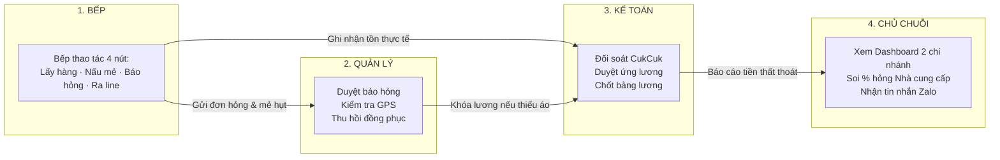

# HƯỚNG DẪN TRẢI NGHIỆM VẬN HÀNH NHÀ HÀNG THEO TỪNG VAI TRÒ
### (Sen Việt Buffet — Hệ thống Quản trị Kho Bếp, Nhân sự & Chống Thất Thoát)

> **Mục tiêu của tài liệu**: Đưa bạn hóa thân vào **5 nhân vật thực tế** tại nhà hàng Sen Việt Buffet. Bạn sẽ hiểu rõ mỗi người đang gặp khó khăn gì, họ dùng phần mềm như thế nào trong 1 ngày, và bạn có thể **tự tay bấm thử theo từng bước** trên màn hình để kiểm chứng.  
> **Địa chỉ ứng dụng Demo đang chạy**: [http://localhost:3000](http://localhost:3000) *(Mở bằng trình duyệt Chrome/Safari/Edge)*

---

## 🛠️ Công Cụ Hỗ Trợ Trải Nghiệm: Thanh "DemoToolbar"

Khi mở [http://localhost:3000](http://localhost:3000), bạn sẽ thấy một **Thanh công cụ màu tối (Floating Pill)** nổi ở góc trên màn hình:
* **Dropdown Vai trò**: Bấm để chuyển đổi tức thì giữa 5 vai trò (Bếp $\rightarrow$ Bếp trưởng $\rightarrow$ Quản lý $\rightarrow$ Kế toán $\rightarrow$ Chủ chuỗi) mà **không cần đăng xuất/đăng nhập lại**.
* **Dropdown Chi nhánh**: Chọn giữa **CN Thái Nguyên** và **CN Quế Võ**.
* **Nút 🔄 Reset Dữ Liệu**: Bấm nút này bất cứ lúc nào để xóa toàn bộ dữ liệu bạn vừa bấm thử và trả về dữ liệu mẫu hoàn hảo ban đầu.

---

---

## 👨‍🍳 VAI TRÒ 1: Anh Nam — Nhân Viên Bếp / Bar (`ROLE_BEP`)

### 1. Tâm sự của Nam:
> *"Tay tôi lúc nào cũng dính đầy dầu mỡ, nước mắm, cua ghẹ sống. Tôi đang bận hấp cua, xào bò cho khách ăn buffet, làm sao mà mở máy tính gõ báo cáo dài dòng được! Cho tôi cái màn hình điện thoại với **đúng 4 nút to tướng**, bấm 1-2 chạm là xong việc để tôi còn nấu tiếp!"*

### 2. Một ngày làm việc của Nam với phần mềm:
* **Đầu ca**: Nam vào kho lấy 10kg cá hồi và 20kg cua sống ra bàn sơ chế $\rightarrow$ Bấm nút **[Lấy hàng]**.
* **Trong ca**:
  * Nam hấp mẻ cua 10kg. Hấp xong, Nam cân lại được 8.2kg thành phẩm $\rightarrow$ Bấm nút **[Chế biến]** để nhập số cân.
  * Nam phát hiện có 2 con cua bị chết bốc mùi $\rightarrow$ Bấm nút **[Báo hỏng]**, giơ điện thoại chụp 1 kiểu ảnh con cua chết gửi Quản lý duyệt.
  * Khay thịt bò trên quầy buffet hết sạch $\rightarrow$ Nam bê khay mới ra quầy và bấm nút **[Ra line +1]**.
* **Cuối ca**: Nam cùng bạn đếm số lượng thịt cá còn thừa trong tủ $\rightarrow$ Nhập số tồn cuối ca.

---

### 👉 HƯỚNG DẪN BẠN TỰ TAY THAO TÁC THỬ (VAI TRÒ BẾP):

1. **Bước 1**: Trên thanh **DemoToolbar**, chọn tài khoản: **Nguyễn Văn Bếp** (`bep_tn`).
2. **Bước 2**: Nhìn vào màn hình, bạn sẽ thấy giao diện **Mobile Shell với 4 Nút Lớn**:
   * 🟢 **Nút 1: LẤY HÀNG (Xuất kho thô)**:
     * Bấm vào nút `Lấy hàng` $\rightarrow$ Chọn mặt hàng `Cá hồi Nauy phi lê` $\rightarrow$ Nhập `5` kg $\rightarrow$ Bấm `Xác nhận lấy hàng`.
     * *Kết quả*: Hệ thống thông báo thành công, kho tự động trừ 5kg cá hồi.
   * 🟠 **Nút 2: CHẾ BIẾN (Theo dõi hao hụt mẻ)**:
     * Bấm vào nút `Chế biến` $\rightarrow$ Chọn món `Cua hấp sả bia`.
     * Nhập số kg xuất làm: `10` kg $\rightarrow$ Bấm `Bắt đầu mẻ`. (Mẻ chuyển trạng thái *Đang làm*).
     * Bấm `Hoàn tất & Cân thành phẩm` $\rightarrow$ Nhập số kg thành phẩm thu được: `7.5` kg (Hụt 2.5kg = 25%).
     * *Điều kỳ diệu*: Định mức cua hấp chỉ cho hụt 15%. Vì bạn nhập 25% nên màn hình **bật cờ đỏ cảnh báo: "VƯỢT ĐỊNH MỨC HAO HỤT (25% > 15%)"**!
   * 🔴 **Nút 3: BÁO HỎNG (Chụp ảnh gửi duyệt)**:
     * Bấm vào nút `Báo hỏng` $\rightarrow$ Chọn `Tôm càng xanh` $\rightarrow$ Nhập số kg: `1.5` kg $\rightarrow$ Chọn lý do `Tôm chết/hôi`.
     * Chọn 1 ảnh bất kỳ từ máy bạn (hệ thống sẽ tự nén ảnh về siêu nhẹ ~200KB) $\rightarrow$ Bấm `Gửi báo hỏng`.
     * *Kết quả*: Đơn chuyển trạng thái `CHỜ DUYỆT`. Bếp không tự ý vứt đồ đi được mà phải đợi Quản lý duyệt.
   * 🔵 **Nút 4: RA LINE (Sổ ra món buffet)**:
     * Bấm nút `Ra line` $\rightarrow$ Chọn món `Bò Mỹ sốt tiêu đen` $\rightarrow$ Bấm nút `+1 KHAY`.
     * *Để ý kỹ*: Nút `+1` lập tức bị khóa mờ trong 1.5 giây kèm vòng xoay để **chống nhân viên bấm đúp 2 lần liên tục**.

---

## 👩‍💼 VAI TRÒ 2: Chị Hương — Bếp Trưởng / Quản Lý Bếp (`ROLE_QL_BEP`)

### 1. Tâm sự của Hương:
> *"Tôi là Bếp trưởng. Tôi chịu trách nhiệm trước bà chủ về việc nguyên liệu có bị nấu cháy, nấu ẩu làm hỏng không. Bếp phụ mà lén vứt cua hỏng vào sọt rác hoặc nấu mẻ mới để giấu mẻ cũ bị cháy là tôi phải phát hiện ra ngay."*

### 2. Việc Hương làm trên phần mềm:
* Xem danh sách các mẻ đang nấu trong bếp: Mẻ nào nấu xong mà hụt quá chuẩn bị báo đỏ là Hương gọi Bếp ra nhắc nhở ngay.
* Mở danh sách các đơn **Báo hỏng** do Bếp gửi lên: Xem ảnh chụp con cua chết có đúng không rồi bấm **Duyệt** hoặc **Từ chối**.

---

### 👉 HƯỚNG DẪN BẠN TỰ TAY THAO TÁC THỬ (VAI TRÒ BẾP TRƯỞNG):

1. **Bước 1**: Trên thanh **DemoToolbar**, bấm đổi sang: **Trần Thị Bếp Trưởng** (`ql_bep_tn`).
2. **Bước 2**: Màn hình tự động chuyển sang chế độ quản lý chuyên sâu:
   * **Kiểm tra mẻ vượt định mức**: Bạn sẽ thấy ngay mẻ Cua hấp lúc nãy bạn vừa làm đang bị **tô đỏ nổi bật** với dòng cảnh báo vượt định mức $25\%$.
   * **Duyệt đơn báo hỏng**:
     * Chuyển sang tab `Báo hỏng / Duyệt hỏng`.
     * Bạn sẽ thấy đơn tôm chết `1.5 kg` mà anh Nam vừa gửi.
     * Bấm xem ảnh hiện trường $\rightarrow$ Bấm nút xanh **[Duyệt đơn]**.
     * *Kết quả*: Số tôm hỏng này chính thức được trừ kho và ghi nhận vào lô hàng của Nhà cung cấp để sau này tính tỷ lệ lỗi!

---

## 🏢 VAI TRÒ 3: Anh Tuấn — Quản Lý Chi Nhánh (`ROLE_QL_CHINHANH`)

### 1. Tâm sự của Tuấn:
> *"Tôi quản lý toàn bộ chi nhánh Thái Nguyên: Từ việc nhân viên đi làm có đúng giờ không, ai tự ý bỏ việc, cho tới việc nhân viên nghỉ việc có trả lại đồng phục của quán hay không. Trước đây nhân viên nghỉ việc cứ mang tạp dề với áo đồng phục về nhà, quán mất tiền oan liên tục."*

### 2. Việc Tuấn làm trên phần mềm:
* **Kiểm tra Chấm công GPS**: Soi xem có đứa nào ở phòng trọ cách quán 2km mà nhờ bạn chấm công hộ không.
* **Xác nhận Bỏ việc**: Xem danh sách nhân viên 3 ngày liền không đi làm để bấm "Xác nhận bỏ việc" (khóa lương về 0).
* **Thu hồi Đồng phục**: Khi nhân viên nghỉ việc, Tuấn kiểm tra từng chiếc áo, tạp dề. Nếu thiếu, Tuấn không tick xác nhận, hệ thống sẽ **khóa cứng không cho Kế toán trả lương**.

---

### 👉 HƯỚNG DẪN BẠN TỰ TAY THAO TÁC THỬ (VAI TRÒ QUẢN LÝ QUÁN):

1. **Bước 1**: Trên thanh **DemoToolbar**, bấm đổi sang: **Lê Hoàng Quản Lý** (`ql_chinhanh_tn`).
2. **Bước 2**: Vào menu **Nhân sự & Chấm công**:
   * **Thử Chấm công GPS gian lận**:
     * Bấm sang tab `Chấm công`.
     * Thử bấm nút giả lập: **"📍 Giả lập GPS ngoài chi nhánh (450m)"** $\rightarrow$ Bấm `Chấm công vào ca`.
     * *Kết quả*: Hệ thống cảnh báo màu vàng: *"CẢNH BÁO VỊ TRÍ: Bạn đang cách chi nhánh 450m (> 50m quy định)"*. Bảng chấm công của Quản lý sẽ gắn cờ vàng để bắt giải trình!
   * **Kiểm tra Giữ lương do thiếu đồng phục**:
     * Chuyển sang tab `Đồng phục & Nghỉ việc`.
     * Bạn thấy nhân viên `Lê Văn Hùng` xin nghỉ việc. Hùng được cấp: 01 Áo thun, 01 Tạp dề, 01 Mũ bếp.
     * Tuấn chỉ nhận lại được Áo và Mũ, còn Tạp dề bị mất $\rightarrow$ Tuấn **bỏ tick ô Tạp dề**.
     * *Kết quả*: Trạng thái của Hùng chuyển sang: **"ĐANG GIỮ LƯƠNG — THIẾU TẠP DỀ"**!

---

## 📊 VAI TRÒ 4: Chị Mai — Kế Toán Tổng (`ROLE_KETOAN`)

### 1. Tâm sự của Mai:
> *"Tôi là người giữ túi tiền cho chị Thêm. Điều tôi sợ nhất mỗi cuối ngày là: Kho thì bảo xuất 50kg thịt, nhưng máy tính tiền POS CukCuk báo khách chỉ ăn hết 40kg thịt. Vậy 10kg thịt còn lại bốc hơi đi đâu? Ai ăn bớt? Tôi cần một bảng đối soát tự động tính ra số tiền lệch từng ngày!"*

### 2. Việc Mai làm trên phần mềm:
* **Đối soát cuối ngày với CukCuk**: Thả file Excel CukCuk vào, app tự trừ:
  $$\text{Lệch} = \text{Xuất kho} - \text{Khách ăn CukCuk} - \text{Hụt nấu nướng} - \text{Đồ hỏng đã báo}$$
  Dòng nào lệch tiền $> 300.000$ đ là phần mềm tô đỏ rực lên ngay!
* **Duyệt ứng lương**: Nhân viên xin ứng 2 triệu, Mai kiểm tra ngày công rồi duyệt chi 1.5 triệu $\rightarrow$ Tiền này tự động trừ vào bảng lương cuối tháng.
* **Chốt Bảng lương**: Xem danh sách chuyển khoản. Thấy nhân viên nào chưa trả đồng phục thì hệ thống tự động **khóa nút chuyển tiền**, không sợ kế toán chuyển nhầm!

---

### 👉 HƯỚNG DẪN BẠN TỰ TAY THAO TÁC THỬ (VAI TRÒ KẾ TOÁN):

1. **Bước 1**: Trên thanh **DemoToolbar**, bấm đổi sang: **Phạm Thu Kế Toán** (`ketoan_tong`).
2. **Bước 2**: Vào menu **Đối soát cuối ngày (CukCuk)**:
   * Bấm nút: **"⚡ Nạp dữ liệu mẫu bán hàng CukCuk"** (hoặc chọn ngày có sẵn).
   * Bạn nhìn vào cột **Lệch không rõ**:
     * Mặt hàng `Cá hồi phi lê`: Xuất 20kg, khách ăn 15kg, hụt 2kg $\rightarrow$ Lệch mất 3kg (~600.000đ).
     * *Kết quả*: **Cả dòng Cá hồi bị tô đỏ chói!** Cạnh đó có nút thông báo: *"🚨 Đã gửi cảnh báo Zalo tới Chủ chuỗi: Lệch 600.000đ (> ngưỡng 300.000đ)"*.
3. **Bước 3**: Vào menu **Bảng lương & Ứng lương**:
   * Nhìn vào danh sách nhân viên: Bạn sẽ thấy nhân viên `Lê Văn Hùng` (người bị thiếu tạp dề ở Bước Quản lý) có dòng chữ: **[KHÓA THANH TOÁN] - Chưa hoàn trả đồng phục**.
   * Dù Kế toán có bấm chuyển khoản cho cả quán, hệ thống sẽ **loại trừ Hùng ra**, không bao giờ bị chi nhầm tiền!

---

## 👑 VAI TRÒ 5: Chị Thêm — Chủ Chuỗi / Giám Đốc (`ROLE_CHU_CHUOI`)

### 1. Tâm sự của Chị Thêm:
> *"Tôi có 2 quán buffet ở Thái Nguyên và Quế Võ. Tôi không thể sáng ở Thái Nguyên, chiều chạy sang Quế Võ đứng canh tủ lạnh được. Tối về nhà tôi chỉ cần mở điện thoại lên: Quán nào đang thất thoát? Đứa nào bỏ việc? Nhà cung cấp nào bán cua chết nhiều nhất để tôi cắt hợp đồng!"*

### 2. Việc Chị Thêm làm trên phần mềm:
* Mở **Executive Dashboard**: Xem biểu đồ tổng quan doanh thu, chi phí, tỷ lệ thất thoát của cả 2 chi nhánh trên 1 màn hình duy nhất.
* Mở **Báo cáo Nhà cung cấp**: Xem bảng xếp hạng nhà cung cấp giao đồ hỏng nhiều nhất.
* Nhận tin nhắn thông báo tự động từ **Zalo Bot** khi có mẻ thất thoát lớn trong ca.

---

### 👉 HƯỚNG DẪN BẠN TỰ TAY THAO TÁC THỬ (VAI TRÒ CHỦ CHUỖI):

1. **Bước 1**: Trên thanh **DemoToolbar**, bấm đổi sang: **Đặng Tổng Giám Đốc** (`admin_chu`).
2. **Bước 2**: Màn hình hiển thị **Dashboard Tổng Quan**:
   * Bạn nhìn thấy ngay các thẻ tóm tắt:
     * *Tổng giá trị thất thoát kho hôm nay* (ví dụ: `850.000 đ`).
     * *Số lượng mẻ vượt định mức hao hụt* (`2 mẻ báo đỏ`).
     * *Số nhân viên đang bị giữ lương* (`1 người`).
   * Thử bấm đổi góc trên sang **"CN Quế Võ"** $\rightarrow$ Toàn bộ số liệu lập tức đổi sang cơ sở Quế Võ mượt mà!
3. **Bước 3**: Vào menu **Báo Cáo Nhà Cung Cấp**:
   * Bạn thấy bảng thống kê:
     * `NCC Hải Sản Biển Đông`: Nhập 150kg, báo hỏng 18kg $\rightarrow$ Tỷ lệ hỏng **$12\%$ (Xếp đầu bảng đỏ)**.
     * `NCC Thịt Bò Vissan`: Tỷ lệ hỏng chỉ $1.5\%$.
   * *Ý nghĩa*: Chị Thêm có đầy đủ bằng chứng và hình ảnh chụp cua chết để gọi điện cho chủ hàng Biển Đông bắt đền tiền hoặc đổi nhà cung cấp khác ngay hôm sau!

---

## 📋 BẢNG TỔNG KẾT CHECKLIST TRẢI NGHIỆM

Bạn hãy mở [http://localhost:3000](http://localhost:3000) và lần lượt tick vào bảng này để tự mình trải nghiệm trọn vẹn phần mềm:

- [ ] **Bếp**: Bấm thử mẻ cua hụt 25% $\rightarrow$ Xem cảnh báo đỏ vượt chuẩn.
- [ ] **Bếp**: Bấm thử Báo hỏng tôm $\rightarrow$ Chọn ảnh và gửi duyệt.
- [ ] **Bếp**: Bấm nút Ra line `+1` $\rightarrow$ Thấy nút khóa 1.5s chống bấm đúp.
- [ ] **Bếp trưởng**: Chuyển vai trò $\rightarrow$ Duyệt đơn báo hỏng tôm.
- [ ] **Quản lý**: Bấm chấm công GPS ngoài 50m $\rightarrow$ Thấy cảnh báo vàng.
- [ ] **Quản lý**: Vào mục đồng phục $\rightarrow$ Bỏ tick tạp dề của nhân viên nghỉ việc.
- [ ] **Kế toán**: Vào Đối soát $\rightarrow$ Thấy dòng cá hồi tô đỏ vì mất $> 300.000$ đ.
- [ ] **Kế toán**: Vào Bảng lương $\rightarrow$ Thấy nút chuyển khoản của nhân viên thiếu tạp dề bị KHÓA CỨNG.
- [ ] **Chủ chuỗi**: Xem Dashboard và Báo cáo % cua chết theo Nhà cung cấp.
- [ ] **Reset**: Bấm nút `🔄 Reset Dữ Liệu` trên thanh Toolbar $\rightarrow$ Đưa phần mềm về trạng thái ban đầu sạch sẽ!

---
*(Tài liệu này được biên soạn dựa trên bản đặc tả hợp đồng chuẩn của Sen Việt Buffet và bản Demo thực nghiệm đang chạy).*
