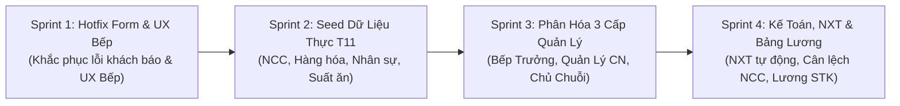

# 📋 KẾ HOẠCH & DANH SÁCH TASK NÂNG CẤP SẢN PHẨM SEN VIỆT BUFFET
### (Dựa trên Phân tích Dữ liệu Thực tế T11 & Báo cáo Trải nghiệm 5 Vai trò)

> **Mã kế hoạch**: TASK-SENVIET-2026-V1  
> **Ngày lập**: 20/11/2026  
> **Mục tiêu**: Nâng cấp toàn diện bản demo từ "dữ liệu giả / trải nghiệm rời rạc" thành **"hệ thống sát thực tế 100%, chạy song song Google Sheet T11 của khách hàng và mượt mà trên cả 5 vai trò"**.  
> **Nguồn tổng hợp**:
> - [PHAN_TICH_3_FILE_EXCEL_NANG_CAP.md](file:///home/tamdae/.gemini/antigravity-cli/brain/47ddacc8-f075-4f6a-a6af-5bc6972dd7d1/PHAN_TICH_3_FILE_EXCEL_NANG_CAP.md)
> - [BAO_CAO_BAT_TIEN_VA_LOI_UX_VAI_TRO_BEP.md](file:///run/media/tamdae/Data/Source%20code/restaurant_project/BAO_CAO_BAT_TIEN_VA_LOI_UX_VAI_TRO_BEP.md)
> - 3 file Excel: `Đánh giá nghiệp vụ chức năng Web SenViệt.xlsx`, `NHAP HANG TN T11.2026.xlsx`, `NHAP HANG QV T11.2026.xlsx`

---

## 🗺️ LỘ TRÌNH THỰC HIỆN TỔNG QUAN (4 SPRINT)

---

## 🚀 SPRINT 1: HOTFIX LỖI FORM & BẤT TIỆN TRẢI NGHIỆM BẾP (P0 & P1)
*Thời lượng ước tính: 1 - 1.5 ngày | Trọng tâm: Sửa lỗi chặn người dùng + dọn sạch bất tiện thao tác*

### Task 1.1: Chuẩn hóa Input Số lượng & Bổ sung dấu chấm cho Virtual Numpad
- **Mã task**: `TASK-S1-01`
- **Mức độ**: `P0 - Blocker`
- **Tệp ảnh hưởng**: `frontend-demo/src/components/kitchen/KitchenModule.tsx`, `frontend-demo/src/components/warehouse/WarehouseModule.tsx`
- **Mô tả công việc**:
  - Bỏ giá trị mặc định `10` ở các ô nhập số lượng, chuyển về `placeholder="Nhập số lượng..."` và để trống.
  - Sửa `step="0.5"` thành `step="any"` hoặc `step="0.01"`, cho phép nhập cả số nguyên chẵn (`10`) và số thập phân (`2.33`, `10.5`).
  - Chuẩn hóa ký tự phân tách số thập phân: tự động đổi dấu phẩy `,` thành dấu chấm `.` khi parse.
  - Thêm nút dấu chấm `.` vào bàn phím ảo `VirtualNumpad`.
- **Tiêu chí nghiệm thu (DoD)**:
  - Gõ được `10` không bị lỗi validation.
  - Gõ được `10.5` hoặc `2.33` bằng cả bàn phím cứng và VirtualNumpad.

### Task 1.2: Sửa lỗi Validation Form chặn lưu Nhập kho & Xuất hủy
- **Mã task**: `TASK-S1-02`
- **Mức độ**: `P0 - Blocker (Khách báo trực tiếp)`
- **Tệp ảnh hưởng**: `frontend-demo/src/components/warehouse/WarehouseModule.tsx`
- **Mô tả công việc**:
  - Khắc phục lỗi: Người dùng đã nhập số lượng nhưng khi bấm Lưu vẫn bị thông báo lỗi không cho lưu.
  - Đánh dấu sao đỏ `(*)` bắt buộc đính kèm ảnh phiếu nhập/hóa đơn theo yêu cầu khách hàng.
  - Kiểm tra và hiển thị tồn kho hiện tại trên form Xuất hủy, chặn xuất vượt quá tồn kho (chống âm kho).
- **Tiêu chí nghiệm thu (DoD)**:
  - Nhập số lượng hợp lệ bấm Lưu thành công ngay lập tức.
  - Không có ảnh hóa đơn -> Báo nhắc đính kèm ảnh.
  - Xuất hủy số lượng > Tồn kho hiện tại -> Báo đỏ chặn submit.

### Task 1.3: Form tự động Reset & Bổ sung Lịch sử lấy hàng trong ca
- **Mã task**: `TASK-S1-03`
- **Mức độ**: `P1 - High UX`
- **Tệp ảnh hưởng**: `frontend-demo/src/components/kitchen/KitchenModule.tsx`
- **Mô tả công việc**:
  - Reset toàn bộ state form lấy hàng (`selectedItem`, `quantity`, `note`) về rỗng ngay sau khi submit thành công.
  - Bổ sung khối giao diện **"Lịch sử hàng đã lấy trong ca hôm nay"** ngay dưới các nút tác vụ.
  - Hiển thị danh sách: Tên món, số lượng lấy, thời gian lấy (hh:mm), nút hủy thao tác nếu lấy nhầm.
- **Tiêu chí nghiệm thu (DoD)**:
  - Lấy xong 10kg cá hồi, mở lại modal thấy ô số lượng trắng, không bị giữ lại số cũ.
  - Màn hình hiển thị ngay dòng: *"10:15 - Cá hồi phi lê: 10 kg"*.

### Task 1.4: Thêm Cooldown & Hiệu ứng phản hồi cho nút "Ra Line (+1)"
- **Mã task**: `TASK-S1-04`
- **Mức độ**: `P1 - High UX`
- **Tệp ảnh hưởng**: `frontend-demo/src/components/kitchen/KitchenModule.tsx`
- **Mô tả công việc**:
  - Thêm cơ chế Cooldown khóa nút tối thiểu 1.5 giây sau mỗi lần bấm.
  - Thêm hiệu ứng số nảy `+1` (floating badge) và rung phản hồi (haptic/visual feedback).
  - Ngăn chặn hoàn toàn việc spam click 100 lần liên tục.
- **Tiêu chí nghiệm thu (DoD)**:
  - Bấm `+1`, nút chuyển trạng thái mờ/loading trong 1.5s trước khi mở lại.
  - Số lượng hiển thị cập nhật mượt mà, không bị nhảy số dồn dập.

### Task 1.5: Minh bạch hóa Đơn Báo Hỏng & Phân loại Lý do Hủy
- **Mã task**: `TASK-S1-05`
- **Mức độ**: `P1 - High`
- **Tệp ảnh hưởng**: `frontend-demo/src/components/kitchen/KitchenModule.tsx`, `frontend-demo/src/components/warehouse/WarehouseModule.tsx`
- **Mô tả công việc**:
  - Bổ sung bảng theo dõi **"Đơn báo hỏng đã gửi ca này"** ngay trên giao diện Bếp với các badge màu:
    - 🟡 `Chờ Bếp trưởng duyệt`
    - 🟢 `Đã duyệt` (hiện người duyệt & giờ)
    - 🔴 `Từ chối` (hiện lý do)
  - Phân loại rõ 3 nhóm lý do xuất hủy:
    1. *Hủy do sơ chế / nấu hỏng* (chè cháy, cơm khê, nước dùng hỏng).
    2. *Hủy do nguyên liệu chết / ươn từ NCC* (cua chết, ghẹ óp, ngao thối).
    3. *Hủy do thừa cuối ca* (hàng ra line không dùng hết theo quy định VSATTP).
- **Tiêu chí nghiệm thu (DoD)**:
  - Bếp gửi báo hỏng xong nhìn thấy ngay đơn của mình ở trạng thái Chờ duyệt.
  - Phân loại rõ ràng giúp Kế toán và Chủ chuỗi phân biệt lỗi tại bếp hay lỗi tại NCC.

---

## 📦 SPRINT 2: IMPORT DỮ LIỆU THỰC TẾ THÁNG 11 VÀO DEMO (P1)
*Thời lượng ước tính: 1 ngày | Trọng tâm: Thay toàn bộ "dữ liệu giả" bằng dữ liệu sống từ 3 file Excel*

### Task 2.1: Seed Danh mục 50+ Nhà Cung Cấp Thực Tế (TN & QV)
- **Mã task**: `TASK-S2-01`
- **Mức độ**: `P1 - High`
- **Tệp ảnh hưởng**: `frontend-demo/src/db/seedData.ts`, `frontend-demo/src/db/schema.ts`
- **Mô tả công việc**:
  - Trích xuất toàn bộ NCC từ sheet `NCC` của cả 2 file TN & QV:
    - Thái Nguyên: Cô Thúy đồ khô, Liên Cua Cà Mau, Cô Phượng Ghẹ Nghệ An, Dũng Cẩm Phả...
    - Quế Võ: Cô Thảo đồ khô, Chị Phượng rau, Khanh Cá hồi...
  - Chuẩn hóa mã NCC: `TNCOTHUY`, `TNLIEUCUA`, `QVCOTHAO`...
  - Ghi nhận thông tin liên hệ, nhóm hàng phụ trách, tổng công nợ phát sinh T11.
- **Tiêu chí nghiệm thu (DoD)**:
  - Chọn NCC khi nhập kho hiển thị đúng danh sách tên NCC thật của Sen Việt.

### Task 2.2: Seed Danh mục ~60 Mặt Hàng & Giá Tồn Đầu Kỳ
- **Mã task**: `TASK-S2-02`
- **Mức độ**: `P1 - High`
- **Tệp ảnh hưởng**: `frontend-demo/src/db/seedData.ts`
- **Mô tả công việc**:
  - Import danh mục mặt hàng từ sheet `GIA TON DAU` và `XUATDUNG`:
    - Phân loại theo 10 nhóm chi phí chuẩn: `HS Chính`, `VỎ CỨNG`, `THỊT`, `RAU`, `BAR`, `GIA VỊ`, `TIÊU HAO`, `HÀNG KHÔ`, `ĐỒ ĂN NV`, `VC CUA GHẸ`.
    - Thiết lập đơn vị tính chuẩn: Kg, Con, Túi, Lần, Chai...
    - Nạp đơn giá tồn đầu kỳ thực tế.
- **Tiêu chí nghiệm thu (DoD)**:
  - Mở kho thấy đủ: Cua thịt TN, Ghẹ Nghệ An, Bề Bề, Hàu, Ngao hai cùi, Ba chỉ bò, Cá hồi Nauy... với giá thật.

### Task 2.3: Seed Danh sách 49+ Nhân Sự Thực Tế & Tài Khoản Ngân Hàng
- **Mã task**: `TASK-S2-03`
- **Mức độ**: `P1 - High`
- **Tệp ảnh hưởng**: `frontend-demo/src/db/seedData.ts`
- **Mô tả công việc**:
  - Import 29 nhân viên cơ sở Thái Nguyên + 20 nhân viên Quế Võ từ sheet `BANGLUONG` và `DS BH`:
    - Họ tên thật: Nguyễn Văn Thà (GĐ), Vũ Thị Thêm, Nguyễn Bá Hoan, Phạm Tuấn Nam...
    - Chức vụ, bộ phận, mức lương cơ bản, hệ số bảo hiểm.
    - Số tài khoản và tên Ngân hàng thực tế (VietinBank, VietcomBank, MB Bank, SHB...).
- **Tiêu chí nghiệm thu (DoD)**:
  - Bảng lương hiển thị đúng danh sách nhân viên thật của 2 cơ sở.

### Task 2.4: Seed Dữ liệu Suất Ăn & Doanh Thu T11 (18 ngày thực tế)
- **Mã task**: `TASK-S2-04`
- **Mức độ**: `P1 - High`
- **Tệp ảnh hưởng**: `frontend-demo/src/db/seedData.ts`
- **Mô tả công việc**:
  - Import dữ liệu suất ăn từng ngày từ sheet `SUATAN`:
    - Số khách Người lớn, Trẻ em, Tổng trung bình (TN: 1529.5 khách; QV: 1244.5 khách).
    - Doanh thu theo ngày tương ứng.
  - Phục vụ tính toán chỉ số tiêu thụ `kg/khách` thực tế cho module Đối soát.
- **Tiêu chí nghiệm thu (DoD)**:
  - Bảng tổng hợp đối soát hiển thị đúng tổng số khách và doanh thu thực tế T11.

---

## 👑 SPRINT 3: PHÂN HÓA VÀ NÂNG CẤP 3 CẤP QUẢN LÝ (P1)
*Thời lượng ước tính: 1.5 - 2 ngày | Trọng tâm: Xóa bỏ sự trùng lặp, biến mỗi vai trò thành một trung tâm hành động đặc thù*

### Task 3.1: Phân tách Giao diện Menu & Quyền hạn cho Chủ Chuỗi (`admin_chu`)
- **Mã task**: `TASK-S3-01`
- **Mức độ**: `P1 - High Architecture`
- **Tệp ảnh hưởng**: `frontend-demo/src/utils/rbac.ts`, `frontend-demo/src/components/layout/AdaptiveShell.tsx`, `frontend-demo/src/types/auth.ts`
- **Mô tả công việc**:
  - Tách biệt hoàn toàn `ROLE_CHU_CHUOI` khỏi `ROLE_GENERAL_ACCOUNTANT`.
  - Thiết kế thanh điều hướng riêng biệt cho Chủ chuỗi:
    - Ẩn bớt các thao tác hạch toán chi tiết kế toán.
    - Ưu tiên: *Bảng Chỉ Huy Giám Đốc*, *Báo Cáo Lãi/Lỗ 2 Chi Nhánh*, *Bảng Đen NCC*, *Duyệt Tăng Lương Chuỗi*.
- **Tiêu chí nghiệm thu (DoD)**:
  - Đổi giữa `ketoan_tong` và `admin_chu` menu khác biệt hoàn toàn về cấu trúc và mục đích.

### Task 3.2: Xây dựng "Bảng Chỉ Huy Giám Đốc" (Executive Cockpit 10 Giây)
- **Mã task**: `TASK-S3-02`
- **Mức độ**: `P1 - High Feature`
- **Tệp ảnh hưởng**: `frontend-demo/src/components/dashboard/ExecutiveCockpit.tsx`, `AdaptiveShell.tsx`
- **Mô tả công việc**:
  - Tạo Dashboard riêng cho Chủ chuỗi với 4 khối Bento:
    1. **So sánh Lãi/Lỗ 2 Chi Nhánh**: Doanh thu vs Chi phí thực phẩm vs Lương (TN vs QV).
    2. **Cảnh báo Thất thoát Nóng**: Các mặt hàng vượt định mức kg/khách trong ngày.
    3. **Bảng Đen NCC Giao Thiếu & Hải Sản Chết**: Danh sách NCC có tỷ lệ hao hụt / giao thiếu cao nhất (tổng hợp từ Cân lệch NCC và Báo hỏng cua chết).
    4. **Duyệt Tăng Lương / Thưởng đặc biệt**: Danh sách đề xuất tăng lương chờ Giám đốc duyệt.
- **Tiêu chí nghiệm thu (DoD)**:
  - Giám đốc đăng nhập thấy ngay bức tranh kinh doanh toàn chuỗi trong 10 giây.

### Task 3.3: Nâng cấp Bếp Trưởng — Trung tâm Duyệt Báo Hỏng, Giám sát Mẻ & Đặt Hàng NCC
- **Mã task**: `TASK-S3-03`
- **Mức độ**: `P1 - High Feature`
- **Tệp ảnh hưởng**: `frontend-demo/src/components/kitchen/KitchenModule.tsx`, `frontend-demo/src/components/kitchen/HeadChefDashboard.tsx`
- **Mô tả công việc**:
  - Khi đăng nhập tài khoản Bếp trưởng (`ql_bep_tn`), mở thêm các phân hệ chỉ huy:
    - **Tab 1: Phê duyệt Báo Hỏng**: Xem ảnh chụp cua chết/nước dùng hỏng, bấm Duyệt hoặc Bác bỏ kèm ghi chú.
    - **Tab 2: Giám sát Mẻ Chế Biến**: Theo dõi tỷ lệ hao hụt mẻ của từng nhân viên bếp; điều chỉnh định mức hao hụt chuẩn.
    - **Tab 3: Lập Đơn Báo Hàng NCC**: Tính năng đặt hàng NCC theo sheet `BAOHANG` (chọn NCC, chọn mặt hàng, số lượng dự kiến giao cho ngày mai).
- **Tiêu chí nghiệm thu (DoD)**:
  - Bếp trưởng có giao diện quản lý thực thụ, không còn bị nhầm lẫn với phụ bếp 4 nút.

### Task 3.4: Xây dựng "Store Manager Command Center" cho Quản Lý Chi Nhánh
- **Mã task**: `TASK-S3-04`
- **Mức độ**: `P1 - High Feature`
- **Tệp ảnh hưởng**: `frontend-demo/src/components/branch-manager/BranchManagerCenter.tsx`, `frontend-demo/src/components/layout/AdaptiveShell.tsx`
- **Mô tả công việc**:
  - Xây dựng Trung tâm điều hành cho Quản lý chi nhánh (`ql_chinhanh_tn`) với 4 tab nghiệp vụ:
    - **Tab 1: Quân số ca & Cảnh báo GPS**: Danh sách nhân viên trong ca, ai đi muộn, ai vi phạm GPS > 50m.
    - **Tab 2: Đăng Ký Ra Ngoài (WC / Việc riêng)**: Tự động tính thời gian vắng mặt (theo sheet `ĐĂNG KÝ RA NGOÀI`), cảnh báo nhân viên đi quá 15 phút hoặc > 3 lần/ca.
    - **Tab 3: Ghi Phạt Vi Phạm**: Nhập lỗi vi phạm nội quy & tiền phạt (theo sheet `PHAT`), tự động liên kết trừ lương.
    - **Tab 4: Chấm Thi Tay Nghề & Mở Thi Lại**: Chấm điểm thi thực hành dao thớt, nghiệp vụ bàn; mở quyền thi lại cho nhân viên trượt.
- **Tiêu chí nghiệm thu (DoD)**:
  - Quản lý chi nhánh quản trị toàn bộ hoạt động nhân sự và kỷ luật ca làm việc trên một màn hình duy nhất.

---

## 📊 SPRINT 4: ĐỐI SOÁT TỰ ĐỘNG, CÂN LỆCH NCC & NÂNG CẤP BẢNG LƯƠNG (P2)
*Thời lượng ước tính: 1.5 - 2 ngày | Trọng tâm: Tự động hóa tính toán, chống thất thoát nguyên liệu và hoàn thiện dòng tiền lương*

### Task 4.1: Xây dựng Bảng Nhập - Xuất - Tồn (NXT) Tự Động & Báo Đỏ Thất Thoát
- **Mã task**: `TASK-S4-01`
- **Mức độ**: `P1 - Core Business`
- **Tệp ảnh hưởng**: `frontend-demo/src/components/reconciliation/AutoNXTTable.tsx`, `frontend-demo/src/components/reconciliation/ReconciliationModule.tsx`
- **Mô tả công việc**:
  - Xây dựng màn hình NXT chuẩn hóa từ sheet `NXT` của Thái Nguyên:
    - Công thức: `Tồn cuối = Tồn đầu + Nhập trong kỳ - Xuất trong kỳ`.
    - Tính **Tỷ lệ Lý thuyết** (kg định mức/suất × tổng suất ăn) vs **Tỷ lệ Thực tế** (tổng xuất / tổng suất ăn).
    - Tự động tô đỏ cảnh báo nếu tỷ lệ chênh lệch âm vượt ngưỡng cho phép (thất thoát).
- **Tiêu chí nghiệm thu (DoD)**:
  - Kế toán và Giám đốc xem được bảng so sánh tự động, click vào món báo đỏ xem được nguyên nhân do đâu.

### Task 4.2: Module Ghi Nhận & Đối Soát "Cân Lệch Nhà Cung Cấp"
- **Mã task**: `TASK-S4-02`
- **Mức độ**: `P1 - High (Khách yêu cầu trực tiếp)`
- **Tệp ảnh hưởng**: `frontend-demo/src/components/warehouse/WarehouseModule.tsx`, `frontend-demo/src/components/reconciliation/SupplierDiscrepancy.tsx`
- **Mô tả công việc**:
  - Bổ sung trường nhập liệu trên phiếu nhập kho: `Khối lượng NCC báo` và `Khối lượng thực cân`.
  - Tự động tính chênh lệch: `Lệch = Thực cân - NCC báo`.
  - Bảng tổng hợp công nợ cuối tháng: Tự động trừ tiền phần cân thiếu vào công nợ phải trả NCC.
- **Tiêu chí nghiệm thu (DoD)**:
  - Nhập NCC báo 20kg, cân thực 19.5kg -> Hệ thống ghi nhận thiếu 0.5kg và tự tổng hợp báo cáo bắt đền NCC.

### Task 4.3: Nâng cấp Bảng Lương: Tích hợp Ngân hàng, Phạt, Ứng Lương & Công 0.5
- **Mã task**: `TASK-S4-03`
- **Mức độ**: `P2 - Medium Feature`
- **Tệp ảnh hưởng**: `frontend-demo/src/components/payroll/PayrollModule.tsx`
- **Mô tả công việc**:
  - Bổ sung cột STK và Tên Ngân Hàng để kế toán chi nhánh xuất file chuyển khoản.
  - Tự động trừ tiền phạt (từ Task 3.4) và tiền ứng lương vào cột Thực lĩnh:
    $$\text{Thực lĩnh} = \text{Lương công} + \text{Chuyên cần} + \text{Trách nhiệm} - \text{Bảo hiểm} - \text{Ứng lương} - \text{Tiền phạt}$$
  - Hỗ trợ chấm công bán phần (`0.5 công` / nửa ca) theo bảng chấm công thực tế của Quế Võ.
  - Render Phiếu Lương Điện Tử dạng thẻ cá nhân (cho nhân viên xem trên điện thoại).
- **Tiêu chí nghiệm thu (DoD)**:
  - Bảng lương hiển thị chuẩn xác số tiền thực lĩnh sau khi trừ phạt và ứng lương, có STK ngân hàng.

---

## 📈 MA TRẬN PHÂN BỔ TÀI NGUYÊN & ĐỘ ƯU TIÊN

| Mã Task | Tên Task | Phân Hệ | Vai Trò Hưởng Lợi | Ưu Tiên | Độ Khó |
|:---|:---|:---:|:---:|:---:|:---:|
| `TASK-S1-01` | Sửa input SL, bỏ mặc định 10, thêm dấu chấm numpad | Bếp / Kho | Bếp viên, Thủ kho | **P0** | Dễ |
| `TASK-S1-02` | Fix validation chặn lưu & check tồn kho xuất hủy | Kho | Thủ kho, Kế toán | **P0** | Trung bình |
| `TASK-S1-03` | Reset form & Lịch sử lấy hàng trong ca | Bếp | Bếp viên | **P1** | Dễ |
| `TASK-S1-04` | Cooldown 1.5s & Visual feedback nút Ra line | Bếp | Bếp viên | **P1** | Dễ |
| `TASK-S1-05` | Danh sách đơn báo hỏng & 3 lý do xuất hủy | Bếp / Kho | Bếp viên, Bếp trưởng | **P1** | Trung bình |
| `TASK-S2-01` | Seed 50+ NCC thật (TN & QV) | Cơ sở dữ liệu | Cả 5 vai trò | **P1** | Trung bình |
| `TASK-S2-02` | Seed ~60 mặt hàng thật & giá tồn đầu | Cơ sở dữ liệu | Bếp, Kho, Kế toán | **P1** | Trung bình |
| `TASK-S2-03` | Seed 49 nhân sự, STK ngân hàng | Cơ sở dữ liệu | Quản lý, Kế toán | **P1** | Trung bình |
| `TASK-S2-04` | Seed 18 ngày suất ăn & doanh thu T11 | Cơ sở dữ liệu | Kế toán, Giám đốc | **P1** | Trung bình |
| `TASK-S3-01` | Phân tách phân quyền Chủ chuỗi vs Kế toán | Phân quyền / Layout | Chủ chuỗi, Kế toán | **P1** | Trung bình |
| `TASK-S3-02` | Executive Cockpit 10s cho Chủ chuỗi | Dashboard | Chủ chuỗi | **P1** | Khá |
| `TASK-S3-03` | Bếp trưởng: Duyệt báo hỏng, mẻ & đặt hàng NCC | Bếp | Bếp trưởng | **P1** | Khá |
| `TASK-S3-04` | Command Center Quản lý CN: Ra ngoài, phạt, GPS | Nhân sự / Vận hành | Quản lý CN | **P1** | Khá |
| `TASK-S4-01` | Bảng NXT tự động & Báo đỏ thất thoát | Đối soát | Kế toán, Chủ chuỗi | **P1** | Khá |
| `TASK-S4-02` | Cân lệch NCC & trừ công nợ | Kho / Đối soát | Thủ kho, Kế toán | **P1** | Trung bình |
| `TASK-S4-03` | Nâng cấp Bảng lương (STK, trừ phạt, công 0.5) | Bảng lương | Kế toán, Nhân viên | **P2** | Trung bình |

---

## 🚦 ĐỀ XUẤT THỨ TỰ BẮT ĐẦU TRIỂN KHAI

1. **Bước 1 (Làm ngay)**: Thực hiện toàn bộ **Sprint 1** (`TASK-S1-01` $\rightarrow$ `TASK-S1-05`) để giải quyết dứt điểm các lỗi chặn người dùng gõ phím, lỗi form không reset và bất tiện của Bếp.
2. **Bước 2**: Thực hiện **Sprint 2** nạp dữ liệu thật T11 vào `seedData.ts`.
3. **Bước 3**: Triển khai **Sprint 3** nâng cấp trải nghiệm quản lý (Bếp trưởng, Quản lý chi nhánh, Chủ chuỗi).
4. **Bước 4**: Hoàn tất **Sprint 4** với Bảng NXT tự động, Cân lệch NCC và Bảng lương nâng cao.
