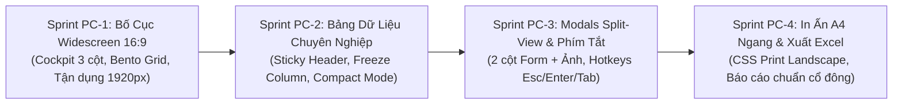

# 🖥️ KẾ HOẠCH & DANH SÁCH TASK: RÀ SOÁT VÀ TỐI ƯU TOÀN DIỆN UI/UX CHO MÀN HÌNH PC TỶ LỆ 16:9
### (Sen Việt Buffet Standalone Management System — 1920x1080 Full HD & Widescreen Desktop)

> **Mã kế hoạch**: `SPEC-UX-DESKTOP-16X9-2026`  
> **Ngày lập**: 21/11/2026  
> **Độ phân giải mục tiêu**: 1920×1080 (Full HD 16:9 tiêu chuẩn), 1600×900, 1366×768, và 2560×1440 (2K Widescreen).  
> **Mục tiêu tối thượng**: **Triệt tiêu hoàn toàn hiện tượng "giao diện mobile kéo giãn" trên PC; tận dụng triệt để chiều ngang màn hình 16:9 để tạo trải nghiệm Cockpit chuyên nghiệp, hiển thị bảng số liệu dày đặc (high-density), Master-Detail 2-3 cột, cố định tiêu đề bảng và hỗ trợ phím tắt bàn phím chuột tối đa.**

---

## 🔍 I. HIỆN TRẠNG & CÁC VẤN ĐỀ CẦN TỐI ƯU TRÊN MÀN HÌNH PC 16:9

```
┌────────────────────────────────────────────────────────────────────────────────────────┐
│ [PC 16:9 - 1920px]                                                                     │
│ ┌────────┬───────────────────────────────────────────────────────────────────────────┐ │
│ │Sidebar │ ⚠️ KHOẢNG TRẮNG THỪA QUÁ LỚN:                                            │ │
│ │ 260px  │ KitchenModule đang bị bóp nghẹt ở max-w-xl (576px)!                       │ │
│ │        │ Chiếm chưa đầy 30% màn hình, 70% còn lại là khoảng xám trống rỗng!        │ │
│ │        │ Người dùng phải cuộn chuột xuống 5 tầng màn hình để xem lịch sử ca!      │ │
│ └────────┴───────────────────────────────────────────────────────────────────────────┘ │
└────────────────────────────────────────────────────────────────────────────────────────┘
```

1. **Lãng phí không gian chiều ngang nghiêm trọng**:
   - `KitchenModule.tsx` bị gán cứng `max-w-xl mx-auto` (576px). Trên màn hình 1920×1080, hơn 1300px chiều ngang bị bỏ hoang, trong khi người dùng phải cuộn chuột mỏi tay để xem đơn báo hỏng và lịch sử mẻ.
2. **Modals & Dialogs dạng dọc kiểu điện thoại**:
   - Các modal Nhập kho, Báo hỏng, Cân mẻ hiện chỉ có chiều rộng `max-w-md` hoặc `max-w-lg`. Trên màn hình rộng 16:9, bảng danh sách 15 mặt hàng nhập kho bị co rúm, phải cuộn dọc liên tục; ảnh đính kèm không xem được cùng lúc với form nhập.
3. **Bảng số liệu lớn (NXT 14 cột, Bảng lương 15 cột, Thẻ kho) thiếu Freeze Panes**:
   - Khi cuộn sang phải để xem số tiền, người dùng bị mất dấu cột `Tên mặt hàng` / `Tên nhân viên`.
   - Tiêu đề bảng không cố định (`sticky top-0`), khi cuộn chuột xuống dòng 50 thì không biết cột đó là "Thực tế" hay "Lý thuyết".
4. **Thừa thãi bàn phím ảo (Virtual Numpad) trên Desktop PC**:
   - Người dùng PC có bàn phím vật lý Full-size với cụm Numpad bên phải gõ cực nhanh. Bàn phím số ảo trên màn hình PC gây vướng víu và che khuất tầm nhìn.
5. **Thiếu phím tắt công thái học (Keyboard Ergonomics)**:
   - Thao tác kho và kế toán trên PC chủ yếu dùng chuột và phím (`Tab` chuyển ô, `Enter` lưu, `Esc` đóng modal, `F2` tìm kiếm). Hiện tại mọi thao tác đều bắt buộc phải rê chuột click.

---

## 🗺️ TỔNG QUAN 4 SPRINT TỐI ƯU UI/UX PC 16:9



---

## 🚀 SPRINT PC-1: BỐ CỤC KHUNG & TỐI ƯU KHÔNG GIAN WIDESCREEN 16:9

### 📌 TASK-PC-01: Widescreen Cockpit 3 Cột cho Phân Hệ Bếp (`KitchenModule.tsx`)
- **Mã task**: `TASK-PC-01`
- **Mức độ ưu tiên**: **P0 (Cực kỳ quan trọng)**
- **Tệp cần sửa**: `frontend-demo/src/components/kitchen/KitchenModule.tsx`
- **Hiện trạng**: Bị khóa cứng ở `max-w-xl mx-auto` (576px), cuộn dọc 5 màn hình.
- **Giải pháp thiết kế trên PC 16:9 (`lg:` và `xl:`)**:
  - Bỏ `max-w-xl`, chuyển thành bố cục **3 Cột Song Song Widescreen**:
    - **Cột 1 (Trái - 300px)**: Thẻ thông tin ca làm việc + 4 Nút Tác vụ chính kích thước tiêu chuẩn PC + Nút mở kiểm đếm Xử lý cuối ca.
    - **Cột 2 (Giữa - Flex-1)**: Quầy Buffet Ra Line trực quan (dạng Grid 3–4 cột món ăn, có số lượng đã ra line và nút +1 có cooldown) + Khu vực Mẻ Đang Nấu Chờ Cân Thành Phẩm.
    - **Cột 3 (Phải - 420px)**: Bảng "Lịch sử lấy hàng trong ca" (cuộn độc lập) + Bảng "Đơn báo hỏng đã gửi ca này" có badge trạng thái.
- **Tiêu chí nghiệm thu (DoD)**:
  - Trên màn hình 1920×1080: Toàn bộ vận hành Bếp hiển thị trọn vẹn trong 1 màn hình duy nhất, **không cần cuộn chuột toàn trang (Zero Full-page Scroll)**.
  - Trên màn hình di động (< 1024px): Tự động thu gọn về 1 cột dọc như cũ.

---

### 📌 TASK-PC-02: Bento Grid 16:9 Không Cuộn Chuột cho Executive Cockpit & Dashboard
- **Mã task**: `TASK-PC-02`
- **Mức độ ưu tiên**: **P0**
- **Tệp cần sửa**:
  - `frontend-demo/src/components/dashboard/ExecutiveCockpit.tsx`
  - `frontend-demo/src/components/dashboard/Dashboard.tsx`
- **Giải pháp thiết kế trên PC 16:9**:
  - Cấu trúc lưới Bento Grid 12 cột tự co giãn theo chiều cao khung nhìn (`h-[calc(100vh-120px)]`):
    - **Hàng trên (Top 25% chiều cao)**: 4 Thẻ KPI chiến lược (Doanh thu TN vs QV, % Cost thực phẩm, Quỹ lương, Thất thoát).
    - **Hàng giữa (Mid 45% chiều cao)**:
      - Bên trái (8/12 cột): Biểu đồ so sánh Lãi / Lỗ và Chi phí 2 Chi nhánh (Thái Nguyên vs Quế Võ).
      - Bên phải (4/12 cột): Bảng cảnh báo Thất thoát Nóng (Cua, Ghẹ, Bề bề...).
    - **Hàng dưới (Bottom 30% chiều cao)**:
      - Bên trái (6/12 cột): Bảng Đen Nhà Cung Cấp giao thiếu / hải sản chết (top 3 NCC phạt nặng nhất).
      - Bên phải (6/12 cột): Danh sách Đề xuất Tăng lương & Quyết định chi tiêu lớn chờ Giám đốc duyệt.
- **Tiêu chí nghiệm thu (DoD)**:
  - Chủ chuỗi / Giám đốc mở app trên màn hình máy tính 1920×1080 nắm bắt trọn vẹn bức tranh 2 cơ sở trong 10 giây mà không cần lăn chuột.

---

### 📌 TASK-PC-03: Tối Ưu Thanh Điều Hướng Sidebar & Header trên PC
- **Mã task**: `TASK-PC-03`
- **Mức độ ưu tiên**: **P1**
- **Tệp cần sửa**: `frontend-demo/src/components/layout/AdaptiveShell.tsx`
- **Yêu cầu chi tiết**:
  1. **Nút Thu Gọn Sidebar (Collapse Sidebar Rail)**:
     - Thêm nút mũi tên `«` / `»` cho phép người dùng thu gọn Sidebar từ 280px về dạng Icon Rail 72px để mở rộng tối đa không gian cho bảng biểu Kế toán / Kho.
     - Trạng thái thu gọn được lưu vào `localStorage` (`senviet_desktop_sidebar_collapsed`).
  2. **Breadcrumb & Chi Nhánh Nổi Bật Trên Topbar**:
     - Hiển thị rõ đường dẫn: `Sen Việt Buffet > Chi nhánh Thái Nguyên > Kho Cơ Sở > Thẻ Kho`.
     - Dropdown chuyển nhanh chi nhánh ngay trên Topbar (Thái Nguyên / Quế Võ / Toàn chuỗi).
- **Tiêu chí nghiệm thu (DoD)**:
  - Bấm nút thu gọn sidebar $\rightarrow$ Bảng kho bên phải tự động giãn rộng thêm 200px.

---

## 📊 SPRINT PC-2: BẢNG DỮ LIỆU TỶ LỆ CAO & FREEZE PANES (TABLES)

### 📌 TASK-PC-04: Cố Định Cột (Freeze Columns) & Tiêu Đề Bảng (Sticky Header)
- **Mã task**: `TASK-PC-04`
- **Mức độ ưu tiên**: **P0 (Nghiệp vụ kế toán/kho cốt lõi)**
- **Tệp cần sửa**:
  - `frontend-demo/src/components/reconciliation/AutoNXTTable.tsx`
  - `frontend-demo/src/components/warehouse/StockCardsTab.tsx`
  - `frontend-demo/src/components/payroll/PayrollModule.tsx`
- **Yêu cầu chi tiết**:
  1. **Sticky Header**: Hàng tiêu đề bảng luôn cố định ở trên cùng (`sticky top-0 z-20 bg-slate-100 shadow-sm`) khi cuộn dọc qua hàng trăm dòng sản phẩm.
  2. **Freeze Columns bên trái (Cố định thông tin nhận diện)**:
     - Bảng NXT: Cố định 3 cột đầu: `STT`, `Mã hàng`, `Tên mặt hàng` (`sticky left-0 bg-white z-10 shadow-r`).
     - Bảng Lương: Cố định 2 cột đầu: `STT`, `Họ và tên nhân viên`.
  3. **Freeze Columns bên phải (Cố định cột hành động & cảnh báo)**:
     - Cố định cột `Trạng thái / Cảnh báo đỏ` và `Hành động (Xem / Duyệt)` ở mép phải (`sticky right-0 bg-white z-10 shadow-l`).
  4. **Thanh cuộn ngang luôn nhìn thấy**: Đặt bảng trong container `max-h-[calc(100vh-280px)] overflow-auto` để thanh cuộn ngang luôn nằm trong tầm mắt, không bắt người dùng phải cuộn xuống đáy trang mới thấy scrollbar.
- **Tiêu chí nghiệm thu (DoD)**:
  - Kéo bảng NXT sang phải $\rightarrow$ Tên món "Cua Thịt TN" vẫn đứng im bên trái, không bị trôi mất.
  - Cuộn dọc xuống dòng 100 $\rightarrow$ Tiêu đề các cột vẫn ghim cứng ở đầu bảng.

---

### 📌 TASK-PC-05: Chế Độ Hiển Thị Dày Đặc (Compact Density Mode) cho Kế Toán
- **Mã task**: `TASK-PC-05`
- **Mức độ ưu tiên**: **P1**
- **Tệp cần sửa**:
  - `frontend-demo/src/components/reconciliation/AutoNXTTable.tsx`
  - `frontend-demo/src/components/payroll/PayrollModule.tsx`
- **Yêu cầu chi tiết**:
  - Bổ sung nút chuyển chế độ hiển thị:
    - 🟢 `Tiêu chuẩn (Comfortable)`: Chiều cao hàng 48px, chữ 14px (dành cho người xem thông thường).
    - 🔵 `Cô đọng (Compact)`: Chiều cao hàng 32px, chữ 12px, padding tối giản (dành cho Kế toán viên đối soát khối lượng lớn dữ liệu).
  - Có thể hiển thị được 25–30 dòng dữ liệu trên màn hình 1080p mà không cần cuộn trang.
- **Tiêu chí nghiệm thu (DoD)**:
  - Bấm nút "Chế độ cô đọng" $\rightarrow$ Bảng thu nhỏ chiều cao dòng, số dòng hiển thị tăng gấp đôi.

---

## 🪟 SPRINT PC-3: MODAL SPLIT-VIEW 2 CỘT & PHÍM TẮT BÀN PHÍM PC

### 📌 TASK-PC-06: Nâng Cấp Modals Sang Dạng 2 Cột Split-Pane Widescreen
- **Mã task**: `TASK-PC-06`
- **Mức độ ưu tiên**: **P0**
- **Tệp cần sửa**:
  - `frontend-demo/src/components/warehouse/WarehouseModule.tsx` (Modal Nhập kho, Xuất hủy)
  - `frontend-demo/src/components/kitchen/KitchenModule.tsx` (Modal Cân mẻ, Báo hỏng)
- **Hiện trạng**: Modal đang là một hộp thoại hẹp ở giữa màn hình (`max-w-md` hoặc `max-w-lg`).
- **Giải pháp thiết kế trên PC 16:9**:
  - Mở rộng kích thước modal trên Desktop: `lg:max-w-5xl xl:max-w-6xl` (chiếm 60–70% chiều ngang màn hình 16:9).
  - Chia làm **2 Cột Split-View độc lập**:
    - **Cột Trái (60% chiều rộng)**: Toàn bộ form nhập liệu (Nhà cung cấp, ngày nhập, bảng danh sách mặt hàng, số lượng, đơn giá).
    - **Cột Phải (40% chiều rộng)**:
      - Đối với Nhập kho: Xem ảnh chụp hóa đơn / phiếu giao hàng cỡ lớn + Bảng tóm tắt tổng tiền, tổng kg, cảnh báo cân lệch.
      - Đối với Cân mẻ: Khung xem ảnh chụp bàn cân điện tử phóng to + Tóm tắt nguyên liệu đầu vào.
      - Đối với Báo hỏng: Ảnh chụp thực phẩm hỏng cận cảnh + Lý do hủy.
- **Tiêu chí nghiệm thu (DoD)**:
  - Mở phiếu nhập kho trên PC: Nhập liệu ở bên trái, ảnh hóa đơn bên phải hiển thị song song, không cần đóng mở popup ảnh.

---

### 📌 TASK-PC-07: Phím Tắt Bàn Phím PC (Hotkeys) & Tự Động Ẩn Numpad Ảo
- **Mã task**: `TASK-PC-07`
- **Mức độ ưu tiên**: **P1**
- **Tệp cần sửa**:
  - `frontend-demo/src/components/kitchen/KitchenModule.tsx`
  - `frontend-demo/src/components/common/VirtualNumpad.tsx` (nếu có)
- **Yêu cầu chi tiết**:
  1. **Ẩn Numpad ảo trên PC**:
     - Thêm class `lg:hidden` cho bàn phím số ảo `VirtualNumpad`. Người dùng PC dùng bàn phím số vật lý.
  2. **Hệ thống phím tắt năng suất cao (Keyboard Shortcuts)**:
     - `Escape`: Đóng bất kỳ Modal hoặc Popup đang mở.
     - `Enter`: Khi đang ở ô nhập số lượng $\rightarrow$ Tự động chuyển con trỏ sang ô tiếp theo hoặc xác nhận lưu.
     - `F2` hoặc phím `/`: Tự động nhảy con trỏ (focus) vào ô tìm kiếm hàng hóa / nhà cung cấp.
     - `Ctrl + S` / `Cmd + S`: Lưu nhanh phiếu nhập kho / mẻ nấu đang soạn dở.
     - Tự động nhận diện cả dấu chấm `.` và dấu phẩy `,` trên cụm phím số bên phải làm dấu thập phân.
- **Tiêu chí nghiệm thu (DoD)**:
  - Bấm `Esc` $\rightarrow$ Đóng modal ngay lập tức không cần dùng chuột bấm nút X.
  - Bấm `/` $\rightarrow$ Gõ tìm kiếm được ngay mặt hàng.

---

## 🖨️ SPRINT PC-4: IN ẤN KHỔ A4 NGANG & XUẤT EXCEL CHUYÊN NGHIỆP

### 📌 TASK-PC-08: CSS Print View Chuẩn Khổ A4 Landscape (A4 Nằm Ngang)
- **Mã task**: `TASK-PC-08`
- **Mức độ ưu tiên**: **P1**
- **Tệp cần sửa**:
  - `frontend-demo/src/components/warehouse/DeliveryVoucherModal.tsx`
  - `frontend-demo/src/components/reconciliation/AutoNXTTable.tsx`
  - `frontend-demo/src/components/payroll/PayrollModule.tsx`
  - `frontend-demo/src/index.css`
- **Yêu cầu chi tiết**:
  - Thêm stylesheet chuyên dụng `@media print`:
    - Ẩn toàn bộ: DemoToolbar, Sidebar, Top Navbar, nút bấm tác vụ, thông báo toast.
    - Cấu hình khổ giấy: `@page { size: A4 landscape; margin: 10mm; }` (Khổ A4 nằm ngang tương thích hoàn hảo với tỷ lệ 16:9).
    - In tiêu đề trang trọng: **CÔNG TY T&T NGUYỄN DƯƠNG — HỆ THỐNG BUFFET SEN VIỆT**.
    - Phía dưới có đủ 4 ô chữ ký: *Người lập biểu*, *Thủ kho*, *Kế toán trưởng*, *Giám đốc duyệt*.
- **Tiêu chí nghiệm thu (DoD)**:
  - Bấm `Ctrl + P` khi đang xem Bảng NXT hoặc Phiếu nhập kho $\rightarrow$ Bản xem trước trang in vừa khít 1 trang A4 nằm ngang, sắc nét, không bị mất cột hay tràn viền.

---

## 📊 BẢNG TỔNG HỢP MA TRẬN TASK GIAO VIỆC CHO DEV

| Mã Task | Tên Công Việc | Phân Hệ Ảnh Hưởng | Độ Phức Tạp | Ưu Tiên | Thời Gian Dự Kiến |
|:---|:---|:---:|:---:|:---:|:---:|
| `TASK-PC-01` | Widescreen Cockpit 3 cột cho Bếp | Bếp (`KitchenModule`) | Trung bình | **P0 (Làm ngay)** | 3.5 giờ |
| `TASK-PC-02` | Bento Grid 16:9 không cuộn chuột cho Giám Đốc | Dashboard (`ExecutiveCockpit`) | Trung bình | **P0 (Làm ngay)** | 3 giờ |
| `TASK-PC-03` | Thu gọn Sidebar Rail & Breadcrumbs Topbar | Khung (`AdaptiveShell`) | Dễ | **P1** | 2 giờ |
| `TASK-PC-04` | Freeze Columns & Sticky Header bảng NXT, Kho, Lương | Bảng biểu (`AutoNXTTable`, Kho) | Khá | **P0 (Làm ngay)** | 4 giờ |
| `TASK-PC-05` | Chế độ Compact Density Mode (32px/hàng) | Kế toán / NXT | Dễ | **P1** | 2 giờ |
| `TASK-PC-06` | Modals 2 cột Split-View Widescreen (Form + Ảnh) | Kho / Mẻ nấu | Khá | **P0 (Làm ngay)** | 3.5 giờ |
| `TASK-PC-07` | Phím tắt PC (Esc, Enter, F2) & Ẩn Numpad ảo | Chung / Toàn app | Dễ | **P1** | 2 giờ |
| `TASK-PC-08` | In ấn khổ A4 Landscape (A4 nằm ngang chuẩn 16:9) | In ấn / Báo cáo | Dễ | **P1** | 2 giờ |
| **TỔNG** | **8 Task Tối Ưu PC 16:9** | **Toàn Hệ Thống** | | | **~22 giờ làm việc** |

---

## 💡 HƯỚNG DẪN KIỂM THỬ GIAO DIỆN PC 16:9 CHO QA / TESTER

1. **Kiểm tra trên màn hình Full HD 1920×1080**:
   - Mở Chrome, ấn `F12` $\rightarrow$ Chuyển chế độ Responsive $\rightarrow$ Chọn `1920 x 1080` (hoặc mở trực tiếp trên màn hình máy tính để bàn).
   - Kiểm tra xem có thanh cuộn ngang trang web ngoài ý muốn không (No unwanted horizontal scrollbar).
2. **Kiểm tra tỷ lệ lấp đầy màn hình**:
   - Màn hình Bếp phải phủ đều 3 cột, không bị dồn cục ở giữa.
   - Bảng NXT phải chiếm trọn chiều ngang, các cột quan trọng không bị cụt chữ.
3. **Kiểm tra phím tắt**:
   - Mở thử 1 phiếu nhập kho $\rightarrow$ Nhấn `Esc` trên bàn phím cứng $\rightarrow$ Modal phải đóng ngay lập tức.
